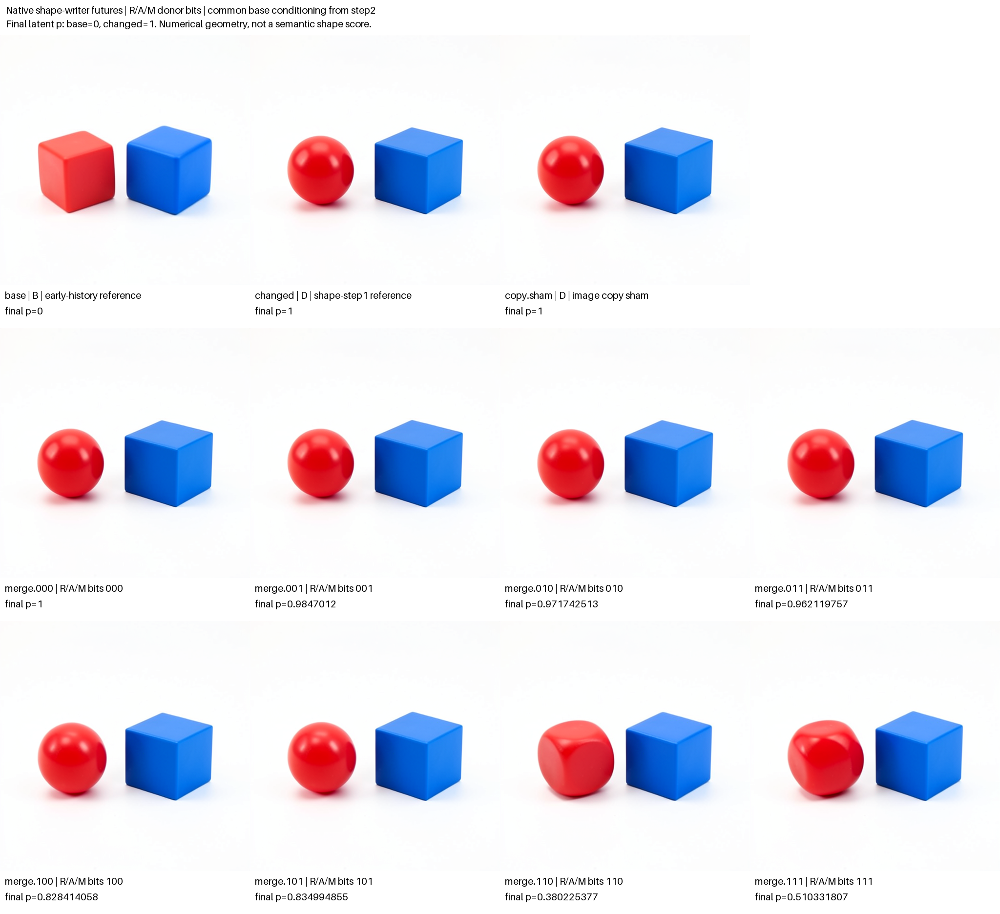

# Factoring a second-step shape writer

This experiment follows the [whole-field shape handoff](FLUX-SHAPE-HANDOFF.md). That panel found an overlap interval in one seed-47 FLUX.2 Klein 4B trajectory: after joint4, either surviving changed text or changed image could sustain the red-sphere outcome, while restoring base image after single4 produced a mixed rounded/faceted object. The next question is which operands of that single block contribute to the later native response.

All eleven native futures completed and passed the independent mechanics audit. The largest numerical baseward response came from combining base residual and attention while retaining recipient MLP operands: p110=0.380225, compared with p100=0.828414 and p010=0.971743. Adding base MLP operands to that combination moved the result back toward the changed reference, to p111=0.510332. Arm-blinded assistant inspection labeled both110 and111 mixed/uncertain, while all other edited red objects remained sphere-like. A/M effects therefore depend strongly on the receiving residual, and no edited arm fully restored the base cube appearance. There is no numerical prediction of the eleven RGB images and no claim that single4 is the first or minimal shape writer.

The completed producer is `job-2bff0a6b7322`, [run03](../../../../artifacts/mdb-flux-shape-writer-20261103/run-03). The [portable index](../qualification/flux-shape-writer-20261103.json) binds every original row, image, final cut, source and seal to the [immutable publication](../../../../artifacts/mdb-flux-shape-writer-20261103/final-v1/result.json).

## Observed parents and common future source

The specimen is the distilled FLUX.2 Klein 4B checkpoint, inventory SHA `dd976d67036c4a0a55642f702dcb3740ba7a4f367557596572baac168330904f`, CUDA BF16, physical batch one, seed47, 512 × 512, four denoising steps and guidance1. The campaign imports two authenticated cuts from the preceding shape handoff after step1 joint4, just before single0. These are observed model states; the prompt encoder is not run again.

The base and shape-exposed histories retain their own text, image and stored conditioning. Other payload fields, model/execution profile and clock must match. Four native single-block transitions advance each origin to the selected single4 entry. The source record retains original and selected cut IDs, all advance receipts, actual selected-block operands and native outputs. This prefix capture is completed before hypotheses are sealed and before the new RGB futures run.

Every branch later resets persistent conditioning to the same base value immediately before the step2 projection. The reset is a typed conditioning-only replacement, including on base, changed and sham controls. Its receipt binds the donor source, before/after cuts and unchanged payload closure. Thus continued reads of the shape source at steps2 and3 cannot explain differences among the branches. The saved scheduler horizon is steps2,3,4; step1 belongs to the supplied history.

## Native residual attention and MLP factorial

The selected block exposes the native merge

```text
I_next = R + gate * Linear(concat(A, M), W_merge, bias).
```

Here R is the incoming residual; A is the attention branch operand; M is the activated MLP branch operand; the learned projection maps the concatenated branches back into the residual width. The experiment observes these actual tensors and retains the original full-shaped native projection, including BF16 rounding. It does not replace them with a separately implemented predictor.

Each of the eight R/A/M bits chooses base image-row values when1 and recipient values when0. The recipient gate, post-block text, stored conditioning and every other state field remain fixed at installation. A typed image-only Act installs the resulting image field at single4 exit. Its later conditioning reset is a separate declared Act.

| Donor mask | Residual | Attention operand | MLP operand |
|---|---|---|---|
| 000 | Recipient | Recipient | Recipient |
| 001 | Recipient | Recipient | Base |
| 010 | Recipient | Base | Recipient |
| 011 | Recipient | Base | Base |
| 100 | Base | Recipient | Recipient |
| 101 | Base | Recipient | Base |
| 110 | Base | Base | Recipient |
| 111 | Base | Base | Base |

Two native references and an image-copy sham accompany all eight masks, producing eleven dependent futures in one resident model lease. Every branch continues through the remaining native denoiser, scheduler and VAE. No arm is dropped for a prediction miss, mixed shape, unfavorable latent projection or an unexpected control observation.

The R=0 surface tests A/M ingredient changes under the native recipient receiving residual. The R=1 surface is a different receiving-state condition: copying base residual may copy shape information already encoded there. It must be reported separately and is not assumed to bound, weaken or strengthen the R=0 response monotonically. An effect of M under one surface is not by itself a named semantic MLP operation or proof of the first creation of shape information.

## Predictions and controls

The frozen numerical extrapolations were that RA moves farther baseward than either R or A alone, and that attention-only moves farther baseward than MLP-only. Both numerical rank directions matched this run. The separate broad visual guesses were that MLP-only retains the red sphere while RA produces a cube-like or mixed red object. The arm-blinded inspection was consistent with those guesses:001 was sphere-like and110 mixed/uncertain. These were broad conditional guesses, not exact image forecasts. Latent geometry did not decide the shape labels.

Exact joins are observed controls, not scientific outcome filters:

- Copy sham and000 should reproduce the changed native future.
- The two native references should reproduce their historical coarse-panel PNGs under the common future source.
- Mask111 should reproduce the coarse `after_single4.restore_image` PNG. It restores base image at the selected exit while retaining recipient text, so it is not expected to reproduce the native base future.

The previous coarse outcomes inform site selection and those controls. This is a mechanistic follow-up with prospective bounded hypotheses, not an independent new-input replication.

## Eleven observed futures



The contact sheet preserves every original512px image pixel, with labels and p in separate bands. Every row has retained native scheduler arrays2,3,4 and a final typed cut. Shape descriptions below come from the separately sealed arm-blinded inspection, not from numerical thresholds.

| Row | Base R | Base A | Base M | Final p | Red shape observation |
|---|---|---|---|---:|---|
| Native base | Reference | Reference | Reference | 0 | Cube-like |
| Native changed | Reference | Reference | Reference | 1 | Sphere-like |
| Copy sham | Copy | Copy | Copy | 1 | Sphere-like |
| 000 | No | No | No | 1 | Sphere-like |
| 001 | No | No | Yes | 0.984701200 | Sphere-like |
| 010 | No | Yes | No | 0.971742513 | Sphere-like |
| 011 | No | Yes | Yes | 0.962119757 | Sphere-like |
| 100 | Yes | No | No | 0.828414058 | Sphere-like |
| 101 | Yes | No | Yes | 0.834994855 | Sphere-like |
| 110 | Yes | Yes | No | 0.380225377 | Mixed/uncertain rounded block |
| 111 | Yes | Yes | Yes | 0.510331807 | Mixed/uncertain rounded block |

The numerical contrast `p110 − min(p100,p010)` is −0.448188680, matching the predeclared RA rank. The attention-versus-MLP contrast `p010 − p001` is −0.012958687, also matching the declared direction. Numerical ranks and qualitative categories remain separate observations rather than interchangeable certifications.

All local controls and historical joins were exact:

| Control observation | Result |
|---|---|
| Copy sham versus changed | All three scheduler arrays and PNG exact |
| 000 versus changed | All three scheduler arrays and PNG exact |
| 111 installed image versus native base block exit | Image field exact; recipient text retained |
| Native base versus coarse base reference | PNG SHA exact |
| Native changed versus coarse changed reference | PNG SHA exact |
| 111 versus coarse `after_single4.restore_image` | PNG SHA exact |

The last join is particularly useful: 111 reconstructs the known coarse image-field restoration, whose p is0.510332. It does not reconstruct the complete native base state, because post-block text remains recipient text. A source-exact installed image therefore need not yield a source-exact future.

## Receiving state changes the ingredient response

| Conditional difference | Native recipient residual R=0 | Copied base residual R=1 |
|---|---:|---:|
| Add base A while M=0 | −0.028257487 | −0.448188680 |
| Add base A while M=1 | −0.022581443 | −0.324663048 |
| Add base M while A=0 | −0.015298800 | +0.006580798 |
| Add base M while A=1 | −0.009622756 | +0.130106430 |
| A/M finite-difference interaction | +0.005676044 | +0.123525632 |

Under the native recipient residual, base A and M substitutions each move the latent slightly baseward; all four R=0 rows remain at p≥0.962120. Under copied base residual, the attention substitution has a much larger effect, while either M substitution moves in the opposite direction. In particular, adding base M to110 increases p by0.130106430. This is an observed countertrend to a blanket “each extra base ingredient helps” story, not a failure of a predeclared monotonicity law.

The same saved base M operand is substituted in each M=1 arm, but that does not make the actual installed image deltas bitwise identical. In real arithmetic, the fixed-gate affine writer gives the same local M increment `gate * W_M * (M_base − M_changed)`, independently of R and A. The recorded BF16 full projection and residual addition introduce small receiving-state differences in that increment. The [saved-cut diagnostic](../../../../artifacts/mdb-flux-shape-writer-20261103/local-M-geometry.json), SHA `583287f3a6cc65d5a5ca15ba23caa779b7ab21330ca38146d67e39925633a07f`, measures the actual installed differences:

| Installed M increment | L2 norm | Cosine to R0 A0 increment | L2 difference from R0 A0 increment |
|---|---:|---:|---:|
| R0 A0: image001 − image000 | 7343.171341 | 1 | 0 |
| R1 A0: image101 − image100 | 7343.152009 | 0.999889223 | 109.300519 |
| R1 A1: image111 − image110 | 7343.324151 | 0.999798654 | 147.358532 |

The increments are closely aligned but not equal. This diagnostic does not isolate native rounding from later nonlinear amplification as an explanation for the final sign reversal. The supplied M operand, the installed BF16 increment and the final consumer response are separate levels of observation.

The R=1 state may already carry a consequential base representation. Its stronger A response does not identify A as the first creator of shape information, and the small R=0 M replacement effect does not establish that native M computation is unnecessary. M is always present: it is replaced with a base operand, never removed. These are conditional substitutions under two receiving states. Compatibility and the remaining native consumer are part of the computation.

The recipient post-block working text is fixed across masks and remains available to the rest of step1. Those later blocks can still transform or reconstruct image features from that text. Resetting C before step2 prevents different later source reads, but does not remove this within-step1 route. The final shapes consequently measure the edited writer plus its native receiving state and continuation, not an isolated semantic MLP function.

## Arm-blinded visual observations

The [blinded annotation](../../../../artifacts/mdb-flux-shape-writer-20261103/blinded-shape-observations.json), SHA `03c94c3d1ccc9e49f7e83cf0e8954aee2e5480a5ef0755ae612db2086e5c972e`, was sealed before revealing randomized arm identities. The [blind map](../../../../artifacts/mdb-flux-shape-writer-20261103/blind-map.json) has SHA `9ab59bf9f0ea67bd707db1e11596bc1b98c498a838ca06c5bd67be462791db3a`. The subsequent [unblinded record](../../../../artifacts/mdb-flux-shape-writer-20261103/unblinded-visual-record.json), SHA `e5bc4121bbb8d124ee2d33d69380aae7a4f46ce8f2078ff955a6ef1fd40c3b98`, verifies all eleven original PNG hashes and preserves the initial descriptions. The parent assistant also inspected the unblinded contact sheet and agreed with the broad categories.

Every image has a blue cube-like object on the right and a red object on the left. The base red object is cube-like. Changed, sham and masks000–101 are sphere-like. Masks110 and111 are rounded/faceted mixed objects, kept uncertain rather than forced into sphere/cube bins. Pose, scale, palette, reflections and exact three-dimensional geometry remain qualified. There is no complete base-cube appearance restoration in any R/A/M arm.

This was arm-blinded but not hypothesis-blinded: the observer knew the task and earlier shape experiments. It was one assistant's qualitative assessment, not calibrated human annotation, a semantic evaluator or terminal shape certification. Both the numerical response and mixed categories are useful evidence without turning these eleven dependent futures into independent prediction trials.

## Signed geometry and factorial reporting

The final-latent coordinate is

```text
p(z) = dot(z - z_base, z_changed - z_base)
       / dot(z_changed - z_base, z_changed - z_base).
```

Base has p=0 and changed has p=1. Negative values and values above1 are valid observations. A zero reference contrast leaves p undefined. Full RGB and scheduler differences accompany this coordinate, which is not a calibrated sphere score or a fraction of shape restored.

The publisher retains all eight raw p values and their baseline-referenced inclusion-exclusion coefficients: intercept `p000`, R, A, M, RA, RM, AM and RAM. For example,

```text
c_RA  = p110 - p100 - p010 + p000
c_RAM = p111 - p110 - p101 - p011 + p100 + p010 + p001 - p000.
```

It also reports finite differences averaged over complementary factor settings and the two conditional A/M surfaces. The later native suffix is nonlinear even though the local merge is affine before rounding. Consequently a downstream interaction coefficient need not imply a nonlinear local writer, semantic synergy, independent redundant copies or a reusable relation/shape program.

The complete raw baseline-referenced coefficients are:

| Term | Signed coefficient |
|---|---:|
| Intercept p000 | +1 |
| R | −0.171585942 |
| A | −0.028257487 |
| M | −0.015298800 |
| RA | −0.419931194 |
| RM | +0.021879597 |
| AM | +0.005676044 |
| RAM | +0.117849589 |

The positive RAM term is consistent with the attenuation of the large RA response when base M is also installed. It is an algebraic summary of these eight outcomes, not a distinct semantic operation. The [published result](../../../../artifacts/mdb-flux-shape-writer-20261103/final-v1/result.json) also retains averaged finite differences and every original weighting coefficient, so alternative descriptive summaries can be checked without model execution.

## Audit and original-pixel publication

The [dedicated submitter](../qualification/submit_flux_shape_writer.py) authenticates the prior cuts and stages one finite CUDA lease with retries disabled. The [merge worker](../qualification/flux_merge_campaign.py) adds this explicit panel while preserving its legacy mode. The [independent auditor](../qualification/analyze_flux_merge.py) verifies request/archive/transaction custody, origin-to-selected lineage, native ports, BF16 residual equations, image-only Act closure, the common conditioning reset, complete receipt paths and final retained cuts. Every branch must retain scheduler arrays2,3,4 and a native PNG. No scientific rank or shape success is required for a valid mechanism audit.

The [saved-evidence publisher](../qualification/publish_flux_shape_writer.py) accepts the completed run, its audit and a new output directory:

```sh
python qualification/publish_flux_shape_writer.py \
  /absolute/completed-run /absolute/completed-run/analysis-v1.json \
  /absolute/new-publication
```

It rechecks source custody and the audit binding, verifies every original PNG hash, and pastes all eleven original512px RGB tiles into a PIL contact sheet. Labels and final-p values occupy separate bands; image pixels are neither resized nor altered. `result.json` retains the full row table, signed effects, interactions, reset/path bindings, numerical prediction misses and historical PNG comparisons. `result.md`, the source snapshot and a complete file-hash manifest accompany the figure.

Shape, order, scale, palette and mixed geometry use the separate post-outcome inspection with uncertainty retained. The original `final-v1` publication keeps its visual-pending fields unchanged; the portable index binds the later inspection records. Whole-field causal edits and exact controls do not establish a minimal writer, an object mask, a general semantic rule or an independently forecast image.

## Custody execution and retained setup failures

The [independent audit](../../../../artifacts/mdb-flux-shape-writer-20261103/run-03/analysis-v1.json), SHA `74333089ac081bcb69bf8e00e6389a15afff4df0354cd9ae23b1cb683359acbc`, verifies both native BF16 merge equations, all eight selected operand recipes, image-only installation and each branch's conditioning-only reset. Each final cut has base conditioning and joins the retained final scheduler latent. Full receipt paths cross the reset exactly once. There are44 retained cuts,52 slot pages and44 tensor blobs.

The [global hypothesis seal](../../../../artifacts/mdb-flux-shape-writer-20261103/run-03/extracted/flux-merge-result/transaction/seal.json) has SHA `77670d7182a367c586366e75a1a86247ffc84e249c3f55f62c2e69d892cada0a`. It was recorded at65.9257 seconds with zero images, after eight prefix-advance transitions and the two selected-block port captures. Those observed native prefixes are explicitly allowed inputs; this is not a seal before all model execution. The sealed transaction subsequently ran all eleven native futures.

The producer used813 adapter steps,20 Acts,8 full-shape projection evaluations and833 receipt emissions, with no prompt encoding. Worker time through output preparation was233.559 seconds; scheduler elapsed time was289.05 seconds, including publication overhead. Peak RSS was3,158.1 MB and peak VRAM9,386 MB. These are one-run telemetry observations, not controlled performance comparisons.

The source archive contains318,730,143 expanded bytes across988 files including its manifest. Archive SHA is `5578944c3f362c702e720a6dae34614b02cdc702292ac3a7216a24f643212775`; request identity is `3ac1e442b38ecd060a656b99d1cc6c4d0c562da22587c53e421bb51578dd8117`. Request, archive, source-file, row, image, final-cut and seal hashes are retained in the portable index. The audit and publication perform no model calls or native diffusion-equation reevaluation.

Two earlier setup failures remain separate evidence. [Run01](../../../../artifacts/mdb-flux-shape-writer-20261103/run-01/submission-failure.json) defaulted to an unreachable localhost scheduler before admission and created no job. [Run02](../../../../artifacts/mdb-flux-shape-writer-20261103/run-02/failed-job.json), `job-70e589d70294`, failed while initializing a Mac-specific UV cache path on the Linux worker:1.32 seconds,7.1 MB RSS,0 VRAM and no model execution. Run03 uses the predecessor's qualified host execution profile. Its scientific configuration and every declared source-file hash equal the second submission-mechanics fixture; those setup corrections did not change the tested masks or hypotheses. Raw failed attempts and the immutable final publication remain unchanged.

For a deliberate reproduction, use a new output directory, an environment with installed public MDB and `mrun-pub`, and the authenticated predecessor run. From the MDB package directory, the successful fleet profile was:

```sh
rtk proxy env \
  MRUN_URL=http://192.168.68.68:9025 \
  MDB_WORKER_UV_CACHE_DIR=/mnt/hdd8tb/mdb/uv-cache \
  MDB_WORKER_TORCH_HOME=/mnt/hdd8tb/mdb/torch \
  MDB_WORKER_MODEL_ROOTS=/mnt/big/llm-models \
  python qualification/submit_flux_shape_writer.py /absolute/new-run \
    --predecessor /absolute/mdb-flux-shape-handoff-20261103/run-01
```

These paths describe the Linux worker, not the Mac client. The command submits real model work; publication and indexing alone do not require another submission. After the returned job finishes, collect it using the same scheduler URL, audit the collected evidence and publish into another fresh directory:

```sh
rtk proxy env MRUN_URL=http://192.168.68.68:9025 \
  python qualification/submit_flux_shape_writer.py /absolute/new-run --collect JOB_ID
rtk proxy python qualification/analyze_flux_merge.py \
  /absolute/new-run /absolute/new-run/analysis-v1.json
rtk proxy python qualification/publish_flux_shape_writer.py \
  /absolute/new-run /absolute/new-run/analysis-v1.json /absolute/new-publication
```

The collector retains the worker log as gzip and accepts at most 512 MiB compressed and 1 GiB expanded. Keep the originally sealed worker and auditor snapshots with a reproduction; an edited harness is a new instrument version whose source identity must remain explicit.

The [independent numerical review](../../../../artifacts/mdb-flux-shape-writer-20261103/independent-results-review.json), SHA `943172316fce1d3e6b2c019556ba80e96b5b578f9e684de05cd4d45c1d8b5298`, retains the valid mechanics, numerical countertrends and alternative explanations. Its next suggested cut is an adjacent-boundary 2×2 A/M factorial with R fixed to0, unchanged recipient text and the same conditioning reset, to test whether the conditional trend persists across the next boundary. That recommendation is not evidence of a first or minimal writer and does not itself launch another experiment.

The curated record [`flux.shape.step1.single4.RAM.seed47`](../../../../artifacts/mdb-flux-shape-writer-20261103/computation-record.json), SHA `fcd9483673647f777841a12cfce991766005a9dfa6bc89e7d0aea7b2c0423982`, preserves the source-qualified occurrence, signed effects, controls, predictions and counterexamples. It is a curated observation record, not automatic reusable-family induction or atlas ingestion.

The [Saturn evidence sweep](../../../../artifacts/mdb-flux-shape-writer-20261103/evidence-v1/checksums.json), SHA `f968efffafb6c78cb8b04b80586fbd991adb7139542dd387133e08437cff32b9`, ran and verified with exit0 over eleven derived numerical rows and zero model calls. Its frozen standard-library evidence pipeline checks numerical stream integrity and indexing; it does not certify the semantic labels or promote a reusable computation family. The [record and sweep generator](../../../../artifacts/mdb-flux-shape-writer-20261103/derive_record_and_evidence.py), SHA `ef2d8ce631b29d67e2e6f7af8daac06692945c4fcf719c085782f8201bca4778`, and all sweep checksum references are bound in the portable index.
