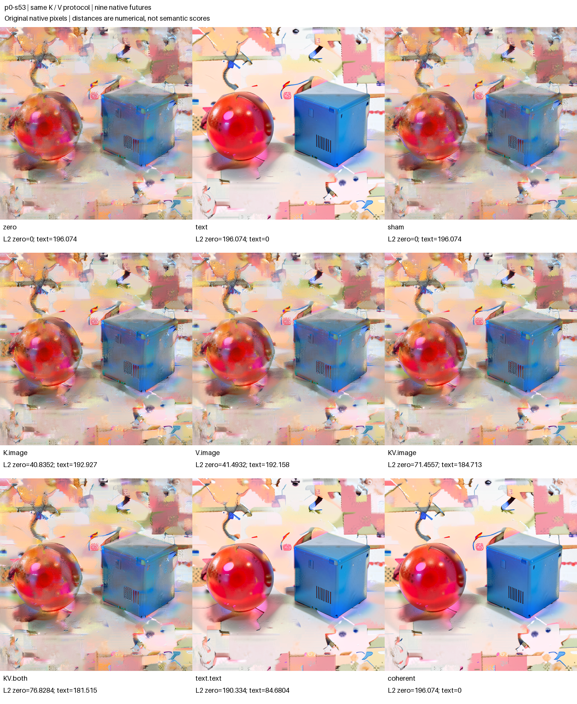
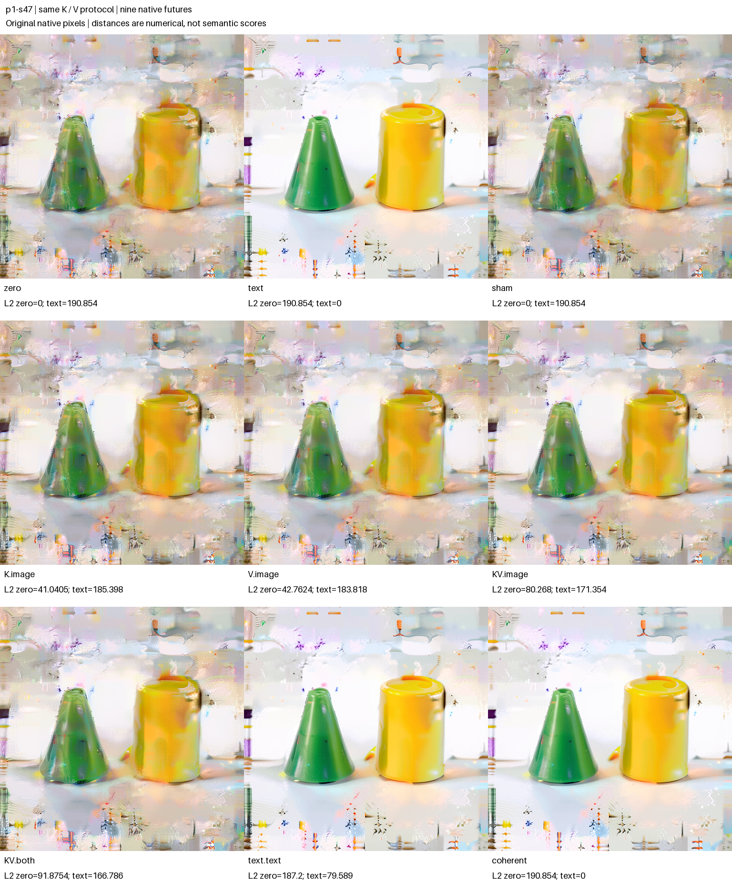
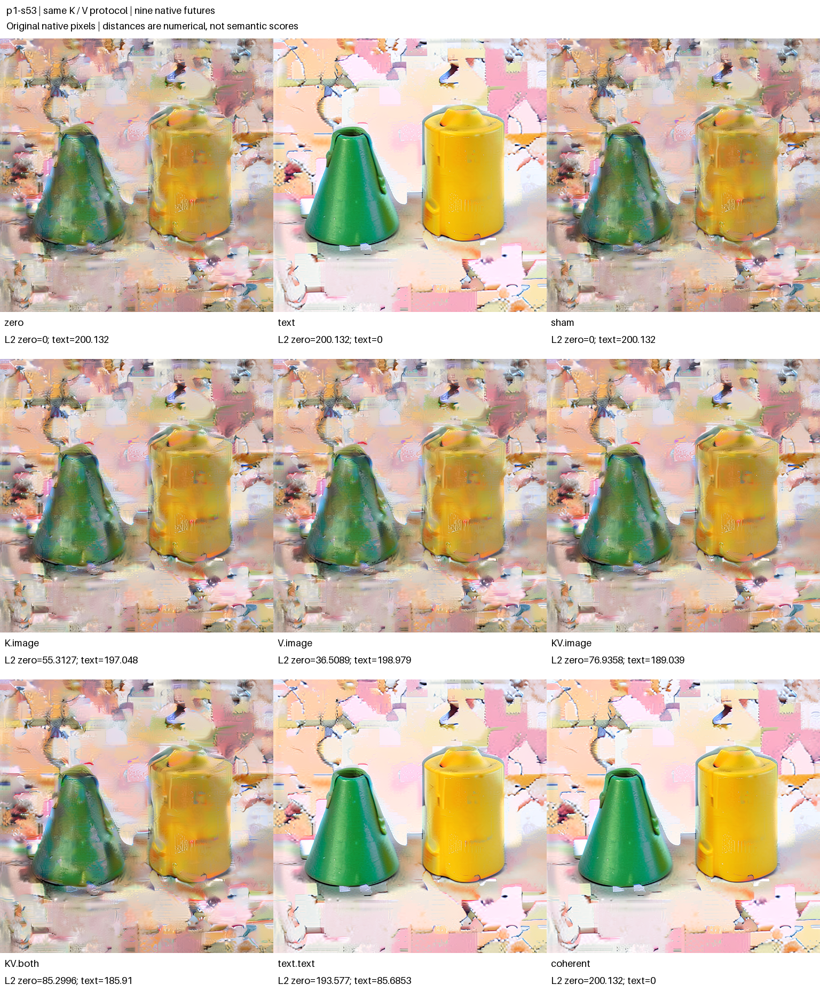

# FLUX single0 forecasts across three fresh contexts

The same local attention law held across three freshly constructed FLUX.2 Klein 4B contexts: selecting both text K and V reproduced each paired text-source image attention, fused projection and immediate image state exactly. That equality still did not determine the continuation. A predeclared directional prediction also held in these three contexts: installing native postblock text alone ended closer to the text reference than each image-only K, V or KV edit, separately in final latent L2 and RGB MAE.

Six novel conditional numerical arrays—K-only and V-only in each context—were sealed before their native target calls. FP64 attention forecasts had **0.1701–0.1727% relative RMS error** against native BF16 samples. These are observations at a fixed sampled attention boundary, without an arbitrary numerical quality threshold. All **27 native final images** and all distance signs are retained below; they are not 27 independent specimens or independent RGB predictions.

## Three connected contexts

| Context | Native prompt | Seed |
|---|---|---:|
| p0-s53 | Red sphere left of blue cube, white background | 53 |
| p1-s47 | Green cone left of yellow cylinder, white background | 47 |
| p1-s53 | Green cone left of yellow cylinder, white background | 53 |

The two p1 contexts provide a within-prompt seed contrast; p0-s53 versus p1-s53 provides a within-seed prompt contrast. This is a connected three-context design, **not a complete current 2×2**. The earlier [single-KV seed-47 assay](FLUX-SINGLE-KV.md) remains a separate code/history cohort. Its original failed publication status was preserved, and the refactored auditor reproduced its previous audit exactly apart from the auditor source digest; see the [regression receipt](../../../../artifacts/mdb-flux-single-contexts-20261103/historical-regression-receipt.json).

## A fresh native source, not an imported donor

Each context uses its own cached native prompt encoding and fresh seeded initial noise. The source builder:

1. Advances natively from Z0 to Z2 with the context's own conditioning.
2. Replaces stored conditioning with zeros at Z2 and continues natively to an altered Z3.
3. Forks that same altered Z3. One branch keeps zero conditioning C0; the other restores its own encoded conditioning C1. Each executes the last step's projection and five joint blocks to the entry of single block 0.
4. Takes only working text T1 from the own-C branch and installs it in the zero-C recipient. The matched entries are therefore **I0/T0/C0** and **I0/T1/C0**, with identical latent, image, stored C0, context/modulation/gates/RoPE, positions, clock and schedule.

The text reference is this T-only hybrid's native continuation. It is not the separate I1/T1/C1 branch. “Zero” describes a conditioning history; T0 and I0 are learned native states, not numerically zero arrays. No foreign-prompt donor or imported StateCut enters this experiment.

Builder lineage is checked through actual typed cuts, source arrays, public receipts and three exact slot replacements. The native path counts are 56 transitions to Z2, 28 to altered Z3 and six on each last-step joint prefix: **96 transitions and three Acts**. Each panel then adds 191 transitions, ten Acts, five direct single-block calculations and nine VAE/final-image calls. The parent has one real job ID and context IDs, with no invented child jobs.

## Two seals and the conditional equation

The global plan was frozen before loading, encoding or drawing noise. Each context then has two distinct public ForecastTransaction seals.

The architectural seal follows the observed builder prefix, with all panel call/transition/Act/image counters zero. It freezes structural hypotheses and branch recipes; it does not predict an unseen prompt's image. Exactly two allowed native source calculations then expose Q/K/V at single block 0, after native normalization and RoPE have been applied to Q/K. The numerical seal binds those source arrays, dispatch profile and fixed query selection before any K/V/KV target calculation, adapter prefix, Act or VAE call.

The independent calculation is

```text
P = softmax(Q Kᵀ / sqrt(128))
attention = P V
```

in FP64 with stable row softmax, for image queries `[0,31,32,255,511,512,767,1023]`, all 24 heads, width 128. Each forecast array has shape `1×8×24×128`. All recipient Q and image K/V are retained; only the own-context text K bank, V bank or both are selected. K and V are novel conditional targets. KV is a represented native-text consistency control. V-only preserves the mathematical weights; a K edit can change normalization and contributions from both banks.

The frozen cast reference is FP64 → FP32 → round-to-nearest-even BF16 expanded to FP32. Error signs below are **actual native sample minus sealed forecast**.

| Context | Selection | Native RMS | FP64 error RMS | FP64 max error | Signed mean error | Cast error RMS |
|---|---|---:|---:|---:|---:|---:|
| p0-s53 | K | 0.206033 | 0.000350541 | 0.00403081 | 2.074e-6 | 0.000248511 |
| p0-s53 | V | 0.198262 | 0.000337179 | 0.00273596 | -2.722e-6 | 0.000244237 |
| p0-s53 | KV | 0.172957 | 0.000305696 | 0.00297791 | 2.531e-6 | 0.000265290 |
| p1-s47 | K | 0.197119 | 0.000337409 | 0.00288806 | 2.472e-6 | 0.000241367 |
| p1-s47 | V | 0.197481 | 0.000336377 | 0.00473006 | -1.872e-6 | 0.000241019 |
| p1-s47 | KV | 0.171711 | 0.000303583 | 0.00350660 | -5.001e-7 | 0.000245888 |
| p1-s53 | K | 0.215428 | 0.000367021 | 0.00238782 | 4.741e-6 | 0.000268496 |
| p1-s53 | V | 0.196081 | 0.000338649 | 0.00291460 | -1.481e-6 | 0.000261738 |
| p1-s53 | KV | 0.170983 | 0.000300402 | 0.00323624 | 4.729e-7 | 0.000240517 |

None of the nine BF16-cast predictions is bit-exact to native dispatch. The offline auditor independently recomputed the FP64 formula from the two saved source QKV banks; maximum saved-versus-recomputed discrepancy was 3.33×10⁻¹⁵, and all recomputed BF16 cast references matched their saved casts. These quantities identify the arithmetic and its measured limits; they are not semantic or numerical promotion gates.

Predicted text-bank probability masses remain forecasts: the native dispatcher did not expose probability weights. The callback is source-reviewed QKV-only Python dataflow, not hermetic process isolation; native source outputs remained resident. No independent MLP, full attention-query field or RGB forecast is claimed.

Reference scopes are explicit in the portable index: published row/image/source/seal descriptors are relative to `run-01`; nested `arrays/...` descriptors inside each numerical attention forecast are relative to `run-01/extracted/flux-single-contexts-result/contexts/<context-id>`. Each context's `numerical_attention_reference_base` records that distinction. The original publication remains unchanged.

## The parallel block and all native futures

This single block computes attention and MLP features in parallel, concatenating them before one fused output projection. Its `attn` return includes both paths. The checked update is `BF16(R + BF16(gate × fused_projection))`; separately rounded projection slices are not assumed to sum exactly.

Image Q/K/V and image MLP preactivations/activations matched between the source calls. The image MLP arrays stayed exact across all five candidates. In every context KV image attention, fused projection and postblock image matched the native text-source image arrays exactly. Candidate text need not equal native text-source text because recipient text Q, residual and MLP remain selected differently.

All image-only and hybrid arms fork the actual zero post-single0 parent; the text reference uses its own native post-single0 parent. `K.image`, `V.image` and `KV.image` install candidate I and retain zero postblock T. `KV.both` installs candidate I/T; `text.text` installs only native text-source T; `coherent` installs native text-source I/T. Sham copies the recipient I/T. Every branch then takes 21 native transitions to Z4, with stored C0 unchanged and no further conditioning projection.

Tables use complete saved Z4 arrays and 8-bit RGB; RGB MAE is in pixel-value units. Rounded displays do not replace the full-precision [portable index](../qualification/flux-single-contexts-20261103.json). Each figure pastes all nine original 512-pixel images unchanged, with labels outside scientific pixels.

### p0-s53



| Row | Z4 L2 from zero | Z4 L2 from text | RGB MAE from zero | RGB MAE from text |
|---|---:|---:|---:|---:|
| zero | 0 | 196.074387 | 0 | 31.325911 |
| text | 196.074387 | 0 | 31.325911 | 0 |
| sham | 0 | 196.074387 | 0 | 31.325911 |
| K.image | 40.835210 | 192.927059 | 3.770718 | 31.944562 |
| V.image | 41.493208 | 192.157543 | 3.915386 | 29.246656 |
| KV.image | 71.455687 | 184.713065 | 6.668282 | 27.182710 |
| KV.both | 76.828378 | 181.514638 | 7.602973 | 26.393768 |
| text.text | 190.334010 | 84.680447 | 28.263426 | 7.258438 |
| coherent | 196.074387 | 0 | 31.325911 | 0 |

### p1-s47



| Row | Z4 L2 from zero | Z4 L2 from text | RGB MAE from zero | RGB MAE from text |
|---|---:|---:|---:|---:|
| zero | 0 | 190.853610 | 0 | 30.570002 |
| text | 190.853610 | 0 | 30.570002 | 0 |
| sham | 0 | 190.853610 | 0 | 30.570002 |
| K.image | 41.040458 | 185.398181 | 2.985132 | 30.293331 |
| V.image | 42.762440 | 183.818331 | 3.962842 | 27.676094 |
| KV.image | 80.267980 | 171.353788 | 6.959347 | 25.285938 |
| KV.both | 91.875365 | 166.785890 | 9.674658 | 22.499800 |
| text.text | 187.199868 | 79.588958 | 29.339887 | 4.628919 |
| coherent | 190.853610 | 0 | 30.570002 | 0 |

### p1-s53



| Row | Z4 L2 from zero | Z4 L2 from text | RGB MAE from zero | RGB MAE from text |
|---|---:|---:|---:|---:|
| zero | 0 | 200.132172 | 0 | 39.808773 |
| text | 200.132172 | 0 | 39.808773 | 0 |
| sham | 0 | 200.132172 | 0 | 39.808773 |
| K.image | 55.312736 | 197.047917 | 4.729345 | 39.343749 |
| V.image | 36.508889 | 198.978604 | 3.548449 | 37.910544 |
| KV.image | 76.935786 | 189.038560 | 7.594444 | 35.057959 |
| KV.both | 85.299588 | 185.910203 | 8.614496 | 34.080472 |
| text.text | 193.576603 | 85.685264 | 37.653631 | 6.904947 |
| coherent | 200.132172 | 0 | 39.808773 | 0 |

Sham equals zero and coherent equals text in final latent and PNG in all three contexts. Both direct native candidates match their actual adapter exits. Those are named replay/control observations. The native futures remain available independently of any ranking interpretation.

## A prospective directional trend, with countertrends

H-text-direction predicted `text.text` would be closer to text than each image-only K/V/KV arm. The signed margin is `distance(image edit,text) − distance(text.text,text)`; positive supports that strict ordering.

| Context | Image-only comparator | Latent L2 margin | RGB MAE margin |
|---|---|---:|---:|
| p0-s53 | K.image | +108.246612 | +24.686124 |
| p0-s53 | V.image | +107.477096 | +21.988218 |
| p0-s53 | KV.image | +100.032618 | +19.924272 |
| p1-s47 | K.image | +105.809223 | +25.664412 |
| p1-s47 | V.image | +104.229373 | +23.047175 |
| p1-s47 | KV.image | +91.764830 | +20.657019 |
| p1-s53 | K.image | +111.362653 | +32.438802 |
| p1-s53 | V.image | +113.293340 | +31.005597 |
| p1-s53 | KV.image | +103.353296 | +28.153013 |

All nine paired comparisons support the direction in both observables: **18 positive margins from three dependent context units**. No tie or observable disagreement occurred for this particular prediction. This is a bounded repeated directional trend, not a semantic score, mediation fraction or universal text-carrier law.

Other orderings vary. For p1-s47, V.image is closer to text in latent L2 than K.image (183.818 versus 185.398); p1-s53 reverses that ranking (K 197.048 versus V 198.979). RGB MAE favors V at both p1 seeds. In p0-s53, K.image is closer to text than zero in latent L2 (192.927 versus 196.074) yet farther in RGB MAE (31.945 versus 31.326). A local equation therefore does not supply one universal endpoint ordering.

The complete signed factorial vector `Y_KV.image − Y_K.image − Y_V.image + Y_zero` also remains nonzero:

| Context | Z4 interaction RMS | Z4 signed mean | RGB interaction RMS | RGB signed mean |
|---|---:|---:|---:|---:|
| p0-s53 | 0.167323 | -1.5932e-3 | 7.623378 | +2.533745 |
| p1-s47 | 0.153322 | -2.4730e-4 | 6.116252 | +2.087021 |
| p1-s53 | 0.176708 | 2.5644e-3 | 8.275279 | +2.058197 |

These are full-vector numerical interactions, not subtraction of distances or semantic conjunction scores.

## Visual and instrument boundaries

The separate [sealed, task-aware arm-blinded visual record](../../../../artifacts/mdb-flux-single-contexts-20261103/unblinded-visual-record.json) covers all 27 originals and three sheets. The observer knew the task and prior scenes; this was informal assistant inspection, not calibrated semantic certification. Main forms, colors and ordering were already visible in zero branches. Cone-like forms were often described as frustum- or can-like, and background fragments persisted. Numerical proximity to text should not be read as proof of clean prompt semantics or pure geometric shapes.

All three panel instruments were `native-replay-qualified`, and all three sampled numerical transactions had qualified prospective timing. Independent audit reports `mechanics_status=valid`; research trends and `terminal_status=unassessed` remain separate. The [postrun review](../../../../artifacts/mdb-flux-single-contexts-20261103/postrun-review.json) found no blocking issue.

Each context retains eight complete builder cuts and 21 complete panel cuts. Intermediate execution points and conditioning coverage come from public receipts and **declared**, source-bound operation footprints. Full intermediate states were not reconstructed; for example a 21-transition native suffix can have only its two endpoint full states retained. This is not independent low-level tracing of every conditioning read. Schema/custody may inspect C where the denoiser no longer consumes it numerically.

## Execution and custody

The single succeeded producer was `job-b87315cd3534`: CUDA BF16, physical batch 1, four CPU threads, one model load, two native prompt encodings and three noise draws. It emitted **861 adapter transitions, 39 Acts, 15 direct block calculations, 27 VAE/final images and 900 receipt emissions**. Worker time was 305.616 seconds; runner time 422.4 seconds, with distinct timing scopes. Peak measured RSS was 8,830.2 MB and VRAM 10,036 MB, under declared RAM/VRAM reservations of 24,000/13,000 MB.

The tracked qualification custodian streamed a 1,276,391,541-byte compressed archive in 153 transport parts, with 1,618 files and 2,420,989,877 expanded bytes. Parts are transport chunks, not independent trials. The archive SHA256 is `e8e565211c979debd20b91d2fa79293880c9fd0d2147be407b1141a82eb32de3`. Parent custody is verified before sequential context array inspection; the auditor uses streaming hashes and memory-mapped saved arrays, without loading the giant transport log as text.

The actual launcher is the immutable [9a5a178e… snapshot](../../../../artifacts/mdb-flux-single-contexts-20261103/source-freeze-01/submit_flux_single_contexts.py). Its 1 GB disk admission field was metadata, not a worker quota. A future-only launcher correction declares 8 GB transient-disk headroom; it did not execute this job and does not alter the scientific results. Executed worker/helper/custody bytes and offline reader sources are separately pinned in [source-freeze-01](../../../../artifacts/mdb-flux-single-contexts-20261103/source-freeze-01/files.json) and [source-freeze-02-offline](../../../../artifacts/mdb-flux-single-contexts-20261103/source-freeze-02-offline/files.json).

## Evidence and saved-evidence reproduction

- [Portable index](../qualification/flux-single-contexts-20261103.json): three contexts, all 27 row/PNG/latent/receipt bindings, both seals per context, full numerical errors, signed direction margins, native controls, source identities and limits.
- [Independent audit](../../../../artifacts/mdb-flux-single-contexts-20261103/run-01/analysis-v1.json) and [immutable publication](../../../../artifacts/mdb-flux-single-contexts-20261103/final-v1/result.json).
- [Campaign](../qualification/flux_single_contexts_campaign.py), [resident panel/source builder](../qualification/flux_single_contexts.py), [auditor](../qualification/analyze_flux_single_contexts.py) and [publisher](../qualification/publish_flux_single_contexts.py).
- [Curated computation records](../../../../artifacts/mdb-flux-single-contexts-20261103/computation-records.json) and the [research narrative](../../../../obsidian/blog/2026-11-03-221217-one-attention-law-three-contexts.md). The separate evidence sweep retained six curated occurrences in two candidate families, 27 numeric rows and 12 frontier citation hits, with run/verify/query exit codes zero. This supports record integrity and citation retrieval; it does not automatically induce an atlas, reusable universal family or semantic claim.

From the MDB checkout, no model is needed to reproduce the saved-evidence audit and publication:

```sh
python qualification/analyze_flux_single_contexts.py \
  /path/to/campaign/run-01 /new/path/analysis.json
python qualification/publish_flux_single_contexts.py \
  /path/to/campaign/run-01 /new/path/analysis.json /new/path/publication
```
