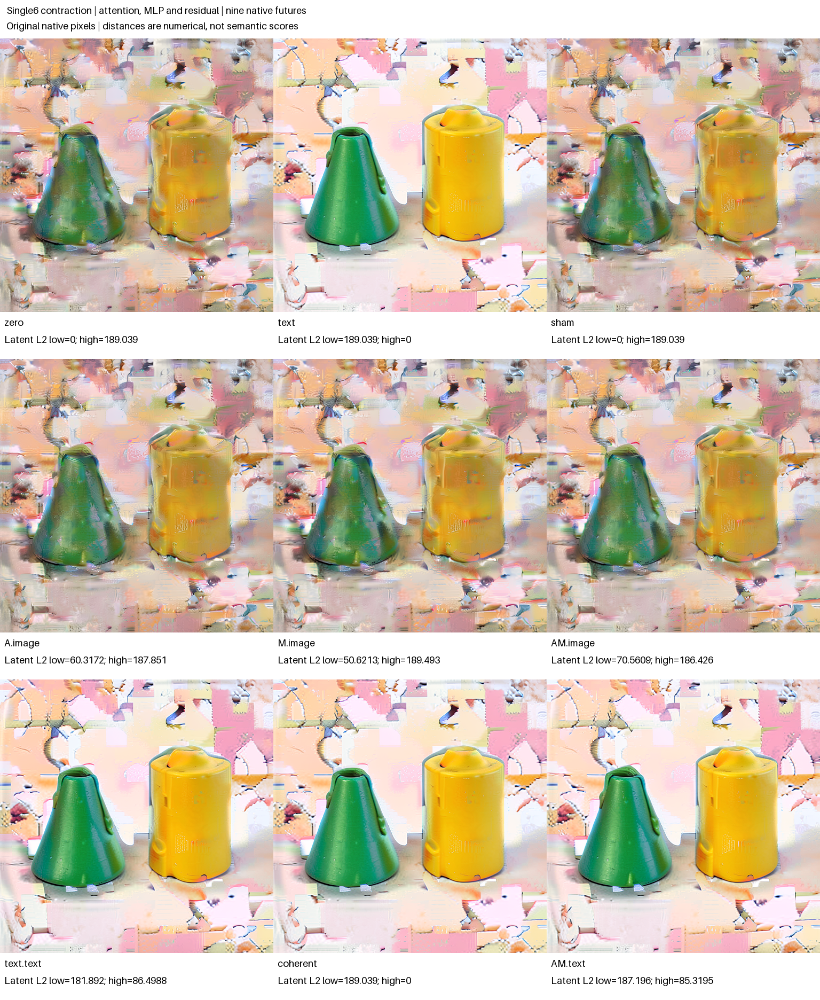
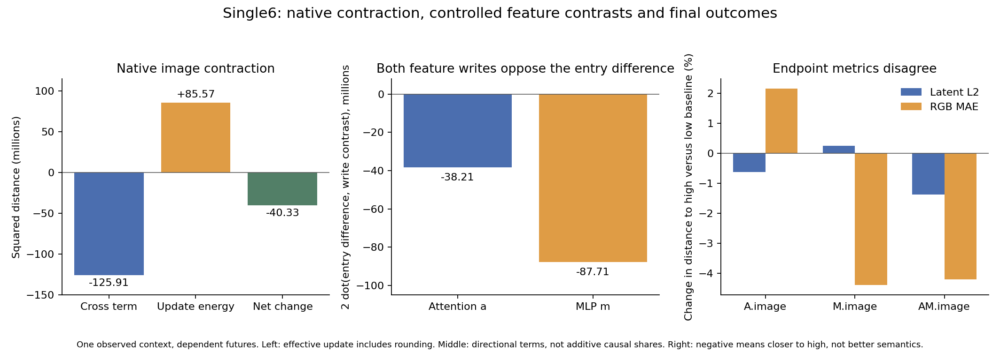

# FLUX single-block contraction: attention, MLP and residual context

The tentative prediction missed: replacing the MLP features alone did **not** bring the immediate image closer to the high-history reference than replacing attention features alone. Both changes nevertheless pointed against the original image difference, and an exact posthoc saved-vector account reproduced the observed contraction without identifying a unique semantic cause. Farther downstream, latent and RGB distances sometimes ranked the same edit in opposite directions.

This assay selects parallel single block 6 in the final denoising step, substitutes its attention and MLP features separately, and retains nine native futures. Unlike the earlier [single-block K/V assay](FLUX-SINGLE-KV.md), both working image and working text differ between source histories. Conditional sampled linear/write forecasts were sealed before mixed calculations; final RGB images are native observations.

Actual campaign `job-3ac4cb5ac458` succeeded in `run-02`. The corrected independent audit reports valid mechanics, a qualified native replay instrument and qualified prospective timing. Earlier offline reader attempts are retained; no native rerun produced the correction.



## Why this boundary

The authenticated predecessor (`job-b8e38f8a326f`) already contained both trajectories and their native endpoints for observed context `p1-s53` (seed 53). A saved-array [geometry calculation](../../../../artifacts/mdb-flux-single-contraction-20261103/prior-geometry.json) found image L2 distance 9,663.352964 before block 6 and 7,283.270655 after it. The squared distance fell by 43.1936%; the next block changed it only slightly, to 7,276.148746. These are historical geometric observations, not semantic repair or evidence that a particular feature path caused the contraction.

The new campaign imports the exact post-single2 cuts and replays blocks 3, 4 and 5 on each history. Six declared native replay transitions therefore occur **before the main seal**. The resulting complete pre-single6 cuts must match prior receipt identities and retained live-array descriptors. The predecessor did not retain those complete after-single5 cuts; the new replay saves them. This is source reconstruction from known history, not an unseen prompt or fresh-context prediction.

The selected entries share stored conditioning, latent, time/modulation/RoPE context, schedule, IDs and execution clock. Working I and T both differ. Attention and MLP features consequently encode the whole high-history state; their substitution cannot identify a text-only causal path. Source names `zero` and `text` refer to these histories and do not mean the current image or text tensors are zero.

## The local feature factorial

In this parallel single block, attention features A and MLP activation features M are concatenated before a native fused linear projection. The experiment observes two native source calls and splices image rows only at the input to that projection. Recipient image residual R, gate g, text features and the native projection weights/bias remain fixed in each mixed candidate.

Writing `P(A,M) = W[A;M]+b`, the declared native update is:

```text
I' = BF16(R + BF16(g × P_native(A, M)))
```

`A.image` selects high-history A with low-history M; `M.image` selects low A with high M; `AM.image` selects both high feature slices. Every mixed candidate keeps low native postblock T. `text.text` installs high native postblock T alone; `coherent` installs high native postblock I/T; `AM.text` combines AM candidate I with high native T. References and a low-copy sham complete nine futures.

AM's full projected image is represented by the observed high projection, making that projection a consistency control. Its updated image is a new low-residual target: using high A/M does not replace R with the high residual. The tentative predeclared hypothesis expected M.image to be closer than A.image to the high immediate postblock image. That directional guess was not established by the prior distance calculation, and it missed in this assay.

| Immediate postblock image | L2 from high-history image |
|---|---:|
| native low | 7,283.270655 |
| A.image | 7,019.696313 |
| M.image | 9,546.543441 |
| AM.image | 9,663.415624 |

All mixed candidates retained low native postblock text exactly. AM projection matched the high native image projection exactly, while AM image did not match high image: the recipient residual remained low. None of these distances is a semantic score.

## A second, numerical seal

After exactly two native source captures, an independent NumPy FP64 calculation uses only the observed concatenated feature arrays, low R/g and selected actual weight rows/bias. It predicts the complete fused linear operation at eight fixed image queries and 32 fixed output dimensions, then predicts the gated residual update. Both FP64 values and an explicit projection/product/residual BF16-rounding reference are persisted in a second public transaction before the three edited A/M/AM calls or native block-6 prefixes.

The fixed queries are `[0,31,32,255,511,512,767,1023]`; output dimensions are every 96 channels from 0 through 2976. A/M projections and all low-residual mixed updates are conditional numerical targets. AM projection is a represented-source control. Every case contains 256 declared output samples.

| Selection | Projection FP64 error RMS | Projection max error | Updated FP64 error RMS | Updated BF16-reference error RMS |
|---|---:|---:|---:|---:|
| A | 0.000705498 | 0.00277551 | 0.0183032 | 0.001953125 |
| M | 0.000816087 | 0.00385043 | 0.0195350 | 0 |
| AM | 0.000697015 | 0.00285635 | 0.0205374 | 0.001953125 |

A and M projection relative RMS errors were about 0.1600% and 0.1773%. The BF16 update reference matched all 256 M samples exactly; A and AM each retained nonzero error (maximum 0.03125). No projection reference was bit-exact. These are retained numerical observations without an error-quality gate, not a full-tensor parity claim.

This predicts neither MLP features nor attention from raw inputs, and does not predict RGB. The BF16 variant is a rounding reference, not a bit-exact CUDA GEMM emulator. Selected weight rows were extracted by the source-bound native worker; a retained full-weight descriptor is not an independent partial-row Merkle proof. Source outputs remained resident, and source-reviewed trusted Python dataflow is not hermetic isolation.

## Exact vector account, bounded interpretation

The real-arithmetic writer is affine in its concatenated inputs at fixed W, b, g and R. A local A/M interaction in recorded BF16 updates must therefore be distinguished from rounding and from later nonlinear continuation. A nonzero final factorial interaction cannot by itself identify a new local nonlinear operation.

Let L/H denote native low/high postimages, and define `dR=R_H−R_L`, `a=I_A−I_L`, `m=I_M−I_L`, `j=I_AM−I_A−I_M+I_L`, `r=I_H−I_AM`, and `ε=r−dR`. The complete saved vectors satisfy:

```text
I_H − I_L = dR + a + m + j + ε
```

This identity closes exactly in the retained FP64-expanded arithmetic. A and M both oppose dR: their dot products are −19,102,976 and −43,852,835 respectively. The larger opposing M dot product does not make M the closer local counterfactual; the full vectors and their magnitudes matter. Local j has L2 108.749976, while ε has L2 49.853048. These small departures belong to the recorded precision/residual account, not a newly discovered nonlinear A–MLP operation.

Using the actual effective update `Ueff=postI−preI`, the independent energy account is `2⟨dR,dUeff⟩ + ||dUeff||²`: −125,905,913.856 plus 85,571,554.775, giving a squared-distance change of −40,334,359.081, or −43.1936%. Vector closure is exact; the scalar reduction residual is about 1.5×10⁻⁸. The native residual-add rounding ρ is retained separately (L2 46.867632 low, 42.551582 high), rather than identifying Ueff with an independently rounded sum of A/M writes.



The chart is a byte-exact copy of the source-bound standard Matplotlib figure. Its [plotter](../../../../artifacts/mdb-flux-single-contraction-20261103/plot_contraction.py), [SVG](../../../../artifacts/mdb-flux-single-contraction-20261103/contraction-geometry.svg) and [provenance](../../../../artifacts/mdb-flux-single-contraction-20261103/contraction-geometry-provenance.json) preserve the audit and numeric inputs. The directional `2 dot` account is not a partition into causal shares.

These directions and cross terms explain the measured geometry without uniquely attributing it to a semantic function. Neither small forecast error nor contraction establishes object repair, minimality, necessity or a universal route.

## All nine continuations and their countertrends

Every row below is a native final future. Distances use the same final Z4 clock and original 8-bit RGB; no outcome was filtered. Signed means, maxima, MAE and complete array bindings remain in the portable index.

| Row | Z4 L2 from low | Z4 L2 from high | RGB MAE from low | RGB MAE from high |
|---|---:|---:|---:|---:|
| zero | 0 | 189.038560 | 0 | 35.057959 |
| text | 189.038560 | 0 | 35.057959 | 0 |
| sham | 0 | 189.038560 | 0 | 35.057959 |
| A.image | 60.317209 | 187.850815 | 5.010211 | 35.812669 |
| M.image | 50.621271 | 189.492752 | 4.229355 | 33.516570 |
| AM.image | 70.560924 | 186.426188 | 5.837105 | 33.582373 |
| text.text | 181.891677 | 86.498783 | 33.426383 | 6.974719 |
| coherent | 189.038560 | 0 | 35.057959 | 0 |
| AM.text | 187.196073 | 85.319476 | 35.766280 | 6.540115 |

A-only moves closer to high in latent L2 but farther in RGB MAE; M-only does the reverse. AM improves both relative to low, though M alone has slightly smaller RGB MAE. These endpoint rankings were exploratory. High native postblock T changes the continuation much more strongly, but AM.text still differs from high by latent L2 85.319476 and RGB MAE 6.540115, despite matching high projection and high T. The remaining image residual difference therefore has a distinct future under otherwise matched receiving state; this does not supply an additive causal percentage.

The direct full-vector final interaction `Y_AM−Y_A−Y_M+Y_low` has latent RMS 0.121510 (signed mean −0.00109233) and RGB RMS 5.309114 (signed mean +0.630163). It includes subsequent nonlinear consumers and must not be used to infer local nonlinearity or a semantic conjunction.

## Separate arm-blinded image observations

An assistant inspected the shuffled original PNGs and sealed captions before unblinding. This was task-aware, arm-blinded informal inspection, not hypothesis-blind annotation or calibrated semantic certification. All nine retain a green/teal tapered foreground form on the left and a yellow/ochre cylinder-like form on the right, with visible separation. Exact geometry, small fragments and physical identity remain uncertain; the left form is described as cone-frustum-like with a blunt or irregular top, rather than a verified ideal cone.

| Rows | Sealed broad appearance observations |
|---|---|
| zero, sham, A.image, M.image, AM.image | Patchy, mottled or smeared multicolored texture crosses the forms; substantial mosaic-like fragmentation and irregular seams remain. |
| text, coherent, text.text, AM.text | Main surfaces are comparatively continuous, saturated and glossy-looking, with clear broad silhouettes; angular pastel background fragments, seams and small irregular marks remain. |

The notes do not establish a fine A-versus-M appearance ranking, disappearance of collateral or complete semantic repair. No visual ordering was a frozen prediction. All captions, uncertainty and original PNG bindings are retained in the [sealed observations](../../../../artifacts/mdb-flux-single-contraction-20261103/blinded-observations.json) and [unblinded record](../../../../artifacts/mdb-flux-single-contraction-20261103/unblinded-visual-record.json).

The execution used one resident distilled FLUX.2 Klein 4B model, CUDA BF16, physical batch 1, no new encoding or noise. Its measured census is 143 adapter transitions: six source-replay steps, two native block-6 prefixes and 135 suffix steps. Five direct block calculations, ten Acts, 153 receipt emissions and nine final PNG/VAE calls are counted separately. Worker panel time was 63.525 seconds; worker time through output preparation, before archive export, was 88.657 seconds. The successful runner took 151.44 seconds, with peak RSS 2,964.9 MB and VRAM 9,784 MB. Direct candidate calls are not complete model forwards.

## Saved-evidence authorities

- [Campaign artifacts](../../../../artifacts/mdb-flux-single-contraction-20261103/) and [actual request](../../../../artifacts/mdb-flux-single-contraction-20261103/run-02/request.json).
- [Prior geometry](../../../../artifacts/mdb-flux-single-contraction-20261103/prior-geometry.json) and its [saved-array derivation](../../../../artifacts/mdb-flux-single-contraction-20261103/analyze_prior_geometry.py).
- [Native splice and numerical equations](../qualification/flux_single_contraction.py), [campaign](../qualification/flux_single_contraction_campaign.py), [offline auditor](../qualification/analyze_flux_single_contraction.py), [publisher](../qualification/publish_flux_single_contraction.py) and [launcher](../qualification/submit_flux_single_contraction.py).

The [corrected audit](../../../../artifacts/mdb-flux-single-contraction-20261103/run-02/analysis-v2.json), [immutable publication](../../../../artifacts/mdb-flux-single-contraction-20261103/final-v1/result.json) and [independent postrun review](../../../../artifacts/mdb-flux-single-contraction-20261103/postrun-review.json) bind the raw archive, source replay and both closed transactions. All named replay/native controls matched, including sham, coherent and known prior endpoints. The [portable index](../qualification/flux-single-contraction-20261103.json) preserves all rows and full vector diagnostics; the figure contains exact copies of all nine original image tiles.

Three offline audit-attempt receipts retain corrections to trust-scope bookkeeping, prefix-reference paths and dictionary ordering. They are reader repairs, not new native results; the actual worker and raw scientific bytes stayed unchanged. Final engineering qualification passed 38 overlapping tests (20 new auditor, four runtime, 14 prior) in 6.61 seconds with clean Ruff. These checks are not independent scientific replications.

Two [curated computation records](../../../../artifacts/mdb-flux-single-contraction-20261103/computation-records.json) retain the applicable model, exact source cuts, signed outcomes and limits. The saved-only Saturn sweep processed nine numerical rows and returned four source-qualified citation hits, with run, verify and query commands all exiting zero. [Checksums](../../../../artifacts/mdb-flux-single-contraction-20261103/evidence-v1/checksums.json) and [provenance](../../../../artifacts/mdb-flux-single-contraction-20261103/evidence-v1/provenance.json) bind this separate integrity/indexing step. It used no native calls and provides neither semantic certification nor automatic family/atlas induction.

From the MDB checkout, reproduce the saved-evidence assessment into fresh paths without loading a model:

```sh
python qualification/analyze_flux_single_contraction.py \
  /path/to/campaign/run-02 /new/path/analysis.json
python qualification/publish_flux_single_contraction.py \
  /path/to/campaign/run-02 /new/path/analysis.json /new/path/publication
```
