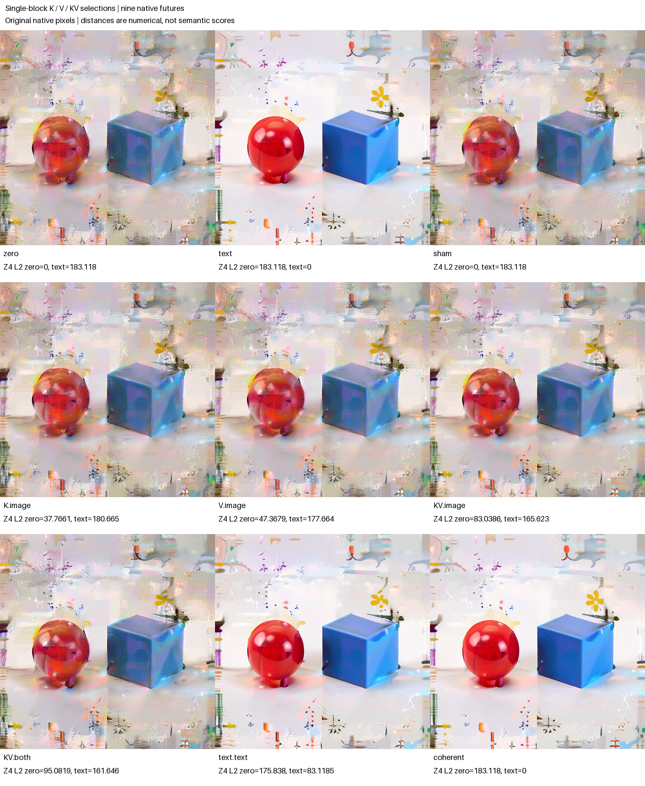

# FLUX single-block K/V forecasts and continuation

The selected parallel FLUX block behaved as its local attention equation predicted: replacing both text K and V reproduced the paired text-source image attention and postblock image exactly. That local equality did not determine the final image. Keeping the zero-history working text produced a different continuation; installing the native text-source return alone moved the final result much closer to the text reference than any image-only edit.

Two prospective numerical forecasts were also tested. After observing the two allowed source QKV banks, an independent NumPy FP64 attention calculation predicted K-only and V-only outputs at eight fixed image queries across all 24 heads. Their native BF16 errors had RMS 0.000323 and 0.000329 against native output RMS about 0.191. These were conditional attention forecasts, not MLP or RGB forecasts. All nine final images below are native continuations.

The external job **failed during REPORT serialization after completing the science**. Its original failure report, full archive, log, producer manifest and scientific rows remain unchanged. A separate offline audit qualified the completed numerical transaction and replay instrument without rerunning the model or rewriting the job status.



## The common-parent contrast

This assay uses the distilled FLUX.2 Klein 4B checkpoint and continues the [rescue-route experiment](FLUX-RESCUE-ROUTES.md), using two retained entries to single block 0 in the last denoising step. They share image, latent, stored conditioning C, time/modulation/RoPE context, positions, clock and schedule; only working text T differs. `zero` means the zero-C **history**, not a numerically zero working text array. `text` is the previous `late.text` hybrid, not the previous full own-C reference.

The source cuts are `725754a599f060d9a3eea609678239ebb357fc80edc58ade6b296bee9873f34c` and `3dbbfc737a8e259c40d8af8c077e9d48983104cd2291690783a5001a91196056`. Their prior archive is `fc47bc6de4709de88812d71e301209f5ddaf20ac7af1a174019af7385a265208`. The source is the same observed seed-47 context, with no new prompt encoding, noise or foreign-prompt donor.

Unlike the earlier sequential joint block, this single block computes attention and MLP features in parallel. At the interception point Q/K have already received native normalization and RoPE. Each edited call retains all zero-source Q and image K/V, selecting only the text K bank, text V bank, or both from the paired text source. The image MLP preactivation and activation remain byte-exact across all five candidates.

The block concatenates attention and MLP features before its fused projection. Its `attn` return therefore includes **both paths**. The native image update is `BF16(R + BF16(gate × fused_projection))`; separately rounded projection slices need not sum exactly to that return. The image-side KV dispatch, fused projection and postblock image all matched the text-source native arrays exactly. Candidate text was not predicted to match: its text Q, residual and parallel MLP remain those of the zero recipient.

## Capture, forecast, seal, execute

The outer public ForecastTransaction sealed structural hypotheses before any new source call, prefix transition, Act or VAE call. At 30.686 worker seconds all such counters were zero. Two native direct source calculations then exposed positioned QKV. A second public transaction bound those arrays and the actual dispatch profile, predicted the edited samples, and persisted its seal **before** K/V/KV target calls or adapter prefixes.

The independent calculation was `softmax(QKᵀ/√D)V`, in FP64, for image queries `[0,31,32,255,511,512,767,1023]`, all 24 heads, head dimension 128. It also froze an explicit FP64→FP32→round-to-nearest-even BF16 reference. K and V are novel conditional predictions; KV is a represented native-text consistency control. Predicted text-bank probability mass is retained but unmeasured: native dispatch did not expose probability weights.

| Selection | Role | Native RMS | FP64 error RMS | FP64 max error | BF16-cast error RMS |
|---|---|---:|---:|---:|---:|
| K | novel conditional forecast | 0.191015 | 0.000323033 | 0.00258960 | 0.000220099 |
| V | novel conditional forecast | 0.191388 | 0.000328756 | 0.00400147 | 0.000224922 |
| KV | represented consistency control | 0.171812 | 0.000302879 | 0.00363630 | 0.000248357 |

All three cast predictions differ from native BF16 output. Errors are observations, without a numerical quality threshold. The offline auditor recomputed these errors from saved predictions and actual samples; it did not reevaluate attention. Seals and source-reviewed callback dataflow support the prospective claim. The native source outputs remained resident, and this trusted Python policy is not an OS sandbox.

## All nine native futures

All edits start from the same native zero post-single0 parent, except the text reference. `*.image` installs only candidate image and retains zero-history postblock T. `KV.both` additionally installs candidate T; `text.text` installs the native text-source T alone. `coherent` installs native text-source I/T. Stored C is unchanged throughout, and no further conditioning projection occurs.

Distances below use the matched final latent Z4 and 8-bit RGB. They are geometric diagnostics, not semantic quality scores. Every row is retained.

| Row | Z4 L2 from zero | Z4 L2 from text | RGB MAE from zero | RGB MAE from text |
|---|---:|---:|---:|---:|
| zero | 0 | 183.117976 | 0 | 32.605972 |
| text | 183.117976 | 0 | 32.605972 | 0 |
| sham | 0 | 183.117976 | 0 | 32.605972 |
| K.image | 37.766074 | 180.664997 | 3.157613 | 33.929527 |
| V.image | 47.367901 | 177.664462 | 4.037280 | 30.085991 |
| KV.image | 83.038571 | 165.623205 | 6.350890 | 28.615785 |
| KV.both | 95.081859 | 161.646319 | 8.719218 | 26.107287 |
| text.text | 175.837777 | 83.118512 | 30.398558 | 5.186515 |
| coherent | 183.117976 | 0 | 32.605972 | 0 |

The local KV image equality is therefore insufficient for final equality. Selecting candidate T changes the continuation further, but `KV.both` still differs from the text reference. Native postblock T alone ends substantially closer to the text reference in latent L2 and RGB MAE, an exploratory observation rather than a frozen rank prediction or a universal text-carrier mediation fraction. K-only is slightly closer to text in latent L2 while **farther** in RGB MAE than zero; the measures disagree.

The direct signed factorial vector `Y_KV.image − Y_K.image − Y_V.image + Y_zero` has Z4 RMS **0.181456** (L2 65.694172, signed mean +0.00111207) and RGB RMS **7.589722** (signed mean +2.563602). These use complete saved arrays, not subtraction of distances. They establish numerical nonadditivity, not a semantic conjunction.

A separate [posthoc saved-operand diagnostic](../../../../artifacts/mdb-flux-single-kv-20261103/sample-interaction-v1/report.json) expands the sampled attention interaction as `(P1_text−P0_text)(V1_text−V0_text)`. Its FP64 interaction RMS is 0.118133 versus native BF16 0.118137, with residual RMS 0.0006314. K-only also changes the image-bank contribution through normalization. This analysis was not presealed and does not turn predicted probabilities into native probability measurements.

## Separate arm-blinded visual observations

One assistant viewed the shuffled grid and all nine original 512-pixel PNGs, wrote captions and structured observations, and sealed them before the mapping and numeric outcomes were revealed. The observer knew the task and prior scene context; this was arm-blinded, task-aware inspection, not hypothesis-blind annotation or calibrated semantic certification.

All nine show two distinct dominant forms: a reddish rounded body with an irregular lower protrusion on the left, and a blue cube-like block on the right. Every scene also retains a yellow flower-like motif and small marks. The red protrusion prevents claiming a pure sphere; the additional fragments make the total object count unknown.

| Rows | Sealed visual observation |
|---|---|
| zero, sham, K.image, V.image, KV.image, KV.both | Readable silhouettes and reflections, with substantial pale smears, mottled surfaces and collage-like fragments. |
| text, text.text, coherent | Clearer dominant outlines, glossy highlights and block faces; local irregularities and scattered marks remain. |

These broad descriptions do not distinguish K, V or KV edits as semantic improvements over zero. The clearer text-only result agrees with the exploratory continuation geometry, but the observer supplied no calibrated ranking or causal attribution. All captions, uncertainty and original PNG bindings remain in the [sealed observations](../../../../artifacts/mdb-flux-single-kv-20261103/blinded-observations.json) and [unblinded record](../../../../artifacts/mdb-flux-single-kv-20261103/unblinded-visual-record.json).

## Instrument, custody and execution

Named native source, local KV, sham, coherent and prior-PNG controls all matched. The independent audit reports `mechanics_status=valid`, `instrument_status=native-replay-qualified`, and prospective timing qualified. Only selected complete StateCuts were retained. Intermediate coverage comes from public receipt points and **declared** native read/write footprints joined to unchanged adapter source; it is not an independent full-state or kernel-read trace. Schema and custody may inspect C even where the denoiser no longer consumes it numerically.

One resident model produced 191 adapter transitions, five direct candidate block calculations, ten Acts, 201 receipt emissions and nine final PNG/VAE calls. These are nine dependent futures in one altered observed seed-47 history, not nine independent prompts or whole-model source forwards. CUDA BF16 used physical batch 1 and four CPU threads. Worker science took 94.073 seconds; the failed external runner lasted 157.18 seconds, peaking at 4,750.5 MB RSS and 9,992 MB VRAM.

The sole original archive contains 391 files and 741,157,998 expanded bytes: 389 producer-manifest entries, the manifest itself, and the subsequent 279-byte `failure.json`. REPORT publication failed on a nested `mappingproxy`. Recovery authenticated the complete original archive and original failure REPORT, admitted exactly that bounded metadata extra, and retained all producer bytes. It created neither a substitute archive nor a successful job record. The [recovery receipt](../../../../artifacts/mdb-flux-single-kv-20261103/recovery-receipt.json) binds these authorities and the separate corrected offline reader. Future export fixes do not change the executed worker.

## Evidence and reproduction

- [Portable index](../qualification/flux-single-kv-20261103.json): complete row metrics, original PNG/cut/receipt bindings, source identities and both seals.
- [Independent audit](../../../../artifacts/mdb-flux-single-kv-20261103/run-01/analysis-v1.json), [immutable publication](../../../../artifacts/mdb-flux-single-kv-20261103/final-v1/result.json), [independent postrun review](../../../../artifacts/mdb-flux-single-kv-20261103/postrun-review.json) and [execution ledger](../../../../artifacts/mdb-flux-single-kv-20261103/execution-ledger.json).
- [Executed helper](../qualification/flux_single_kv.py), [campaign](../qualification/flux_single_kv_campaign.py), [offline auditor](../qualification/analyze_flux_single_kv.py) and [publisher](../qualification/publish_flux_single_kv.py). Executed sources are pinned in the raw request and source freezes; a current export-only fix is not the producer source.

The [componentwise outcome record](../../../../artifacts/mdb-flux-single-kv-20261103/componentwise-hypothesis-outcomes.json) separates matched structural predictions, nonzero sampled forecast errors, control outcomes and exploratory continuation/visual observations. Two [curated computation records](../../../../artifacts/mdb-flux-single-kv-20261103/computation-records.json) retain exact model/frontier applicability. A separate Saturn evidence sweep processed nine numeric rows and returned four exact frontier citation hits; run, verify and query commands all exited zero. Its [checksums](../../../../artifacts/mdb-flux-single-kv-20261103/evidence-v1/checksums.json) bind commands, sources and outputs. This is target-stream integrity and citation indexing, with zero automatic claims—not semantic certification or automatic reusable-family/atlas induction.

Mechanical qualification progressed from 19 tests to 20 after adding a second-seal regression, then 24 after the failed-publication reader repair. These are overlapping engineering checks, not additional scientific trials. The final reader review and source hashes are preserved in [source-freeze-04](../../../../artifacts/mdb-flux-single-kv-20261103/source-freeze-04-failed-publication-reader/review.json). The future worker `7e825080…` fixes nested immutable-mapping export only; actual science used `13a2474a…`. The original failed job remains the execution authority.

From the MDB checkout, saved-evidence reproduction requires no model:

```sh
python qualification/analyze_flux_single_kv.py \
  /path/to/campaign/run-01 /new/path/analysis.json --failed
python qualification/publish_flux_single_kv.py \
  /path/to/campaign/run-01 /new/path/analysis.json /new/path/publication --failed
```

No semantic score, object address, reusable universal route, or raw-prompt-to-RGB prediction is established by this assay.
