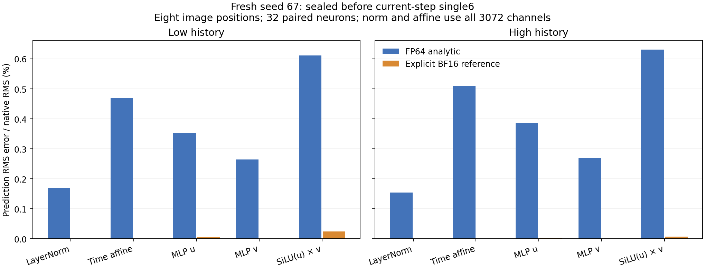
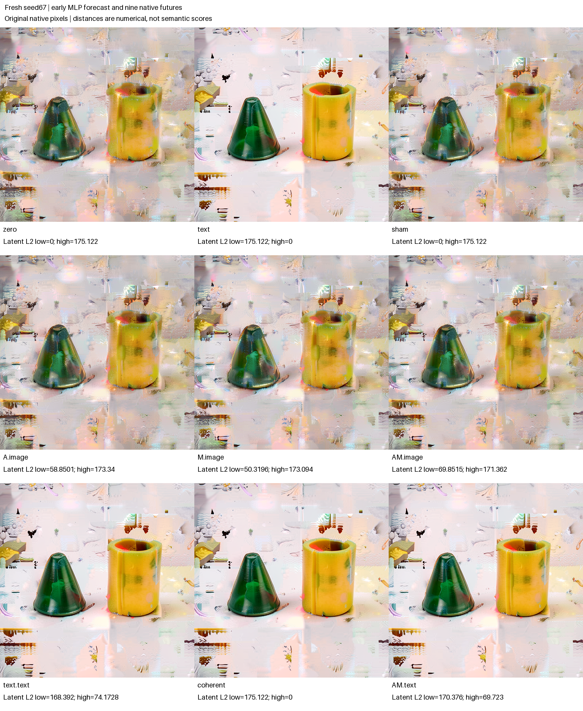

# Predicting FLUX MLP features from the incoming state

From the observed incoming state and supplied weights, the independent numerical reference matched 255 of 256 selected native MLP activations in **each** of two histories. At the same eight image queries, all 24,576 LayerNorm and all 24,576 time-affine samples per history matched exactly. The two remaining activation errors are retained, not rounded away or used to discard the futures.

The forecasts were sealed before the first execution of logical step 3, single block 6. This extends the [earlier contraction assay](FLUX-SINGLE-CONTRACTION.md) to the entry of the MLP feature computation. It is conditional on observed internal state and known weights, not a raw-prompt image prediction.

Corrected job `job-5720e9aa8640` succeeded. [Audit v3](../../../../artifacts/mdb-flux-mlp-entry-20261104/run-02/analysis-v3.json) reports valid mechanics and a qualified native replay instrument. The [immutable final-v2 publication](../../../../artifacts/mdb-flux-mlp-entry-20261104/final-v2/result.json) retains all nine continuations. **Those image futures consumed native MLP features, not the independently predicted MLP samples.**

## The observed frontier

The specimen is the distilled FLUX.2 Klein 4B checkpoint, CUDA BF16, physical batch 1, at logical denoising step 3, single block 6. A fresh seed-67 run uses the prompt:

> A green cone to the left of a yellow cylinder on a plain white background. Two separate objects, simple studio product photograph.

The prompt specifies intended content; it does not certify the generated shapes. One fresh encoding and noise draw construct two own-history source trajectories. A direct post-single0 image replacement creates matched image/different-text states, then native blocks 1–5 carry them to pre-single6. Both image and text may differ by the selected entry. This construction does not rerun a K/V-equivalence assay.

Preparation consumes 108 native transitions and four Acts before the early seal: the 96-transition/three-Act builder plus 12 transitions and one image Act. Earlier-timestep executions of module 6 are allowed. The excluded target is **logical step 3, single block 6**, whose normalization and MLP outputs are unavailable to the early predictor.

This is a conditional computation forecast from an observed internal state and supplied weights. The native prefix, prompt encoding and state construction are not independently predicted. It is neither a raw-prompt image forecast nor a complete-MLP or RGB forecast.

## The entry equation

For each selected image position, x contains all 3,072 incoming hidden channels. The native LayerNorm has no learned affine parameters, uses biased variance over those channels, and has ε = 10⁻⁶. Time modulation supplies shift s and scale c:

```text
μ = mean(x)
n = (x − μ) / sqrt(mean((x − μ)²) + ε)
h = (1 + c) × n + s
[u, v] = selected_native_weight_rows × h + selected_bias
MLP_selected = SiLU(u) × v
```

The selected rows come from `single_transformer_blocks.6.attn.to_qkv_mlp_proj`. Its first 3H rows belong to Q/K/V; the paired MLP rows are `3H+j` and `3H+I+j`, with H=3,072 and I=9,216. Thirty-two fixed neurons use indices `0,288,…,8928`. Eight fixed image queries are `[0,31,32,255,511,512,767,1023]`.

The NumPy predictor receives only incoming image, time modulation, the paired actual weight rows, optional bias, ε and declared indices. It computes the full-width normalization at those positions, then 256 selected neuron values per source. Native current-site normalization, modulated inputs, preactivations and activations are not predictor arguments. Selected weight rows are extracted by the source-bound worker; a full parameter descriptor is not an independent Merkle proof of those partial rows.

Two numerical references are frozen. The FP64 equation uses the widened native BF16 inputs and weights directly. An explicit BF16 reference rounds normalization, `1+scale`, modulation product/addition, paired linear outputs, SiLU and the activation product using FP64→FP32→round-to-nearest-even BF16. This reference is not an exact CUDA LayerNorm/GEMM/SiLU emulator. Every declared error and exact or inexact sample is retained without a numerical quality gate.

## Numerical outcomes, including the two misses

Both source roles used the fixed eight queries and 32 neurons. The exact-match census below compares native BF16 values with the explicit BF16 reference; it is bounded to the declared samples, not the entire module or image-token field.

| Stage | Low-source exact samples | High-source exact samples | BF16-reference RMS error: low / high |
|---|---:|---:|---:|
| LayerNorm | 24,576 / 24,576 | 24,576 / 24,576 | 0 / 0 |
| Time-affine input | 24,576 / 24,576 | 24,576 / 24,576 | 0 / 0 |
| u preactivation | 255 / 256 | 255 / 256 | 0.0000305176 / 0.0000152588 |
| v preactivation | 256 / 256 | 256 / 256 | 0 / 0 |
| SwiGLU activation | 255 / 256 | 255 / 256 | 0.0000305176 / 0.00000762939 |

Activation RMS errors are 0.0252069% and 0.00777627% of the respective native activation RMS. Maximum errors are 0.00048828125 low and 0.0001220703125 high. The unquantized FP64 activation errors have RMS 0.000740398 and 0.000618712, respectively. These different references describe numerical execution precision; they do not establish a new semantic law. SiLU alone is predicted but was not separately measured—the combined activation was measured.



The figure is copied exactly from the saved-only plot bound to audit v3; its [numeric/provenance record](../../../../artifacts/mdb-flux-mlp-entry-20261104/mlp-entry-errors-v2.json) retains the nonzero values and exact stages.

A separate [posthoc sample-localization diagnostic](../../../../artifacts/mdb-flux-mlp-entry-20261104/sample-error-localization.json) finds the u mismatch at neuron 5472 in both histories: query 31 low and query 255 high. The activation mismatches occur at those coordinates. Substituting the **observed** u/v into the explicit BF16 SwiGLU calculation reconstructs all 256 selected native activations per history. This supports a preactivation-origin account for these two discrepancies; the near-rounding-midpoint observations do not identify a CUDA kernel cause. The observed-u/v calculation is posthoc diagnosis, not an additional forecast.

## Three separate seals

1. **Early MLP-entry seal:** after source construction, before any current-step single6 call. It binds the incoming states, modulation, selected weights and predicted normalization/MLP arrays for both histories.
2. **Structural panel seal:** before the two native single6 source calculations and the subsequent feature edits. It binds source roles, A/M recipes, native controls and exploratory geometry scope.
3. **Later projection seal:** after those two allowed native source captures expose A/M features, before three mixed A/M/AM calculations. It forecasts sampled fused-linear projections and low-residual gated updates, as a separate conditional target.

After the early seal, scoped hooks observe the first two direct source calls at the target block. Their saved normalization, modulation, u/v and activation arrays are the later native witnesses. The hooks do not replace values and are removed on exit. The public transaction persists predictions before observations; native clocks, external counters, source-bound code and scoped hooks establish the declared exclusion policy. This trusted Python dataflow is not an OS sandbox or independent kernel-read trace.

## Native continuation and evidence scope

The later panel follows the [single6 contraction design](FLUX-SINGLE-CONTRACTION.md): low/high references, sham, A.image, M.image, AM.image, text.text, coherent and AM.text. The image-feature edits preserve recipient residual, gate and text features at the fused output projection; separate typed text Acts install high native postblock text where declared.

The earlier seed-53 tentative M-over-A prediction remains a recorded miss. This fresh-seed plan declares no positive contraction or M-over-A ordering. Effective-write geometry, feature-factorial interactions, endpoint distances and visible outcomes are exploratory, with all rows retained. The locally fixed fused projection is affine in real arithmetic; recorded BF16 departures and later nonlinear continuations must keep their separate scopes.

The complete finite census is 245 native transitions, 14 Acts, 259 receipt emissions, five direct block calculations and nine final PNG/VAE calls, with one model load, encoding and noise draw. The panel contributes 137 transitions and ten Acts after the 108-transition/four-Act builder. Nine futures are dependent branches of one context, not nine independent prompts.

## All nine native futures

The fresh native image contrast decreased from L2 8,300.6834 before block 6 to 6,362.8024 after it. A-only ended closer to the high local image than M-only (5,986.2663 versus 8,488.6736), while AM under the low residual remained 8,301.0585 away. **No A-versus-M ordering was predicted for seed 67.** The earlier seed-53 tentative M-over-A prediction remains a historical miss, separate from this exploratory ordering.



| Row | Final latent L2 from low | Final latent L2 from high | RGB MAE from low | RGB MAE from high |
|---|---:|---:|---:|---:|
| zero | 0 | 175.121798 | 0 | 27.415095 |
| text | 175.121798 | 0 | 27.415095 | 0 |
| sham | 0 | 175.121798 | 0 | 27.415095 |
| A.image | 58.850097 | 173.340240 | 4.638638 | 28.428076 |
| M.image | 50.319609 | 173.093803 | 4.194640 | 25.838935 |
| AM.image | 69.851521 | 171.362485 | 5.688090 | 26.825310 |
| text.text | 168.391725 | 74.172780 | 26.524443 | 4.578197 |
| coherent | 175.121798 | 0 | 27.415095 | 0 |
| AM.text | 170.375604 | 69.722964 | 27.630280 | 4.305751 |

A-only reduces distance to high in latent space while worsening RGB MAE; M and AM reduce both, with different rankings by metric. High native postblock text changes the continuation much more strongly. AM.text still differs from coherent high by latent L2 69.722964 and RGB MAE 4.305751, despite its high projection and high T. The remaining image difference includes the receiving residual and native rounding; its future relevance does not make it an independently persistent residual register or an additive mediation fraction.

Task-aware arm-blinded assistant captions describe comparatively clearer main surfaces in the four high-T rows—text, coherent, text.text and AM.text. Backgrounds remain fragmented in every row. Green-left tapered and yellow-right open-cylinder/cup-like dominant forms persist, with uncertain detailed geometry; the images do not certify an ideal cone, a clean white background or semantic repair. The [sealed observations](../../../../artifacts/mdb-flux-mlp-entry-20261104/blinded-observations.json), [mapping](../../../../artifacts/mdb-flux-mlp-entry-20261104/blind-map.json) and [unblinded join](../../../../artifacts/mdb-flux-mlp-entry-20261104/unblinded-visual-record.json) retain all nine originals and uncertainty. The observer knew the task and earlier design, and supplied no calibrated semantic score or fine numerical ranking.

The optional public `bf16-bits` tensor archive stores native BF16 bits losslessly and retains dtype/shape/stride custody descriptors. Legacy storage remains the default. This storage choice is not a numerical approximation or a measured speedup claim.

## Execution and reader history

The successful runner took 367.88 seconds, peaking at RSS 8,247.7 MB and VRAM 9,754 MB. Its worker summary was recorded at 260.637 seconds before archive export; these clock boundaries differ. The first job, `job-ec1f4d871de8`, failed while saving native int64 text-position IDs, before noise, builder, selected-target execution or image futures. Its [original failed job record](../../../../artifacts/mdb-flux-mlp-entry-20261104/run-01/job.json) remains unchanged. The corrected job was explicitly submitted with native int64 codec support, not automatically retried.

After collection, the initial offline reader rejected valid legacy Fortran-layout NPY arrays. The reader-only compatibility repair verifies their C-ordered numerical bytes while retaining C-layout requirements for explicit new encodings. [The failed audit attempt](../../../../artifacts/mdb-flux-mlp-entry-20261104/audit-attempt-01.json) and [reader qualification](../../../../artifacts/mdb-flux-mlp-entry-20261104/qualification-offline-reader-v3.json) preserve this history. No GPU rerun or producer-array change was required.

A subsequent [interpretation correction](../../../../artifacts/mdb-flux-mlp-entry-20261104/interpretation-correction-01.json) removed an inherited seed-53 “prediction miss” label from the fresh, unpredicted seed-67 A/M ordering. [Audit-v3 correction provenance](../../../../artifacts/mdb-flux-mlp-entry-20261104/audit-interpretation-correction-v3.json) records the changed labels and sample counts. Earlier audits, first publication and plots remain immutable; final-v2 uses audit v3. The current public codec includes lossless float/int64 storage and the legacy Fortran reader; executed producer and current reader source hashes remain distinct.

Final installed-wheel engineering qualification passed 74 tests in 19.23 seconds. These overlapping mechanics/regression checks are separate from the one successful native specimen and its nine dependent futures.

## Reproduce outside the workspace

Use an installed-wheel Python, an absolute MDB checkout path for the qualification scripts, and fresh output paths. The working directory can be `/tmp`; no checkout path injection is needed. For saved evidence only:

```sh
MDB=/absolute/path/to/saturn-pub/packages/mdb
PY=/absolute/path/to/qualified-environment/bin/python
RUN=/absolute/path/to/mdb-flux-mlp-entry-20261104/run-02
cd /tmp
"$PY" -I "$MDB/qualification/analyze_flux_single_mlp.py" \
  "$RUN" /new/path/analysis.json
"$PY" -I "$MDB/qualification/publish_flux_single_mlp.py" \
  "$RUN" /new/path/analysis.json /new/path/publication
```

To stage a separate reproduction, the [launcher](../qualification/submit_flux_single_mlp.py) uses one bounded mrun lease with strict preflight, CUDA admission and no automatic retries. Keep staging, admission and collection explicit:

```sh
FRESH_RUN=/absolute/path/to/new-run
COMMON=/absolute/path/to/common/bin/common
"$COMMON" exec "$PY" -I "$MDB/qualification/submit_flux_single_mlp.py" \
  "$FRESH_RUN" --stage-only
"$COMMON" exec "$PY" -I "$MDB/qualification/submit_flux_single_mlp.py" \
  "$FRESH_RUN" --submit-staged
# After the returned job finishes:
"$COMMON" exec "$PY" -I "$MDB/qualification/submit_flux_single_mlp.py" \
  "$FRESH_RUN" --collect JOB_ID
```

The [entry equations and native witness hooks](../qualification/flux_single_mlp.py), [worker](../qualification/flux_single_mlp_campaign.py), [auditor](../qualification/analyze_flux_single_mlp.py) and [publisher](../qualification/publish_flux_single_mlp.py) keep prediction, observation and saved-only checking separate. The final publication binds the source/codec identities, three seals, actual state cuts, all samples and native row artifacts; the earlier seed-53 report remains unchanged.
