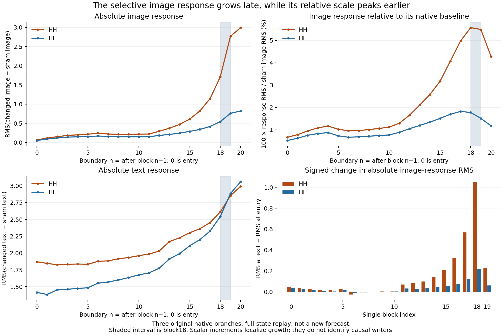

# Native response localization through all twenty single blocks

The [query/bank assay](FLUX-IMAGE-QUERY-BANK.md) explains a conditional joint0
image read. This separate cut follows two existing native perturbations from
their saved pre-single0 states to pre-readout, locating where their responses
diverge. It is a full-state native replay trace, not a new numerical forecast.

## Actual result

Three own-state branches share the high receiver from the earlier
receiver–direction cross: sham=`c1-o0.sham`, HH=`c1-o0.d-c1-o0`,
HL=`c1-o0.d-c0-o1`. HH/HL are experiment IDs for two directions, not semantic
names. Each retains its own image, text, latent and carried context throughout.

| Boundary | HH image RMS | HL image RMS | HH image / sham image RMS | HH text RMS | HL text RMS |
|---|---:|---:|---:|---:|---:|
| Pre-single0 | 0.069200 | 0.054099 | 0.6647% | 1.870246 | 1.415237 |
| After single6 | 0.220857 | 0.157355 | 0.9599% | 1.883929 | 1.569453 |
| After single13 | 0.471888 | 0.245397 | 2.5799% | 2.226617 | 1.990525 |
| After single17 | 1.711993 | 0.544962 | 5.5739% | 2.611110 | 2.541458 |
| After single18 | 2.766184 | 0.761115 | 5.4926% | 2.854180 | 2.885024 |
| After single19 | 2.992588 | 0.821642 | 4.2767% | 2.992095 | 3.061694 |

RMS here means the full changed-minus-sham field at that boundary. All twenty-one
boundaries and both streams are retained, including signed means, maximum
differences, changed values, native amplitudes and relative amplitudes.



Single18 has the largest signed HH-minus-HL increment in absolute image-response
RMS:1.054190876−0.216153754=0.838037122. Blocks14–19 account for
2.520699665 of the total2.923387767 HH scalar RMS increase, about86.23%.
This is a partition of scalar net growth, not a causal share or energy
decomposition. Blocks6–8 shrink HH's absolute response.

The normalization changes the interpretation. Sham image RMS rises from
10.410380 at entry to69.973710 at exit. HH's relative response peaks at
boundary18, then falls despite continued absolute growth. Block18 is selected
for absolute selective growth, not maximal relative or intrinsic amplification.
At exit, HH/HL image-response ratio is3.642202, while its text-response ratio
is0.977268. Similar text amplitudes do not establish similar content or rule
out text mediation.

## Transition account

For complete state S and original single-block function F_l,

\[
S^b_{l+1}=F_l(S^b_l),\qquad
\delta^b_{l+1}=F_l(S^b_l)-F_l(S^{sham}_l).
\]

The measured scalar increment is RMS(δ at exit)−RMS(δ at entry). It is not
the RMS of the block's write difference: direction and cancellation matter.
Every F_l retains original weights and finite arithmetic. Attention and
activated SwiGLU are parallel in a single block; their features concatenate
before one shared output projection, modulation gate and residual addition.
The trace alone does not separate those writers or explain their selectivity.

## Qualified execution and custody

Native job `job-a6c2b6aae21e` succeeded. It executes sixty complete native single
calls: twenty banks, three sequential B1 calls per bank, image1024/text512.
The census is60SDPA/120linear/60LayerNorm/120RMSNorm/60SwiGLU. It retains
63complete public StateCuts with actual boundary clocks and honest
component-derived lineage. It creates no Session.continue or Act receipts.

Every new block consumes the preceding model-produced image/text, not an oracle
replacement. Other payload slots remain each branch's own carried state.
No prefix, full model, encoder, noise, scheduler, suffix or VAE is executed.
One original parameter bank is hydrated at a time from169 original recipes.
One7,751,089,152-byte checkpoint hash and80 individually checked tensor reads
are included. No persistent weight bank is created.

The original source job `job-46a52ffae499` failed during post-execution export.
Its completed science was recovered read-only with authenticated SSH and a
collector-derived manifest. This source status is retained. Sixty selected
original files bind both entry and historical pre-readout cuts and ledgers.

CPU audit `job-55e160b067a5` also succeeded. It verifies all raw manifest members,
all63 cuts,126 image/text fields, clock/parent/call joins and carried slots;
independently recomputes every response; and compares all six exits against
complete historical native fields. Every historical error is zero and every
producer response row agrees. No model/reference call or forecast runs in the
audit. Four descriptive trace records are emitted, not equation forecasts or
automatic computation families.

Seven isolated installed-runtime worker checks and eight audit checks pass.
The request-bound finite review has no blockers. Tiny tests cover actual native
modules and complete public LocalStore paths; they are not production timing
calibration. Numerical discrepancies would remain observations rather than
abort gates.

Native scheduler:59.47s, RSS2308.6MB, VRAM1088MB; worker35.763s.
Declared8192MB RAM is history-clamped to6656MB, with3072MB VRAM admitted.
CPU scheduler:20.88s, RSS1111MB, zero VRAM; audit worker14.785s.
These are actual costs, not an end-to-end speedup comparison.

Raw evidence:452files/608,330,541bytes at
`/mnt/big/mdb/research/job-a6c2b6aae21e/binding-minimal-result`.
Compact collection:23files/3,150,567bytes, archive404,088bytes. It includes
all numerical curves, cut/call indexes, source custody, descriptive records,
original recipes and checksum retrieval scripts. Full states remain near compute.

Native request:
`7a853ce252faec186c338638c172a32499d7d7b112426671e0ea6c0a4beffcfd`.
Executed worker:
`330bf66e79274c70455b49ad389e5fae1867a289fcec9a166ae2f258c39c2187`.
CPU request:
`f350fc8d64c0e60e652fdce3946bda3520c9b6d1485a435d3651aeabb5925e52`.
Executed auditor:
`126ced98b7ff718408123e19bcdceb44be153e456bb328d1fe487195a3ac7526`.

## Installed workflow

Use the source-pinned public wheel cohort and a configured scheduler URL,
outside a source checkout:

```sh
export MRUN_URL=http://192.168.68.68:9025
python -I qualification/stage_flux_single_stack_trace.py RUN \
  --campaign AUTHENTICATED_PROMPT_FACTORIAL_CAMPAIGN
# Bind independent finite-run review to this exact request and payload.
python -I qualification/stage_flux_single_stack_trace.py RUN --submit
python -I qualification/audit_flux_single_stack_trace.py AUDIT --study RUN
python -I qualification/audit_flux_single_stack_trace.py AUDIT --submit
python -I qualification/recover_flux_directory.py AUDIT COMPACT_COLLECTION
```

[Complete numerical accounts](assets/flux-single-stack-accounts-20261106.json)
retain every boundary and normalization. The next causal cut crosses sham/own
attention features with sham/own activated MLP features at **both** HH and HL
block18 recipients, then consumes each output through original single19.
Corner00 retains its recipient's residual and is not sham. Corner11 must be
compared with the native own-state exit. No attention/MLP winner is assumed.
