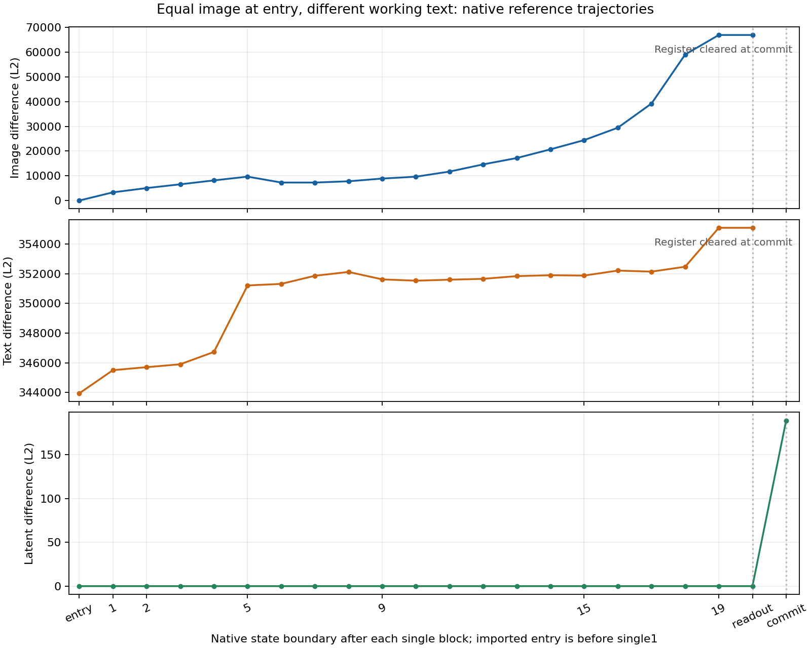
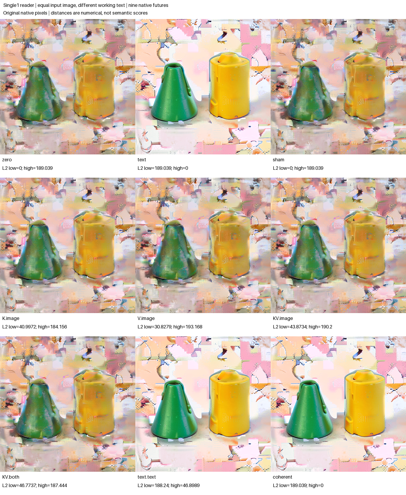

# FLUX single1: the next image write and its native future

The presealed first-reader prediction matched: two complete native states entered single block 1 with exactly the same working image and different working text, and their image states first differed immediately after that block. The difference then grew, contracted temporarily, and grew again. It never became exactly zero at a later live image boundary. The latent remained exact until the scheduler committed the final update.

The local K/V equation also matched, but it did not specify a better future. KV reproduced the high-text source's immediate image attention, fused projection and image state exactly. Its image-only continuation nevertheless finished **farther from high than the unchanged low baseline** in both latent L2 and RGB MAE. Installing native high postblock text alone ended much closer. This is one previously observed p1 seed-53 history at a new consumer site, with nine dependent futures—not fresh prompt replication or a universal route law.

## The authenticated source pair

This continues the [three-context single0 experiment](FLUX-SINGLE-CONTEXTS.md), using its p1-s53 context: green cone left of yellow cylinder, white background. The actual prior `KV.image` and `coherent` post-Act cuts sit at logical step 3, single index 1, local clock 1:

| Role in this assay | Actual prior row | Complete source cut |
|---|---|---|
| zero / low | KV.image, after its image Act | `a8b22c7d571e2a1dd07d84879e9ec5f6b6c2d5d186dfde830d74b6ff7c0b7570` |
| text / high | coherent, after its last text Act | `9b6b1925e426a3559a30930567f808845711828aea3165409bcfc8c0d50f0792` |

All state slots except working T match exactly: I, latent Z3, stored C0, context/modulation/gates/RoPE, positions, schedule and clock. Stored C0 remains the zero-conditioning history. “Low/high” names this observed text contrast, not a quality score, monotonic scale or new prompt encoding.

The prior source was real job `job-b87315cd3534`, archive `e8e565211c979debd20b91d2fa79293880c9fd0d2147be407b1141a82eb32de3`. Its full archive was verified during staging. The new job received only the selected **26 CAS files, 22,504,745 bytes**, plus authenticated prior metadata. The independent offline audit joins 30 selected original files to the pinned prior producer manifest and report, checks the original row/Act/cut chain against the pinned prior audit, and verifies current input cuts against that exact CAS. It also checks all five native implementation file basenames and package versions against the predecessor; the prior encoder-only source is an allowed extra.

Both reference suffixes **already executed in the predecessor**. Their known PNGs and final latent descriptors are replay controls. This assay newly captures the local single1 write and full reference trajectories, and makes new K/V conditional edited calculations. It does not forecast previously unseen reference PNGs, load an encoder, draw noise or import a foreign context.

## What was frozen before release

The global plan was saved before the current model load. The architectural ForecastTransaction then sealed the first-reader, local KV/MLP, branch and directional hypotheses before any panel source calculation, prefix transition, Act or VAE call. Its source entries are observed imported states, not predictions.

Exactly two allowed direct native source calls expose QKV, with native normalization and RoPE applied to Q/K, not V. A second public transaction binds those source arrays and the actual dispatch profile, then seals numeric predictions **before** K/V/KV edited calls or adapter prefixes. The timing checks qualified; no later intervention site was selected after seeing a divergence.

The conditional calculation is `softmax(QKᵀ/√128)V`, in independent NumPy FP64 with stable row softmax, at image queries `[0,31,32,255,511,512,767,1023]`, all 24 heads of width 128. Recipient Q and image K/V remain exact. Only high-source text K, V or both are selected. K and V are novel conditional targets; KV is a represented high-source consistency control. Text-bank probability masses are predicted only—the native dispatcher did not expose measured weights.

| Selection | Native RMS | FP64 error RMS | FP64 max error | Signed mean error | BF16-cast error RMS |
|---|---:|---:|---:|---:|---:|
| K | 0.235881 | 0.000404317 | 0.00398490 | 1.346e-6 | 0.000292742 |
| V | 0.240345 | 0.000404773 | 0.00498432 | 2.959e-6 | 0.000281672 |
| KV | 0.220839 | 0.000380857 | 0.00398889 | 5.274e-6 | 0.000285481 |

Errors use actual native output minus sealed forecast. K and V relative RMS errors are **0.1714% and 0.1684%**. None of the three explicit FP64→FP32→round-to-nearest-even BF16 cast references is bit-exact to native dispatch. Offline source-QKV recomputation agrees with the saved FP64 calculation to at most 3.55×10⁻¹⁵ and reproduces all saved BF16 casts.

These magnitudes report the arithmetic contract and its measured differences; no arbitrary “small enough” threshold is a scientific gate. Source-reviewed QKV-only Python dataflow is not hermetic process isolation: native source outputs remained resident. No independent MLP, full query-field, readout or RGB prediction was made.

This block has parallel attention and MLP features with one fused projection. The receiving `attn` return contains both paths. Image MLP preactivation and activation stayed exact across all five direct candidates; the rounded whole update `BF16(R + BF16(gate × fused_projection))` matched. KV image dispatch, fused projection and postblock image matched high exactly, while candidate text was not predicted to match high.

## Native trajectories: first write, contraction, persistence



The plot comes from standard Matplotlib applied to saved arrays. Lines connect discrete observations; they are not forecasts or a continuous dynamical fit. Axes use different scales, so their heights are not comparable. [SVG](../../../../artifacts/mdb-flux-single-successor-20261103/native-trajectories.svg) and [plot provenance](../../../../artifacts/mdb-flux-single-successor-20261103/native-trajectories-provenance.json) bind the exact audit and points. I/T absence after commit is not plotted as zero.

Each reference has **21 recorded exits**: the single1 prefix exit plus 20 suffix transitions. Full I/T/latent arrays are retained wherever live, and actual native noise prediction is retained after readout. Six complete StateCuts per reference cover after single1, after single2, after single9, pre-readout, post-readout and final commit. The total typed store contains 29 complete cuts.

| Observed boundary | Next frontier | Image L2 difference | Latent L2 difference |
|---|---|---:|---:|
| Imported entry | before single1 | 0 | 0 |
| After single1 | before single2 | 3,323.956012 | 0 |
| After single5 | before single6 | 9,663.352964 | 0 |
| After single6 | before single7 | 7,283.270655 | 0 |
| After single7 | before single8 | 7,276.148746 | 0 |
| After single9 | before single10 | 8,889.514024 | 0 |
| After single19 | pre-readout | 66,904.314162 | 0 |
| After readout | pre-scheduler commit | 66,904.314162 | 0 |
| After scheduler commit | Z4 | I/T absent | 189.038560 |

The first image difference is therefore at the predicted single1 output. The `point.index` stored in a receipt names the **next** block: point single6 is after executed single5, for example. The after5→after6→after7 contraction is real attenuation in the saved image distance, not exact reconvergence or semantic repair. The data do not identify whether attention, parallel MLP, gating, residual geometry or another component caused that contraction. Separating those writes near single6 is a possible next causal cut, not a result here. After-single5 retains full I/T arrays and its receipt identity, but no complete typed cut. A new intervention there must replay from the retained after-single2 cut, check parity against the saved after-single5 arrays, and capture the single6 frontier.

Working text already differed at input (L2 343,937.985586) and remained different. Z3 stayed byte-exact through all live image/text processing and readout, as expected when the scheduler has not yet updated it. The actual native readout noise predictions differed by L2 **262.993158**; the committed Z4 difference was **189.038560**. The plot and [portable index](../qualification/flux-single-successor-20261103.json) retain every boundary and signed distance change, including contractions. Full intermediate arrays support these curves; only selected complete states support direct replay. Public receipt footprints remain declared, source-bound footprints rather than independent low-level kernel-read traces.

## Nine native futures, including the endpoint counterexample

Each edited arm starts at the native low post-single1 state, except the high/text reference. Image-only K/V/KV arms install the candidate image while retaining low postblock T. `KV.both` also installs candidate T; `text.text` installs native high postblock T alone; `coherent` installs native high postblock I/T. Sham copies low I/T. Every row then follows 20 native suffix transitions, with C0 unchanged and no further conditioning projection.



| Row | Z4 L2 from low | Z4 L2 from high | RGB MAE from low | RGB MAE from high |
|---|---:|---:|---:|---:|
| zero | 0 | 189.038560 | 0 | 35.057959 |
| text | 189.038560 | 0 | 35.057959 | 0 |
| sham | 0 | 189.038560 | 0 | 35.057959 |
| K.image | 40.997208 | 184.155577 | 3.768551 | 33.129267 |
| V.image | 30.827914 | 193.168437 | 2.665643 | 36.155540 |
| KV.image | 43.873436 | 190.199517 | 3.573025 | 35.321716 |
| KV.both | 46.773678 | 187.443899 | 3.801228 | 34.239271 |
| text.text | 188.240064 | 46.898931 | 34.748740 | 3.588621 |
| coherent | 189.038560 | 0 | 35.057959 | 0 |

The display rounds metrics; original values, source paths, PNG/latent hashes, Acts and native receipt IDs are in the portable index. RGB MAE uses 8-bit pixel units and does not measure semantic fidelity.

The low baseline is 189.038560 from high in latent L2. Despite exact local high-image matching, **KV.image ends at 190.199517**, and V.image at 193.168437; both are farther. Their RGB distances also exceed low's 35.057959: KV.image 35.321716 and V.image 36.155540. K.image is closer by both metrics (184.155577 and 33.129267). Thus neither stronger local image matching nor a K/V ordering learned at the earlier site guarantees a closer endpoint. The full live state and subsequent consumer matter.

The predeclared text-direction hypothesis does hold here: native high postblock T alone is closer to high than each image-only edit, in both metrics. Its endpoint is 46.898931 latent L2 and 3.588621 RGB MAE. Signed margins are `distance(image edit,high) − distance(text.text,high)`:

| Image-only comparator | Latent L2 margin | RGB MAE margin |
|---|---:|---:|
| K.image | +137.256646 | +29.540647 |
| V.image | +146.269506 | +32.566920 |
| KV.image | +143.300586 | +31.733096 |

These are **six positive margins within one context**, not six independent trials or evidence of universal text mediation. The copy sham equals low and the coherent replacement equals high in latent and PNG; both unchanged native references reproduce their authenticated prior endpoints. Matching immediate I alone is insufficient for a complete continuation boundary.

The final image K/V factorial vector `Y_KV.image − Y_K.image − Y_V.image + Y_zero` has Z4 RMS **0.128328** (signed mean −0.00129039) and RGB RMS **5.664050** (signed mean −1.043435). This is full-array numerical nonadditivity, not a semantic conjunction or subtraction of distances.

## A separate posthoc state-update equation

A saved-operand [Euler diagnostic](../../../../artifacts/mdb-flux-single-successor-20261103/commit-math.json) checks how already observed native noise and Z3 produce the committed latent. It reconstructs **both complete Z4 arrays bit-exactly** with

```text
Z4 = B16(F32(Z3) + B16(B16(dt) × N))
```

where N is the actual native post-readout noise prediction. The stored FP32 schedule difference is −0.7174965739250183; its effective BF16 coefficient is −0.71875. Here dt is a zero-dimensional FP32 scalar multiplying dimensioned BF16 N: the observed scalar-promotion behavior preserves a BF16 product. Coefficient rounding, product rounding, FP32 addition and final BF16 rounding all matter for this source-bound profile. A length-one coefficient tensor, another dtype/backend, stochastic step or changed scheduler can change the arithmetic.

| Posthoc formula variant | Low residual RMS | High residual RMS | Exact Z4? |
|---|---:|---:|---|
| FP64 unrounded Euler | 0.002304158 | 0.002589083 | neither |
| FP32 Euler, final BF16 only | 0.002517345 | 0.002862231 | neither |
| BF16 product with FP32 coefficient, FP32 sum, final BF16 | 0.002469871 | 0.002872497 | neither |
| BF16 coefficient and product, FP32 sum, final BF16 | 0 | 0 | both |

All alternative errors are retained. This identifies a bounded effective arithmetic program from observed operands; equality alone does not uniquely identify every internal implementation. It was **not presealed**, did not independently predict native readout or Z4, and executed no native scheduler or model. The paired latent difference also differs from the ideal unrounded `dt × noise_difference` by L2 1.107963. Exact local arithmetic closure should not be promoted into a stronger prospective claim. The [independent postrun review](../../../../artifacts/mdb-flux-single-successor-20261103/postrun-review.json) separately recomputed both full Z4 arrays with an independent BF16 implementation, checked the pinned scheduler source and retained all three nonexact alternatives. It found no material execution/audit error; its editorial corrections about live slots, retained cuts and scalar arithmetic are applied here.

## Visual observations and curated evidence

The [visual record](../../../../artifacts/mdb-flux-single-successor-20261103/unblinded-visual-record.json) joins captions for all nine original 512×512 PNGs only after the [caption seal](../../../../artifacts/mdb-flux-single-successor-20261103/blinded-observations-seal.json). The task-aware assistant observer described green tapered forms left of yellow cylinder/can-like forms in every image. High/text, coherent and text.text had more continuous foreground surfaces; the other arms looked mottled. Background fragmentation remained throughout. These informal arm-blinded observations are not calibrated classification, independent specimens or proof of semantic repair; exact pure cone/cylinder identity remained uncertain. Low/high remain the imported zero/text histories, not native-original scene references.

[Three curated computation records](../../../../artifacts/mdb-flux-single-successor-20261103/computation-records.json) connect the local reader, working-text continuation and observed-operand commit arithmetic to their actual sources and receipts. The [evidence provenance](../../../../artifacts/mdb-flux-single-successor-20261103/evidence-v1/provenance.json) records nine numerical rows and six qualified xref hits. [Run](../../../../artifacts/mdb-flux-single-successor-20261103/evidence-v1/run.json), [verification](../../../../artifacts/mdb-flux-single-successor-20261103/evidence-v1/verify.json) and [query](../../../../artifacts/mdb-flux-single-successor-20261103/evidence-v1/xref-query.json) all returned zero. This was curated offline indexing using explicit evidence-source snapshots; no automatic law induction or model run occurred, and installed MDB runtime does not import those private evidence sources. The [narrative report](../../../../obsidian/blog/2026-11-03-230409-the-next-reader-and-the-latent-commit.md) develops the consumer and precision findings.

## Mechanics, custody and limits

The current producer `job-b8e38f8a326f` succeeded. Independent audit reports `mechanics_status=valid`, `instrument_status=native-replay-qualified` and qualified sampled prospective timing. First-reader matching, endpoint direction, all numerical forecast errors, non-monotonic trajectories and the KV endpoint countertrend are separate research observations; `terminal_status` remains `unassessed`. Figures and distance metrics do not certify cone/cylinder identity, scene quality or semantic repair.

One resident model performed **182 adapter transitions, five direct block calculations, ten Acts, 192 receipt emissions and nine native VAE/final-image calls**, with no encoding or noise draws. The engine panel load count is zero; the real outer job load count is one. The added trajectory/noise snapshots add retention, not native forwards or extra arms. CUDA BF16 used physical batch 1 and four CPU threads. Worker time was **112.031 s**, runner time **193.65 s**, measured peak RSS **6,937.6 MB** and VRAM **9,992 MB**. Reservations were 16,000 MB RAM, 13,000 MB VRAM and 8 GB transient disk; headroom is not a speedup claim.

The streamed multipart archive contains **499 files**, **789,933,667 compressed bytes** and **1,479,802,243 expanded bytes**, in 95 transport parts. Current parent custody was verified once before sequential array inspection. The archive is `7ba8da5c2b0093310697760d397868932cad3b8b08fc3fd7cba01eac33c469d0`. The pinned prior report/manifest and current archive have distinct authority; no child job, replacement archive or fabricated historical report was created.

The engineering panel passed 97 overlapping checks with Ruff clean; those checks are not additional research specimens. The [historical regression receipt](../../../../artifacts/mdb-flux-single-successor-20261103/historical-regression-receipt.json) preserves the earlier failed-publication audit exactly except for its auditor digest. Existing single0 defaults remain compatible; this site uses an explicit index1→index2 audit contract and a 20-transition suffix.

## Evidence and reproduction

- [Portable index](../qualification/flux-single-successor-20261103.json): all nine endpoint rows, both source cuts, two seals, exact prior-source lineage, full numerical errors, 42 reference snapshots with array hashes, signed curves and limits.
- [Independent audit](../../../../artifacts/mdb-flux-single-successor-20261103/run-01/analysis-v1.json), [immutable publication](../../../../artifacts/mdb-flux-single-successor-20261103/final-v1/result.json), [source-selection manifest](../../../../artifacts/mdb-flux-single-successor-20261103/run-01/source-selection.json) and [prior-source custody verification](../../../../artifacts/mdb-flux-single-successor-20261103/run-01/source-verification.json).
- [Campaign](../qualification/flux_single_successor_campaign.py), [shared resident panel](../qualification/flux_single_contexts.py), [offline auditor](../qualification/analyze_flux_single_successor.py) and [publisher](../qualification/publish_flux_single_successor.py). Executed and offline source digests remain in the raw request, audit and publication.

Published row/image/source/seal paths are relative to `run-01`. Nested `arrays/...` paths in the numerical and trajectory audit are relative to `run-01/extracted/flux-single-successor-result`, explicitly recorded as `nested_audit_tensor_reference_base`. Plot and posthoc math records declare their own bases. These scopes are retained in the portable index.

From the MDB checkout, saved-evidence reproduction needs no model:

```sh
python qualification/analyze_flux_single_successor.py \
  /path/to/campaign/run-01 /new/path/analysis.json
python qualification/publish_flux_single_successor.py \
  /path/to/campaign/run-01 /new/path/analysis.json /new/path/publication
```
