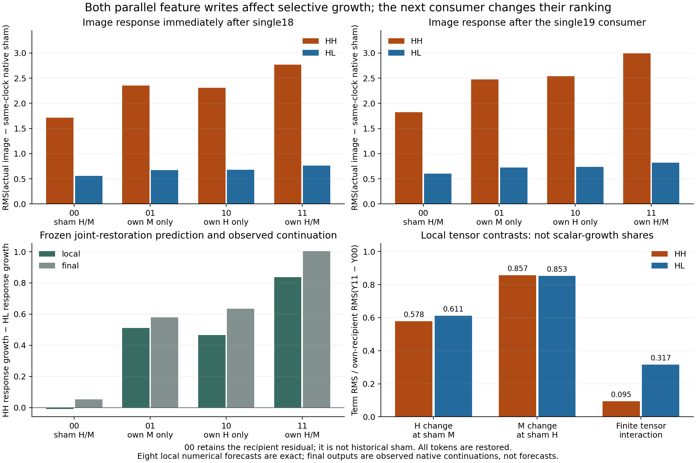

# Parallel writer restoration and a consumed next block

The [complete single-stack trace](FLUX-SINGLE-STACK.md) selected single18 for
the largest HH-minus-HL increment in absolute image-response RMS. Relative HH
response falls there as native amplitude grows. This panel tests its attention
and activated-MLP features causally at both recipients, then follows each
result through single19. It does not assume an intrinsic amplifier or winner.

## Program and intervention

Original FLUX.2 Klein4B distilled runs CUDA BF16. In its single block, modulated
normalization feeds a joint QKV/MLP projection. Attention features H and activated
SwiGLU features M are parallel; they concatenate before one shared output
projection. With the declared rounding boundaries B,

\[
O=\operatorname{NativeLinear}_C([H;M],W_o),\qquad
Y=B\!\left(R+B(g\odot O)\right).
\]

The original bias-free projection includes its native finite reduction and
BF16 output. R contains all text+image tokens; g is the recipient's actual
modulation gate. All weights are original, recipe-backed checkpoint tensors.

Three complete source calls observe H/M/R/g and retain full outputs. Eight
conditional local image/text forecasts execute original `to_out` and BF16
multiply/add, then seal together before any mixed target. Each target executes
its actual norm/QKV/attention/SwiGLU and replaces only the declared concat at
projection entry. The real projection return is not replaced. Actual receiving
and consumed concat bytes are independently retained with BF16 bit encoding.

At each HH/HL recipient,00 uses sham H/M,01 uses own M,10 uses own H,11 uses
own H/M. Every cell retains its own recipient residual/context/gate. Therefore
00 is not historical sham. All four structurally mixed01/10 inputs are also
numerically new relative to the three source concats, verified without a
novelty gate or adaptive dose change. These are eight corners in two related
receiving states from one historical campaign, not eight independent contexts.

Original single19 then consumes each actual local output. Its final state is
an observed continuation, not a sealed numerical forecast in this experiment.

## Actual effects

Let d_b(c,k)=RMS(S_b(c,k)−S_sham(k)) for the image field at local/final stage k,
and e_b the image-response RMS at the common selected-entry clock. Report

\[
G(c,k)=[d_{HH}(c,k)-e_{HH}]-[d_{HL}(c,k)-e_{HL}].
\]

The frozen image prediction was G(00,k)−G(11,k)<0 at both stages. It is
supported locally and after the consumer; text direction was exploratory.

| Own features retained | Local HH image RMS | Local HL image RMS | Local G | Final HH image RMS | Final HL image RMS | Final G |
|---|---:|---:|---:|---:|---:|---:|
| Neither00 | 1.716221 | 0.557489 | −0.008299 | 1.825800 | 0.605606 | +0.053162 |
| M only01 | 2.353287 | 0.675643 | +0.510613 | 2.473210 | 0.726422 | +0.579757 |
| H only10 | 2.311815 | 0.679284 | +0.465500 | 2.538012 | 0.735918 | +0.635063 |
| Both11 | 2.766184 | 0.761115 | +0.838037 | 2.992588 | 0.821642 | +1.003914 |



Joint restoration changes G by−0.846336066 locally and−0.950751594 at final.
It removes most of this interval's additional selective scalar growth while
preserving the earlier carried difference: HH00 remains much farther from
sham than HL00. This is not complete repair of the branch or a causal percentage.

For the **same G estimand**, M-only exceeds H-only locally, but H-only exceeds
M-only after single19. Component importance depends on the consumer. This
does not establish a particular text/image mediation route. Text's restoration
contrast is+0.100824684 locally/+0.098374676 final, retained as exploratory
collateral with its own signed baseline.

## Finite tensor interaction versus scalar interaction

Within each fixed recipient, retain ΔH=Y10−Y00, ΔM=Y01−Y00,
I=Y11−Y10−Y01+Y00 and J=Y11−Y00=ΔH+ΔM+I.

| Image contrast RMS | HH recipient | HL recipient |
|---|---:|---:|
| ΔH | 1.205016 | 0.360741 |
| ΔM | 1.786380 | 0.503545 |
| I | 0.198041 | 0.186938 |
| J | 2.085134 | 0.590348 |
| RMS(I)/RMS(J) | 9.4978% | 31.6656% |

With clamped H/M and fixed R/g, the real-arithmetic map is affine in the two
features. Its observed nonzero tensor interaction belongs to the finite
projection/multiply/add law. It is not newly measured upstream SwiGLU
nonlinearity. A scalar RMS factorial is a different quantity because norms
themselves are nonlinear. Neither contrast norm nor scalar effect is an
independent causal share.

All local tensor forecasts and signed energy identities close. HH image squared
energy is13,676,948.851994 from term energies4,567,799.635495,
10,038,500.253719 and123,376.732784 plus signed cross terms
−797,640.432734,−125,620.586595 and−129,466.750675. Full tensor closure
error is zero; scalar energy reduction differs only at floating summation scale.

## Qualification, actual cost and custody

Native `job-13ab6b3ae66e` and CPU audit `job-b08236501080` succeeded.
All eight complete local I/T forecasts are bit-exact:37,748,736 BF16 values,
with zero maximum error. Fourteen full source/own11 local/final historical field
comparisons are exact. Actual receiving/consumed operands, nineteen cuts,
carried state, closed transaction, counts and event order are fully audited.

Seal at worker22.6941092s has zero target entries; first target entry is later.
There are3source+8target+8single19=19complete native blocks,19SDPA,
46linear including8forecast projections,19LayerNorm/38RMSNorm/19SwiGLU.
Nineteen typed cuts comprise three source outputs and sixteen intervention/
continuation outputs. No Session/Act receipts or new full model, prefix,
encoder, noise, scheduler or VAE occur. Two original banks provide eight
individually checked tensors after one7.75GB streamed checkpoint hash.

Seven isolated installed-worker checks and nine audit checks pass. They exercise
actual CLI export, seal corruption/premature entry, wrong-source bit/layout
joins, signed/collapsed inputs, full cuts and no-forward audit paths. Earlier
fixture failures remain preserved. Run01 admission was rejected before job
creation because the launcher note exceeded500characters; run02 changes only
launcher/request identities after a404-character note and early length check.
The science configuration and worker are unchanged; the delta review is bound.

Native scheduler58.44s/RSS2323.8MB/VRAM1404MB; worker36.111s.
Declared8192MB RAM is history-clamped to6656MB; VRAM reservation3072MB.
CPU scheduler36.18s/RSS2739.8MB/VRAM0; audit worker31.325s.
These are execution costs, not a predictor speedup claim.

Raw215files/870,820,667bytes remain at
`/mnt/big/mdb/research/job-13ab6b3ae66e/binding-minimal-result`.
Compact44files/2,472,573bytes arrive in328,058bytes, including all accounts,
twenty curated local equation records, seals, cut indexes, original169 recipes
and checksum retrievers. No persistent parameter bank is added.

Native request:
`89c5f4a321c74d5e8d2e2bab6f8abb93c41d86fc072f580e3e3597c0f5b56a8f`.
Worker:
`69c99f215cf47c63da7e5f4873a94303b7406c1953064f0c1d35ce101db09d10`.
CPU request:
`c507fe2e21f07303a08b86f6c2d28746ec1996efd82355fd2ae43a0feefb7831`.
Auditor:
`ffe9d2c8fb386d36ef2f558d5bf850b71354bacf64e7507f3ef6b9a2ecc9b27c`.

## Installed workflow and next frontier

```sh
export MRUN_URL=http://192.168.68.68:9025
python -I qualification/stage_flux_single_writer_square.py RUN \
  --source-run COMPLETED_SINGLE_STACK_RUN \
  --source-compact COMPLETED_SINGLE_STACK_COMPACT
# Bind finite-run review to the exact staged request/payload.
python -I qualification/stage_flux_single_writer_square.py RUN --submit
python -I qualification/audit_flux_single_writer_square.py AUDIT --study RUN
python -I qualification/audit_flux_single_writer_square.py AUDIT --submit
python -I qualification/recover_flux_directory.py AUDIT COMPACT_COLLECTION
python -I -m mdb equations find \
  --catalog COMPACT_COLLECTION/extracted/binding-minimal-result/catalog/equations \
  --applicable-to COMPACT_COLLECTION/extracted/binding-minimal-result/catalog/context-exact.json
```

Actual installed CLI queries give twenty exact-context single matches and twenty
changed-clock abstentions. The generic law is
`law.flux.single.observed-parallel-writers.v1`. Records cover eight local
endpoints and twelve local tensor contrasts, not twenty independent trials or
final forecasts. Applicability predicates are supplied; family induction is open.

[Complete accounts](assets/flux-single-writers-accounts-20261106.json) retain
both streams, all corners and counter-trends. The remaining frontier is H/M
formation from earlier state. The next major candidate composes a complete pass
from a latent/project cut, without refreshing any intermediate operand from
native execution. Original kernels remain explicit primitives; this would be
independently orchestrated original-weight computation, not independent CUDA
kernel implementation or raw-prompt-to-image coverage.
