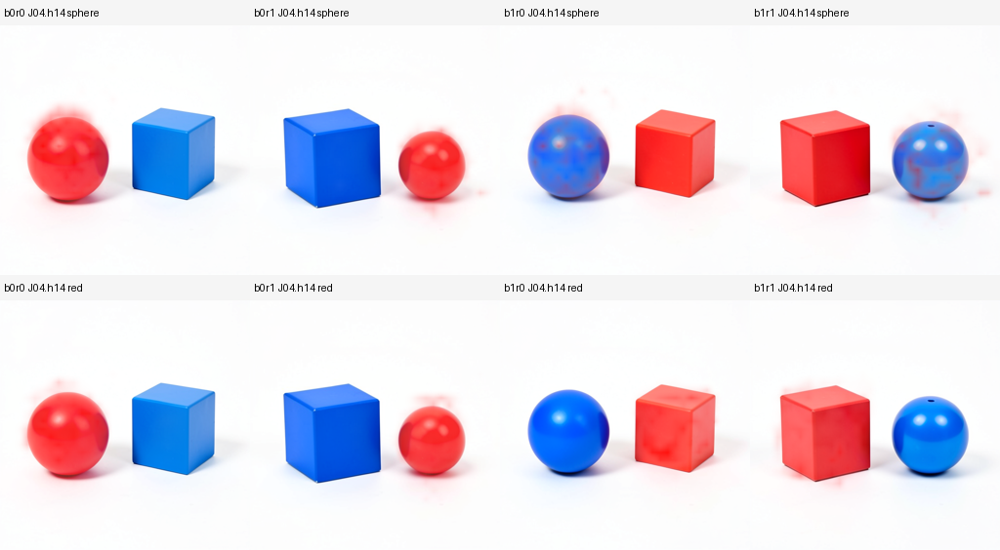
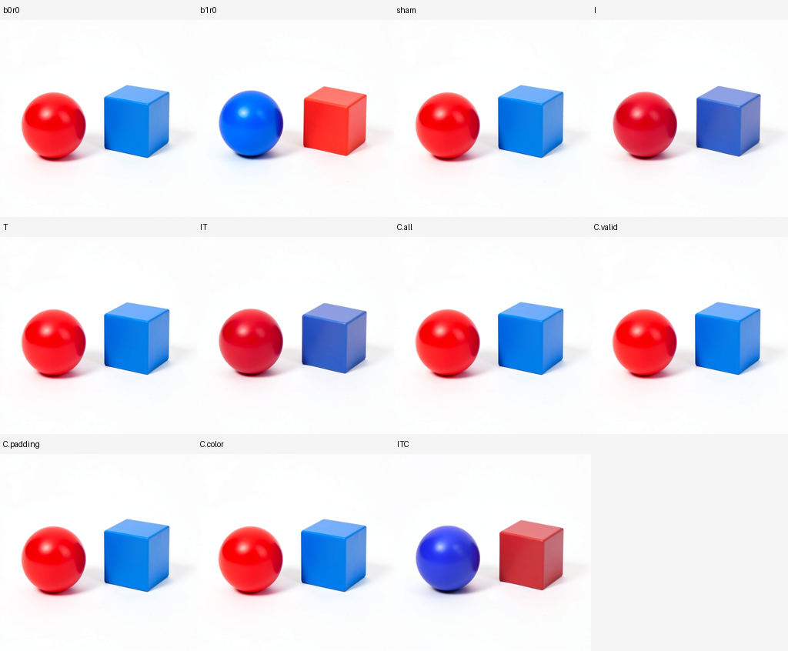

# A connected investigation of six computational gaps

This study connects prompt representation, attention routing, MLP writes, continued execution, decoding and object binding in one controlled organism. The specimen is FLUX.2 Klein4B distilled, CUDA BF16, one seed (109), batch one, 512×512 and four denoising steps. The four prompts independently swap red/blue between a sphere and cube and reverse left/right. The exact prompts, chat-template tokens and encoder operands are retained.

| Case | Exact first sentence |
|---|---|
| b0r0 | A red sphere to the left of a blue cube on a plain white background. |
| b0r1 | A red sphere to the right of a blue cube on a plain white background. |
| b1r0 | A blue sphere to the left of a red cube on a plain white background. |
| b1r1 | A blue sphere to the right of a red cube on a plain white background. |

Every prompt appends exactly ` Two separate objects, simple studio product photograph.` The native encoder receives these through its recorded user-role chat template with a generation prompt and thinking disabled. `tokens.json` retains the exact formatted strings, IDs, masks and spans; the denoiser receives the resulting continuous conditioning rather than these strings directly.

The scientific question is whether an account of the computations supports correct edits with predictable collateral. Numerical agreement, source-directed pixel movement and a correct object binding are separate observations.

```mermaid
flowchart LR
  Prompt --> Encoder[Native Qwen encoder]
  Encoder --> C[Carried conditioning C]
  C --> Project[Project at each clock]
  Z[Latent history Z] --> Project
  Clock --> Project
  Project --> IT[Working image and text]
  IT --> QKV[Positioned Q K V]
  QKV --> Attention[Attention write]
  Attention --> U[Updated receiving residual]
  U --> MLP[Joint MLP write]
  MLP --> R[Updated working state]
  R --> Blocks[Remaining joint and parallel single blocks]
  Blocks --> Readout
  Readout --> Commit[Euler commit]
  Commit --> Z
  Z --> VAE[Terminal VAE]
  VAE --> RGB
```

The symbol-table record indexes a computation occurrence along this path, including its source, receiver, clock and consumer. An object-associated route is one part of that record; it is not automatically a complete edit program.

## Computational boundary

The native Qwen text encoder supplies conditioning. The pipeline concatenates hidden layers 9, 18 and 27 into 512 conditioning rows of width 7,680. We verify the actual input IDs, mask and packing. We observe these encoder outputs; we do not independently predict the encoder's internal computation.

From that observed conditioning and fresh shared initial noise, the existing source-qualified NumPy program predicts the full initial project and joint0 output for all four prompts. Each joint prediction consumes its own predicted image, text, time modulation and rotary position state. Predictions are sealed before any denoiser block executes. Parameter banks are bound to checkpoint/source/name/shape/content recipes rather than exported again in full. The primary saved-only auditor compares every predicted image/text value with native cuts. An additional independent reconstruction then reuses earlier archived native parameter banks, checking every bank against this run's recipes before rebuilding all four new computations.

The relevant project equations, with `B` denoting the declared BF16 rounding boundary, are

\[
 I_0=B(ZW_I^T+b_I),\qquad T_0=B(CW_T^T+b_T).
\]

The initial latent and clock are shared. Consequently the initial image projection cannot depend on which prompt is used. Text enters the image stream through joint attention. Time produces modulation and gates; it does not directly substitute for the contextual text state.

There is a sharper source-level deduction at this first boundary. The identical projected image and clock imply identical first image Q, K and V. For an image query, the prompt-dependent part of attention is initially confined to text K/V:

\[
 A_{I,0}(C)=W_O\left[\operatorname{softmax}\!\left(\frac{Q_{I,0}[K_T(C);K_{I,0}]^T}{\sqrt d}\right)[V_T(C);V_{I,0}]\right],
\]

with the declared normalization, positioning and BF16 boundaries understood. The first attention write changes the image residual; the sequential image MLP consumes that changed state. Later image queries can therefore become prompt-dependent. This is an architectural deduction from the qualified source and identical native incoming image state, supported by the four prospective full-field forecasts; individual native first-block Q/K/V fields were not separately archived in this assay. It explains how a fixed learned law can produce a dynamic route without assigning one permanent semantic operation to a neuron.

## Routing and the receiving MLP

In a joint block, normalized and clock-modulated image/text states produce separate Q, K and V fields. Learned RMS normalization and RoPE transform Q/K before

\[
 P=\operatorname{softmax}(QK^T/\sqrt{d}),\qquad A=B(B(PV)W_O^T+b_O).
\]

The receiving state and sequential MLP obey

\[
 U=B(R+B(g_AA)),\qquad N=\operatorname{mod}(\operatorname{LN}(U)),
\]

\[
 [u;v]=B(NW_{\rm in}^T+b_{\rm in}),\quad H=B(B(\operatorname{SiLU}(u))\odot v),
\]

\[
 M=B(HW_{\rm out}^T+b_{\rm out}),\qquad R'=B(U+B(g_MM)).
\]

Replacing attention therefore changes the MLP's receiving state. Freezing the old MLP write and recomputing it answer different causal questions. Single-stream blocks instead calculate attention and SwiGLU branches from the same normalized incoming state and join them in one output projection. The learned weight maps and receiving states distinguish their functions even when their mathematical skeleton is shared.

The study captures actual positioned Q/K/V at step1/joint4. Seven same-parent arms separate QK routes, V payloads, full QKV, attention return, MLP return, both returns and an exact sham. Each arm installs only the image exit through a typed Act. Recipient text, conditioning, latent and clock remain unchanged at that installation. Candidate block calculations are counted separately from native adapter transitions.

For image queries, a fixed set of 64 spatial rows measures all-key softmax routes. Token-span and padding masses are descriptive addressing measurements. Neither a noun token nor a high attention weight is an object identity.

## MLP witnesses and temporal composition

Three MLP occurrences are sampled in every natural history: step0/joint0, step1/joint4 and step3/single19. Each retains eight spatial rows of actual input, paired preactivation, nonlinear activation/consumer input and output. Sixteen neuron pairs and sixteen output channels include named native weight/bias selections. An independent NumPy audit checks those affine operations and all sampled nonlinear activations, with native versus mathematical reduction discrepancies retained.

Four natural histories support the finite interaction measurement

\[
 \Delta_{br}X=X_{11}-X_{10}-X_{01}+X_{00}.
\]

This measures the error of the additive prediction at conditioning, projected state, joint0, joint4 and every committed latent. It does not establish independent semantic operators. Sparse spatial witnesses track the causal arms through subsequent blocks, while selected complete StateCuts retain exact replayable closure. A separate bridge installs predicted joint0 image/text into the native same-clock context scaffold and continues through the unchanged native suffix and VAE. That is a numerical future test with an explicitly observed scaffold.

## Separating latent rounding from nonlinear decoding

Two observed natural final latents define a direction. Doses −0.1, −0.05, 0, 0.05 and 0.1 yield continuous `Zα` and BF16-rounded `B(Zα)` inputs, frozen before dose decoding. These are response probes from observed final states, not predictions of those original final states.

The same widened FP32 VAE parameters consume continuous and rounded inputs. Their difference isolates packed-input BF16 rounding under that fixed FP32 preparation/consumer. Native BF16 preparation and VAE consumption form a separate comparison. The latter includes latent denormalization arithmetic as well as decoder arithmetic.

\[
 F_c(\alpha)=D_{32}(P_{32}(Z_\alpha)),\quad
 F_q(\alpha)=D_{32}(P_{32}(B(Z_\alpha))),\quad
 F_n(\alpha)=D_{16}(P_{16}(B(Z_\alpha))).
\]

`Fq−Fc` isolates input rounding within the diagnostic lane; `Fn−Fq` compares preparation/consumer arithmetic. The symmetric raw-pixel response

\[
 K_c(a)=F_c(a)+F_c(-a)-2F_c(0)
\]

measures curvature without packed-input BF16 rounding or final uint8 image quantization. FP32 VAE calls are real decoder executions in a distinct diagnostic lane, not independent mathematical predictions of pixels.

## Reproduction and evidence

The implementation is [the finite worker](../qualification/flux_six_areas_campaign.py), [the controlled panel](../qualification/flux_six_areas.py), [the launcher](../qualification/submit_flux_six_areas.py), [the saved-only auditor](../qualification/analyze_flux_six_areas.py) and [the contextual publisher](../qualification/publish_flux_six_areas.py). The mathematical program is reused unchanged from [the initial-project and joint reference](../qualification/flux_reentry_reference.py).

Run through the configured `common exec` environment and qualified installed MDB interpreter. Stage first, submit once through mrun, collect the terminal job, then audit and publish without additional model execution. Worker scratch/cache/output stay on the HDD; no full weight bank is transferred. All branches are serial in one CUDA lease with strict preflight and retries disabled.

The current run is `job-c829133410d8`, with request `1865ff3878474a593c7b114025269c772cb1ab925d3190e624a0df8ac9464b6d`. The first attempt, `job-7d0c198eaeea`, stopped on a logging-key error after encoding and before any denoiser target. Its exact scheduler log and original payload are preserved. No scientific inference is assigned to that harness failure.

The workspace artifact root is `artifacts/mdb-flux-six-areas-20261105/`. Results, visual review and the coverage ledger accompany the audit there. No universal object dictionary, independent raw-prompt image prediction or end-to-end speedup is claimed.

## Results from the first connected panel

The saved-only audit passed without repair. The run produced 27 images, 1,111 native adapter transitions, 9 typed Acts and 11 separately counted candidate blocks. Denoiser-entry hooks independently count 1,007 block calls including candidates. All forecasts sealed with zero target entries, zero native transitions and zero images. The QKV sham and zero-dose native decoder PNGs are exact. Runtime was 389.55 seconds including bootstrap/export, with 8,332 MB peak RSS and 9,606 MB peak VRAM. Scientific work finished at approximately 303 seconds. Authenticated transport contains 2,619 files in a 766 MB compressed archive.

| Area | Observation | Remaining boundary |
|---|---|---|
| Representation formation | Native initial image projections are identical across all four prompts; text differs. Binding × relation interaction already appears in the observed encoder layers: interaction/joint-change RMS is 0.476, 0.662 and 0.721 at layers 9, 18 and 27. | These are finite contextual differences, not independent encoder predictions or isolated semantic operators. |
| Attention routes | Full donor QKV and donor attention-return installation give exactly the same image exit and PNG. QK-only and V-only have distinct effects. At this occurrence V-only moves RGB farther than QK-only, but both effects are small. | One step1/joint4 occurrence is insufficient to swap object colors. Head necessity and object-specific addresses remain unresolved. |
| MLP functions | All 12 sampled SwiGLU activation equations are exact conditional on observed paired preactivations. Selected output-affine relative RMS errors range from 0 to 0.345%. The donor-write interaction is approximated by the receiving-MLP recomputation term within 3.86% relative RMS. | Full sampled activations are independently checked; only selected affine rows/channels are independently projected. A semantic name for each learned map is not established. |
| Continued execution | Four own-state joint0 image forecasts have 0.4705–0.4795% relative RMS error. The predicted joint0 I/T bridge reaches final RGB MAE 0.168695 against native. Additive binding/relation composition has final-latent interaction/joint-change RMS 1.364. | Native context is the bridge scaffold. Later denoiser operations and VAE are native; this is not a full prompt-to-image mathematical forecast. Sparse trajectories are witnesses, not full intermediate rewinds. |
| Decoder response | Continuous FP32 curvature/antisymmetric-response ratios are 0.2474 at ±0.05 and 0.4253 at ±0.1. Rounded-input FP32 ratios are 0.2476 and 0.4255. | Substantial curvature survives removing packed-input BF16 rounding. Native preparation/consumer arithmetic contributes separately; this is one latent direction and not a universal decoder error model. |
| Objects and relationships | Visual inspection confirms all four natural scenes have the requested color/shape binding and left/right relation. All six non-sham single-block interventions retain the base categorical binding. | Colored connected components identify chromatic regions and image-plane ordering. Shape identity is a manual observation. Current numerical route effects do not constitute a successful categorical edit. |

The sampled attention route also sees contextual padding. There are 475 encoder-padding rows among the 512 conditioning rows. Their hidden values change when binding or relation changes, and they receive approximately 12.0–12.8% of the measured image-query attention mass. The large number of rows is a confound; this observation does not prove causal semantic transport. It motivates the next source-localization cut, separating valid-token rows, two changed color-token rows and padding rows in future conditioning.

The predicted-I/T bridge has maximum absolute channel error 38 despite its small mean error; the 99th-percentile channel error is 2. Fine local equality is not established by the global average. The sampled exact SwiGLU check covers 884,736 activation values conditional on observed preactivations, while the independently projected affine rows/channels have their own nonzero discrepancies.

The [independent reused-weight audit](../qualification/audit_flux_six_areas_reused_weights.py) uses the earlier final-latent campaign's request-frozen independent equations and archived project/joint0 parameters. Every selected parameter archive, native BF16 hash and widened FP32 recipe matches. It rebuilds 40 complete fields and 39,518,208 scalars exactly against the sealed new forecasts, including image/text, time modulation and RoPE. It consumes only each new initial cut and its own predicted predecessor states, with zero new model calls or parameter exports. Elapsed saved-only reconstruction is 16.577 seconds. This exact mathematical rebuild and the separate nonzero native CUDA errors describe different comparisons.

Eight numerical equation occurrences are indexed in the public equation catalog and atlas, with eight exact applicability hits and sixteen changed-state/clock abstentions. Seven causal observations are kept separately. The frozen offline evidence-plane run, verification and address query return 0/0/0, indexing 27 records and 54 numerical observation rows. These records expose context and counterexamples rather than inducing semantic families automatically.

## A candidate object/attribute address from saved Q/K

A second saved-only analysis expands the route measurement to all 1,024 image queries and all 1,536 keys, retaining all 24 heads. In these four scenes, head14 at step1/joint4 gives a strong object-associated pattern. Its sphere-token route follows the sphere when position and color change; its red-token route follows the red object when shape and position change.

Using chromatic component masks sampled at native image-token centers and manually checked shape identities, head14's within-object versus other-object shape selectivity is 0.346–0.413 across the four cases. Color selectivity is 0.281–0.386. These numbers are attention-mass differences, not semantic accuracy or causal shares. The head ranking was selected after outcomes; the four same-seed scenes are dependent observations and are not held-out prediction evidence. Every head's per-case score is retained in `route-associations-v1.json`.

Head14 is not the only positively associated route: twelve heads have positive shape selectivity in all four scenes, and ten have positive color selectivity. Head14 has the largest mean under this diagnostic. The full ranking prevents the selected illustration from being mistaken for a unique circuit.

This is a useful generic address, `step1/joint4/head14`, rather than a global name such as “the sphere head.” The complete QKV transplant at this block still leaves the base categorical binding intact. An associated reader can be accurate without a single transient replacement controlling the final scene. The next source cut changes current image/text versus continuing conditioning, including valid, padding and color-token row groups; a later head-specific necessity/repair test remains open.

## The successful conditional edit

The next source cut was executed as `job-6da1423bca40`. All nine futures share the same saved step1/joint4 parent and native incoming latent. Current image/text transplants occur before that joint block. Future conditioning changes occur at project2 and persist through project3. No new prompt encoder or noise draw is used. The [worker/launcher](../qualification/flux_binding_program.py) and [saved-only audit](../qualification/analyze_flux_binding_program.py) retain every Act, full undeclared-state closure, receipt and native image.

The decisive same-parent two-by-two is:

| Current I/T source at step1/joint4 | Conditioning from project2 onward | Native final scene |
|---|---|---|
| Base | Base | Red sphere left of blue cube |
| Base | Binding donor | Red sphere left of blue cube |
| Binding donor | Base | Red sphere left of blue/periwinkle cube |
| Binding donor | Binding donor | Blue sphere left of red cube |

The combined recipe produces the intended categorical binding change with two recognizable shapes, their ordering and the white studio setting retained. Shading, saturation and some geometry differ from the natural donor; whole-image distance to the donor is 6.6097 RGB levels MAE. This is a donor-assisted causal edit on one exact parent, not independently calculated edited pixels or a general edit compiler.

Five color-position predictions were frozen before these branches. Four match. The conditioning-only swap prediction fails and is retained as a counterexample. Separate I-only, T-only, I/T-only and all four unprimed future-conditioning source groups preserve the base categorical color binding; I-containing pulses still change tint and shading appreciably. Because even full future C fails on the unprimed receiver, valid/padding/two-color-row outcomes there do not establish which subset is sufficient in the successful combined recipe.

The state audit identifies where the interaction enters. After the current I/T pulse, native execution commits a different Z2. At step2/project, image, text and time context have reset; all complete payload fields except latent are identical across the four parents. The two base-history Z2 values are exact, and the two I/T-written Z2 values are exact. After installing future C, `C.all` and `ITC` again differ only in latent. The same future source therefore meets two controlled receiving histories.

The conditional future-C effect has latent RMS 0.008804 on the native receiver versus 0.068003 on the I/T-written receiver at Z3, a 7.72× finite response ratio. At Z4 the ratio is 7.47×; native RGB response RMS is 1.310 versus 50.261, a 38.36× ratio. These are vector response magnitudes, not semantic percentages. The interaction is exactly zero before C is first read and nonzero at the next committed latent, before VAE decoding. `binding-interaction-v1.json` independently checks this complete closure and the four-stage finite differences.

This narrows the computation record to **source program + receiving latent + clock + writer/consumer sequence**. Current I/T does not literally survive the project reset: its earlier write has changed the latent that receives the next conditioning program. That is the connection between a dynamic circuit, temporal state and the final object binding. I+C versus T+C, the required C rows under I/T priming, and individual head/MLP necessity remain untested.

The follow-up uses 711 native transitions, 13 Acts and nine VAE images. Its sham reproduces the old base PNG exactly. Worker scientific time is 195.073 seconds; total runner time is 318.67 seconds, peak RSS 4,006 MB, peak VRAM 9,264 MB, and compressed custody 132.4 MB. The first binding submission stopped at argument parsing before any model load; that failure and a saved-only described-metadata reader repair are preserved. Three focused instrument/entry-point tests pass outside the checkout with installed public packages.

The second evidence sweep indexes nine generic causal program records plus the head association, independent reconstruction and decoder response records. Run/verify/query returns 0/0/0 with twelve records, thirty-nine numerical rows and twenty-two qualified addresses. Across the two evidence indexes there are thirty-nine records and forty-nine qualified addresses; the eight equation-atlas occurrences remain separate from curated causal observations. Automatic semantic family induction and new-context applicability remain open.
