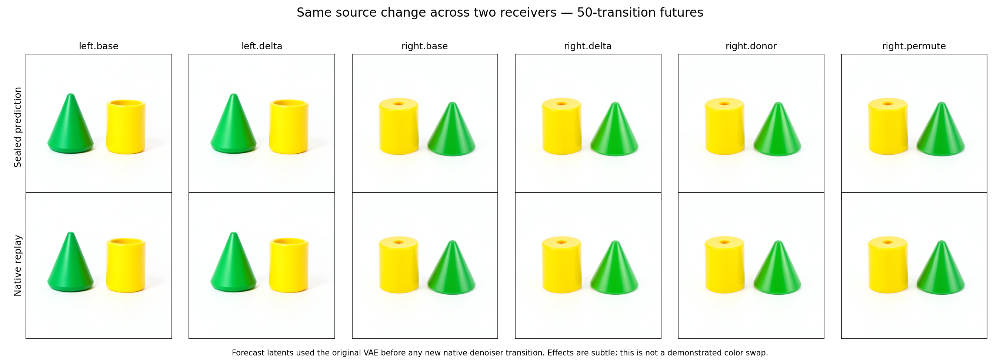

# A source change through two FLUX receivers

The fixed working-text change followed the predicted temporal path in both
receivers: an attention-mediated image write, a changed latent, and a later
attention read back into text. Thirty declared invariances were exact. Text
reset from unchanged conditioning, yet a text difference reappeared after the
next image read. This is evidence for persistent carrier transport across passes.

Six original-weight, fifty-transition futures were sealed before new native
denoising. Final latent relative RMS errors were 1.01–1.29%; signed latent-effect
errors were 23.25–23.50%. Predicted images closely match native replay, but the
interventions did **not** visibly swap the objects' colors. The supported family
is a conditional computation path, with semantic labels still unassigned.

The run is exploratory. Numerical discrepancies and ineffective interventions remain
evidence. The exact same-parent sham, source custody, forecast seals, and actual
execution census protect the instrument; image quality is not an execution gate.

## Specimen and observation boundary

The specimen is FLUX.2 Klein 4B distilled, seed 127, 512 × 512, four denoising
passes, batch one. The native backend is CUDA BF16. The source states were captured
by `job-95453050cf73` at logical step 2, immediately before single block 0, after
joint block 4. These are existing observed states, not new held-out prompts.

The four source contexts cross green/yellow assignment with left/right placement
of a cone and cylinder. Left and right receivers differ in their complete saved
state, including image, latent, and conditioning. This does not isolate image
receiving state alone.

Let `T00`, `T10`, `T01`, `T11` denote their full 512-row working-text states.
The fixed source change is

```text
delta = FP32(T10) - FP32(T00)
candidate(receiver) = round_BF16(FP32(T_receiver) + delta)
```

The seven branches are:

| Branch | Receiver | Text action |
|---|---|---|
| left.base | T00 context | unchanged |
| left.delta | T00 context | add delta |
| right.base | T01 context | unchanged |
| right.delta | T01 context | add the same delta |
| right.donor | T01 context | replace with T11 |
| right.permute | T01 context | add delta rolled by one text row |
| right.sham | T01 context | same-value replacement |

The donor arm is an explicit comparison. The delta itself is derived from two
observed contexts; this is not donor-free discovery from a raw prompt.
The original conditioning remains fixed even when working text is replaced.
Consequently, matching a color-source text state does not recreate that source's
complete natural trajectory or guarantee a full color swap in the final image.

## Prediction before native execution

A CPU-only mrun lease uses explicit NumPy equations, original checkpoint parameter
bits, FP64 arithmetic, and declared BF16 boundaries. It predicts six distinct
50-transition suffixes; the sham reuses the right baseline forecast. No fitted
response parameters or native module forwards are allowed. Each program is sealed
with MDB's `ForecastTransaction` before the complete cohort is published.
This still executes the denoiser's mathematical workload. Zero native forwards
does not mean zero neural arithmetic or a cheap prompt-to-image shortcut.

Each suffix contains step 2's twenty single blocks, readout and commit, then
step 3's projection, five joint blocks, twenty single blocks, readout and commit.
Every later mathematical transition consumes its own predicted state.

A separate resident CUDA lease verifies the sealed cohort. It renders all six
predicted terminal latents through the native VAE before any new native denoiser
transition. Derived terminal scaffolds come from observed project-0 origins;
they do not borrow unavailable future states. MDB then resumes all seven native
branches through `NativeCutNavigator.step()`.

The planned census is 300 mathematical transitions, 350 native transitions,
315 native transformer blocks, one model load, zero prompt encodes, zero noise
draws, eleven Acts, and thirteen VAE images. Rendering is a native consumer call;
the mathematical predictor is not a bit-exact emulator of CUDA GEMM or SDPA.

## What the port observations distinguish

Within each receiver, the first single block starts with identical image rows.
Its image-local normalization, QKV, and parallel MLP therefore remain identical
under a text-only change. Attention can read changed text K/V and change image
output. At the next single block that changed image can alter image-local MLP
operands. Single-block attention and MLP are parallel; joint-block attention
precedes the receiving MLP.

At the next pass's projection, unchanged conditioning rebuilds identical text
within each receiver pair. Any surviving intervention effect enters through the
previously updated latent and image projection. Joint block 0 can then read the
changed image K/V and write a new difference into text. Whether and how strongly
that survival occurs is measured, not assumed.

Schematically, the candidate carrier trajectory is

```text
delta T2 → attention(Q_image, K_text, V_text) → delta I2
         → readout → delta noise2 → scheduler commit → delta Z3
         → image projection → delta I3
         → attention(Q_text, K_image, V_image) → delta T3_after_joint0
```

The scheduler relation is `Z3 = Z2 + (sigma3 - sigma2) * noise2`, with the
implementation's specified rounding. Because `Z2` and the schedule are unchanged
within a receiver pair, a change in the predicted noise can carry the source
effect into the next pass. Meanwhile `T3 = project_text(conditioning)` rebuilds
the same text input within that pair. This is a concrete temporal dependency
map. It does not by itself assign a concept name to any tensor, prove that one
path carries the entire effect, or establish a portable semantic instruction.

Native ports are observation-only hooks. Complete output arrays are retained at
six landmarks: the first two single blocks, the first commit, the next projection,
the next joint block, and the terminal commit. Other exits retain full hashes,
moments and 64 fixed witnesses. Full-field error claims apply only at landmarks.

## Reproduce and inspect

Use the installed-wheel qualification environment and the matching original
source custody. `stage_flux_source_receiver.py` stages immutable request and
source payloads for `--phase forecast`, then `--phase native --forecast DIR`.
Submission is explicit via `--submit`; it uses one finite mrun lease per phase,
strict preflight and no automatic retry. Long CPU runs require the source-bound
review artifact named in the plan.

`recover_flux_directory.py` collects a completed worker directory with authenticated
custody. `analyze_flux_source_receiver.py FORECAST NATIVE OUTPUT` checks arrays,
seals, sham replay, locality, landmark errors and RGB contrasts without model
execution. `publish_flux_source_receiver.py` creates nine generic computation
records with exact applicability context and searchable evidence. A changed
horizon must abstain; publication is not automatic family discovery.

Artifacts include original parameter recipes and `retrieve_weights.py`. The
bounded reader verifies the original safetensors source and payload hashes and
retains at most 256 MiB of immutable raw BF16 bytes; no duplicate exported full
parameter bank is required. Expanded block-local arrays are temporary. Cache
qualification does not establish a real-model speedup.

## Measured temporal mechanism

| Native comparison within a receiver pair | Left | Right |
|---|---:|---:|
| First single image-local norm/QKV/parallel MLP | Exactly unchanged | Exactly unchanged |
| First single image attention change, RMS | 0.01377 | 0.01591 |
| Next single image MLP change, RMS | 0.00588 | 0.00706 |
| Next projection, complete text change | Exactly zero | Exactly zero |
| Next projection, complete image change, RMS | 0.00715 | 0.00654 |
| Next joint text norm/Q/K/V | Exactly unchanged | Exactly unchanged |
| Next joint text attention-head change, RMS | 0.00328 | 0.00336 |
| Next joint text MLP change, RMS | 0.01618 | 0.01624 |

The thirty exact comparisons comprise twenty first-single image-prefix/MLP
witness comparisons, eight later text-prefix witnesses, and two complete text
resets. Port measurements cover five image rows in the single blocks and four
text rows in the later joint block; complete projected text covers all 512 rows.
The table compares each port against its own baseline, not magnitudes across
different tensor spaces. Nonzero effects are observations, not calibrated
percentages of causal responsibility.

This connects the same mathematical laws to changing state. The first image MLP
cannot consume the changed text directly; its parallel attention branch can.
The next image MLP consumes the changed image. At the following pass, image K/V
can write into text even though text's own initial state has reset. The evidence
supports this route in two complete receiving contexts from one seed. It does
not establish a universal semantic program or isolate which receiver covariate
controls transfer.

## Predictions and retained misses

| Measurement | Left receiver | Right receiver |
|---|---:|---:|
| Final signed latent-effect relative RMS error | 23.25% | 23.50% |
| Final signed RGB-effect relative RMS error | 16.22% | 19.59% |
| Observed RGB-effect RMS, byte units | 2.747 | 2.622 |

Across all six distinct futures, final latent endpoint error is 1.01–1.29%.
RGB endpoint mean absolute error is 0.085–0.126 on the 0–255 scale. The
source-by-receiver RGB interaction error is 18.07% relative to the observed
interaction RMS. Endpoint error divides by predicted-state RMS; effect error
divides by observed changed-minus-baseline effect RMS. These are different claims.



The original cone remains green and cylinder yellow in the inspected images.
The native effects are subtle image differences. Their persistence is useful
mechanical evidence, but it does not name a reliable color-swap operation.

There are informative controls. Left addition exactly reconstructs the observed
left color-source text. The same addition on the right differs from the
contextual donor by 88.895 text RMS, or 36.93% of donor-text RMS. The resulting
native terminal latent effects have cosine 0.673, rather than being identical.
Actual rounded delta doses are 114.407/114.469 RMS in left/right receivers;
the rolled-row dose is 114.464 RMS. Despite similar dose size, the rolled
control's RGB effect has cosine 0.121 with the unrolled effect and RMS 1.156
versus 2.622. Thus source location matters to the future; equal energy is not
an explanation of the measured response. These are finite contrast statistics,
not semantic similarity measurements or a claim about arbitrary permutations.

Both known baseline PNGs reproduced exactly. The same-value sham preserves
the complete final payload and PNG exactly. The extra saved-only verifier checks
all 350 actual native exit clocks and all 361 unique receipt seals, separately
from the frozen numerical auditor. No numerical forecasts were changed after
native execution.

## Searchable computation records

Nine occurrences retain six terminal predictions, two source-response effects,
and one receiver interaction. Their three generic law IDs are
`law.flux.complete-suffix.v1`, `law.flux.conditional-source-response.v1`, and
`law.flux.source-receiver-interaction.v1`. All nine exact queries resolve; all
nine changed-horizon queries abstain. Applicability is supplied from the bound
specimen, parents, clock and horizon; it is not inferred generalization.

From `artifacts/mdb-flux-source-receiver-20261105/`, using the matching installed
MDB wheel:

```bash
python -I native-02/payload/analyze_flux_source_receiver.py \
  forecast-collection-01/extracted/binding-minimal-result \
  native-collection-01/extracted/binding-minimal-result audit-recheck.json
python -m mdb equations find --catalog public-records-v1/equations \
  --applicable-to public-records-v1/context-right-effect.json
python -m mdb equations find --catalog public-records-v1/equations \
  --applicable-to public-records-v1/context-wrong-horizon.json
```

The first query returns the conditional source-response occurrence; the second
returns `[]`. Actual CLI outputs are retained. The record keeps prediction
errors and counterexamples; a catalog hit is not a quality certificate.

## Execution, recovery and custody

The original mathematical job, `job-9877d6c5292c`, completed all 300 transitions
and six seals, then failed while JSON-serializing the immutable cohort mappings.
Runner elapsed time was 914.08s, peak RSS 3209.1MB, VRAM zero. The original
failed directory and scheduler logs remain unchanged. Metadata-only recovery
`job-c63fc7cf3ca3` verified its inventory, transaction seals, declared shapes and
every referenced array, then published the unchanged predictions in 2.76 worker
seconds. It performed zero new mathematical transitions or model executions.
The recovered summary distinguishes inherited work from new work. Original
cache counters were not published and are not reconstructed as measurements.

Two earlier startup attempts failed before any mathematics because the CPU
launch omitted empty `CUDA_VISIBLE_DEVICES`; an accidentally duplicated
submission is preserved too. The first metadata recovery exposed tuple/list
shape comparison in immutable descriptors. The fixes now pass eleven focused
installed-wheel tests, including a genuine public transaction seal/reload/write/
array round trip. Future array writers include shape in their content address;
legacy views permit only the same verified BF16 bit sequence. This cohort had
zero physical/logical view aliases. None of these repairs regenerated a forecast
or consumed a new target.

Native job `job-3272cb7fc922` completed in 172.79 runner seconds, with 5662.8MB
peak RSS and 9138MB peak VRAM. Its one resident load executed all seven branches,
350 transitions, 315 original blocks, eleven Acts, 361 receipts and thirteen VAE
calls/images. The first six images preceded every new native transformer call.
Both leases bind original checkpoint/source identities and frozen requests.
The queued-only larger GPU request was canceled before replacement with the
same scientific payload and a smaller calibrated reservation.

Custody verified 394 forecast files totaling 325,272,070 bytes, and 946 native
files totaling 539,942,436 bytes. Their compressed archives total 680,533,527
bytes. Local retention is about 2.2GiB including extracted data, custody archives,
transport logs and staging; no persistent 7.751GB parameter bank was added.
Original weight recipes and the standalone retriever remain included.

The local campaign root contains `audit-v1.json`,
`clock-receipt-verification-v1.json`, `controls-analysis-v1.json`, original
requests/reviews, separate scheduler-publication joins, and searchable records.
The frozen numerical auditor is saved-only; it does not independently recompute
all 300 mathematical transitions. Saturn evidence-plane run/verify return zero
with timeline-only scope. They do not certify the semantic interpretation.
Terminal status remains unassessed.

## Next causal cut

Restore baseline latent at the first commit, keeping the original conditioning
and all subsequent execution fixed. Freeze the prediction that both the next
image difference and reintroduced text difference disappear. This directly
tests the proposed persistent-carrier bottleneck in the native consumer. Then
split the changed first attention read into text-key and text-value contributions
from matched operands. That distinguishes source addressing from transported
content before broadening the record across fresh seeds or assigning concept names.

The [latent/reader follow-up](FLUX-LATENT-READER.md) now completes that cut:
latent restoration and transplantation replay exact futures, and image K/V
reproduce the later text exit exactly. Split K/V futures reveal a value-aligned
image response in both contexts, while small signed text-effect forecasts remain
inaccurate despite low full-state error. The numerical limit is retained.
