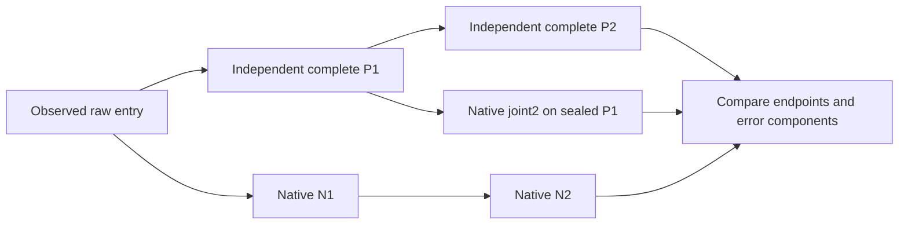

# Complete image and text predictions through two FLUX blocks

We now predict both complete working streams through FLUX.2 Klein4B joint1 and
joint2. Joint2's forecast consumes the independently predicted joint1 image
**and** text, with no observed-state refresh. A native second-block consumer
also ran on exactly that sealed predicted state through MDB forks and typed
Acts. The complete-state and lineage audit passed.

After two blocks, image-state relative RMS error is 0.486–0.491%; text-state
error is 0.144–0.155%. Smaller case-minus-base effects have substantially larger
errors, 13.8–28.1%. This is a measured numerical continuation of a specified
component, not exact execution or complete prompt/image prediction.

## What advanced

The [previous attention study](FLUX-ATTENTION-STATE-LAW.md) followed 32 image
queries and all keys, then predicted their image exits. Its state could not
enter the next block because most image exits and all text exits were missing.
This run computes every query, key and value, both attention output projections,
both receiving normalizations, both MLPs, and both complete residual exits.

The standalone mutable closure is:

\[
S=(I,T,\mathrm{imageMod},\mathrm{textMod},\cos,\sin,\mathrm{clock}),
\]

where \(I\) has shape `[1,1024,3072]` and \(T\) has shape `[1,512,3072]`.
Position and time-modulation context stays fixed across these two joint blocks;
the clock advances. Latent/scheduler/conditioning state is outside this
component contract because neither native block reads it. Full-pipeline cuts
remain distinct from these component cuts.

The three inputs are base text \(T_0\), a **new** quarter mixture
\(B(0.75T_0+0.25T_1)\), and the known midpoint \(B(0.5T_0+0.5T_1)\), with
identical incoming image/context. Base and midpoint were previously executed
by the single-block study. Their native joint1 image/text payloads reproduce
exactly in this run, despite distinct component-cut contracts. The quarter
mixture is a fresh internal state, not a new natural prompt or independent seed.

## Two predicted transitions before native execution

With \(\widehat F_i\) denoting the independent NumPy implementation and
\(F_i\) the original native block:

\[
P_1=\widehat F_1(S),\qquad P_2=\widehat F_2(P_1).
\]

Six complete-state forecasts, three per block, were sealed before the first
native block. Every parameter is an original checkpoint tensor. No coefficients
were fitted. NumPy uses FP64 reductions with explicit BF16 rounding boundaries
and the original positional arithmetic conventions. It still differs
numerically from native CPU BF16 kernels.

All 1536 queries read all 1536 keys/values. Row chunks of 64 bound temporary
workspace; they do not remove keys or truncate context. Only one block's FP32
parameter expansion is resident at a time beside the fixed native BF16
two-block component. This fits mrun's automatic 4GB CPU reservation.

Native validation computes:

\[
N_1=F_1(S),\qquad N_2=F_2(N_1).
\]

MDB then forks each immutable \(N_1\) cut, replaces both entire streams with
their sealed \(P_1\) counterparts using two typed Acts, and computes:

\[
C_2=F_2(P_1).
\]

The fork supplies lineage at the correct clock. The audit verifies that its
complete consumed image/text equal the sealed prediction and that the
unchanged context/clock match the declared source. The forecast \(P_2\) never
consumes \(N_1\) or \(C_2\); those outputs did not exist when it was sealed.



## Complete-state accuracy

Each image comparison covers 3,145,728 scalars; each text comparison covers
1,572,864. Relative RMS here divides error RMS by sealed prediction RMS.

| Case | Joint1 image | Joint1 text | Two-block image | Two-block text |
|---|---:|---:|---:|---:|
| Base |0.21215%|0.06251%|0.48872%|0.15285%|
| New quarter |0.20609%|0.06996%|0.48642%|0.15456%|
| Known midpoint |0.20840%|0.06772%|0.49134%|0.14410%|

The two-block image maximum absolute discrepancy is 0.5. Text maximum
discrepancy is 16 in base and 8 in the other two cases. The full errors and
changed-coordinate counts are retained. CPU results do not establish CUDA
parity, RGB fidelity, or semantic correctness.

A close endpoint is not an equally close prediction of a small difference:

| Case-minus-base change | Joint1 image error / observed effect RMS | Joint1 text | Joint2 image | Joint2 text |
|---|---:|---:|---:|---:|
| Quarter |18.579%|19.250%|27.583%|28.063%|
| Midpoint |10.524%|9.517%|14.829%|13.804%|

The earlier 32-row midpoint image-effect error was 7.86%; the complete-row
measurement here is 10.52% at joint1. Broader coverage changes the denominator
and exposes additional discrepancies. Neither value should replace the other
or be presented as a universal accuracy number.

Saved-only direction checks tell the same qualified story. After joint2,
predicted/observed effect-vector cosines are 0.960–0.962 for quarter and
0.989–0.990 for midpoint. Strict per-coordinate negative/zero/positive agreement
is only 69.4–75.9% for image state and 83.4–89.4% for text. Full three-way
confusion matrices, including exact-zero disagreements, are retained in
`effect-geometry-v2.json`. These are array diagnostics, not semantic decisions.

## Where continuation error comes from

The native predicted-input branch distinguishes inherited-state discrepancy
from the second forecast's own-input arithmetic discrepancy:

\[
\underbrace{N_2-P_2}_{\text{total error}}=
\underbrace{C_2-P_2}_{\text{joint2 own-input arithmetic}}+
\underbrace{N_2-C_2}_{\text{native propagation of joint1 input error}}.
\]

This signed identity closes exactly across all 4,718,592 image/text scalars
in every case. It explains how the measured error is composed; the identity
itself does not certify forecast accuracy.

For base:

| Stream | Total error RMS | Own-input arithmetic RMS | Propagated joint-input discrepancy RMS | Component cosine |
|---|---:|---:|---:|---:|
| Image |0.007081|0.004115|0.007096|−0.2936|
| Text |0.035991|0.025965|0.038161|−0.4214|

The contributions partly cancel. Across the three cases, image cosines are
about −0.29; text cosines range from −0.28 to −0.42. Norms do not add, and a
short chain's small net error is not evidence that every operation is exact.
These are controlled numerical comparisons in the original consumer, not
object-level causal attributions.

The propagation term includes discrepancies in both incoming streams. This
run does not distinguish image-origin from text-origin contributions. It also
does not establish active semantic repair: opposing numerical errors can
reduce a final residual without implementing a behavioral correction.

## The mathematical law is shared, the state and binding change

Both streams follow a fixed form: normalization/modulation, original Q/K/V
projections and positioning, joint softmax/value read, output projection,
time-gated residual addition, receiving normalization, SwiGLU and another
time-gated residual addition. Their matrix bindings differ, as do the
parameters between joint1 and joint2.

The first block writes both streams. Those writes determine the next block's
queries, keys, values and MLP coefficients. This closes the earlier
image-only observation gap and makes the dynamic dependency explicit. It does
not assign meanings to particular heads or tensor coordinates. The architecture
is known; the new evidence is the frozen state-specific forecast, measured
continuation, and the separation of its numerical discrepancies.

The next useful cut is a four-corner second-block input panel: native/native
streams, predicted-image/native-text, native-image/predicted-text, and both
predicted. Freeze both forecast and consumer predictions first. That separates
the stream contributions and their interaction before merely making the chain
longer. Fresh prompt/seed contexts can then test whether particular routing and
MLP response patterns deserve reusable family records.

## MDB records and reproducible workflow

Nine measured occurrences are indexed in `public-records-v1/equations/`:
three complete joint1 predictions, three end-to-end two-block predictions and
three native own-input joint2 comparisons. IDs are generic:
`law.flux.joint-state.v1` and `law.flux.joint-state-chain.v1`. Records bind the
exact checkpoint, CPU profile, raw/predicted frontier, input cut, clock,
complete shapes, consumers and signed errors. All nine exact-context queries
resolve; nine changed-backend and nine changed-step queries abstain. Conditions
are supplied predicates, not learned semantic applicability rules.

The actual native path used public Saturn `Session`, MDB
`NativeCutNavigator`, immutable `LocalStore` cuts, three forks, six typed
`Act.replace` operations and 15 verified unique receipts. Port hooks observe
native values and return them unchanged. Nine steps each join 24 declared
ports: complete image/text returns plus 32-image/16-text intermediate
witnesses. Observed residual/write composition is exact on the witnesses in
both streams. Complete intermediate coverage or ATen/SSA replay is not claimed;
the native RMSNorm temporary-alias recorder gap remains.

From artifact root `artifacts/mdb-flux-state-closure-20261105/`:

```bash
# Saved-only independent audit; output is exclusive and no model runs.
python -I audit-sources-v2/analyze_flux_state_closure.py collection-01 audit-recheck.json

# Search complete two-block occurrences or one exact predicted-input context.
python -m mdb equations find --catalog public-records-v1/equations \
  --law-id law.flux.joint-state-chain.v1
python -m mdb equations find --catalog public-records-v1/equations \
  --applicable-to public-records-v1/context-predicted-input-quarter-j2.json
```

The qualification scripts are `flux_state_closure.py` (math/stage/submit),
`flux_state_closure_campaign.py` (native/fork worker),
`analyze_flux_state_closure.py` (saved-only audit), and
`publish_flux_state_closure.py` (searchable occurrences).
`analyze_flux_state_effects.py` reproduces the full-coordinate effect-direction
diagnostics without new model work.

## Evidence and resources

Job `job-d07bd1c3fcbd` executed one original two-block component load, six NumPy
forecasts, nine native block calls, 108 native linears, nine image MLPs and nine
text MLPs. There were zero full-pipeline forwards, encoder calls, images or
noise draws. Worker duration was 276.20s; runner duration 443.42s; peak RSS
3770.8MB and VRAM zero. The 4GB automatic reservation was enforced by Linux
cgroups. No model retries or duplicate full suites ran.

The original output is 362,430,145 bytes across 157 files. The authenticated
archive is 246,813,151 bytes. Sealed block forecasts are separate bundles;
complete native exits live once in typed CAS state, while NPZ archives store
only intermediate witnesses. Thirty-two parameter recipes and a standalone
`retrieve_weights.py` recover the original checkpoint tensors when needed;
there is no new persistent parameter bank.

The prospective plan, request, frozen audit sources, complete collection,
`audit-v1.json`, `cross-run-native-joins-v1.json`, and publication are retained.
Audit-source v2 adds explicit distinct-case/unique-receipt checks before target
inspection; v1 remains preserved. A collection request issued just after native
publication was refused before creating output because mrun was still
finalizing. The same unchanged directory was collected after terminal success,
without a model rerun. Ten focused arithmetic and tiny-component tests passed,
including both-stream nonzero attention and MLP checks.

The standard Saturn evidence-plane `run` and `verify` sweeps both return zero
with `target-streams-only` scope. They check the 16-row timeline with 17 adapted
predicates; they ingest no claim receipts and discover no `ar://` references
from these MDB formats. This qualifies timeline mechanics, while the dedicated
auditor verifies native ports/state/forks. Automatic format integration into
the claims/address plane remains a recorded tooling gap.
