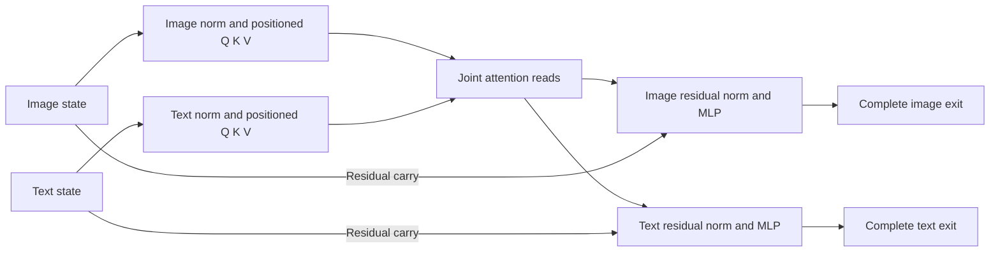

# Where image and text state changes meet

The same-parent joint2 factorial locates reciprocal image/text communication at
the native attention read. All 48 sampled normalization/Q/K/V locality
predictions were exact; cross-stream differences first appeared in head
returns. Both receiving MLPs then consumed the changed reads. Known endpoints
replayed exactly across runs, so the controlled numerical effects reproduce.

The numerical forecasts have an important limit. Complete outputs remain close
to native CPU BF16, but the **small restoration effects** are predicted poorly:
81–133% error relative to measured effect RMS. This experiment strengthens the
causal dependency map while exposing a precision-sensitive gap in the current
independent arithmetic. It does not establish reliable micro-effect prediction.

## Four corners from each immutable parent

The [complete-state study](FLUX-STATE-CLOSURE.md) produced observed joint1 state
\(N_1\) and sealed independent prediction \(P_1\). Its native joint2
continuation differed when consuming \(P_1\). The new experiment separates the
two incoming discrepancies:

| Corner | Image input | Text input | Status before this run |
|---|---|---|---|
| 00 | Native \(N_{1,I}\) | Native \(N_{1,T}\) | Known calibration endpoint |
| 10 | Predicted \(P_{1,I}\) | Native \(N_{1,T}\) | New mixed state |
| 01 | Native \(N_{1,I}\) | Predicted \(P_{1,T}\) | New mixed state |
| 11 | Predicted \(P_{1,I}\) | Predicted \(P_{1,T}\) | Known calibration endpoint |

Three parent contexts—base, quarter and midpoint—give twelve corners, including
six new mixed states. They are related internal contexts from one original
prompt/seed, not independent prompts or seeds. The frontier is **observed
joint2 entry**; this assay does not predict its upstream prefix.

Every branch starts from the same immutable parent for its context. Clock,
position and time modulation match. MDB forks each parent; 00 includes a
same-value image replacement sham, 10/01 replace one stream, and 11 replaces
both. Fifteen typed Acts, twelve native continuation steps and 27 unique
receipts are verified. The original joint2 runs unchanged on CPU BF16.

Twelve full original-weight NumPy forecasts were sealed before any current
native call. The forecaster receives the declared native/predicted joint1
inputs. Prior joint2 calibration outputs contribute only metadata descriptors;
their numerical returns are not forecast operands. No coefficients were fitted.

## The computational boundary is visible

Each stream first normalizes/modulates its own residual and constructs its own
positioned Q/K/V. For fixed context:

\[
(Q_I,K_I,V_I)=G_I(I),\qquad (Q_T,K_T,V_T)=G_T(T).
\]

Attention then reads the concatenated streams:

\[
H_I=\operatorname{Attention}(Q_I,[K_T,K_I],[V_T,V_I]),
\]
\[
H_T=\operatorname{Attention}(Q_T,[K_T,K_I],[V_T,V_I]).
\]

Changing text therefore leaves the image prefix identical while potentially
changing its read through text K/V. Changing image leaves the text prefix
identical while potentially changing its read through image K/V. Position and
modulation are held fixed, and query rows do not mix with other query rows.

All 48 declared comparisons of sampled norm/Q/K/V ports were exact: image
prefixes matched 00↔01 and 10↔11, and text prefixes matched 00↔10 and 01↔11.
All six cross-stream directions showed nonzero sampled head changes. For base:

| Changed source → receiving stream | Receiving norm/Q/K/V change | Head RMS change | Attention projection RMS change | Receiving MLP RMS change |
|---|---|---:|---:|---:|
| Text → image | Exactly zero |0.001930|0.006229|0.002831|
| Image → text | Exactly zero |0.001562|0.006072|0.011152|

These intermediate measurements cover the fixed 32 image and 16 text witness
rows. Complete exits cover every row: image `[1,1024,3072]` and text
`[1,512,3072]`. The known architecture supplies the operator dependency; the
interventions connect that dependency to this specimen's actual native writes.



## The interaction cannot be omitted

For a port or complete return \(F_{ab}\), define:

\[
E_I=F_{10}-F_{00},\quad E_T=F_{01}-F_{00},\quad
E_{IT}=F_{11}-F_{10}-F_{01}+F_{00}.
\]

Then \(F_{11}-F_{00}=E_I+E_T+E_{IT}\). This signed identity closes exactly
on all saved native ports and complete returns. For the base context:

| Output | Image-only effect RMS | Text-only effect RMS | Interaction RMS | Joint effect RMS |
|---|---:|---:|---:|---:|
| Image state |0.006990|0.004307|0.005861|0.007096|
| Text state |0.018838|0.038098|0.027537|0.038161|

The pattern recurs in these three related contexts: image-only perturbation
has the larger single-stream effect on image output, while text-only has the
larger single-stream effect on text output. The other stream still matters.
Own-stream effects include the direct residual carry; this ordering does not
show that attention preferentially reads its own stream.
Interaction RMS is 0.826–0.842 times joint-effect RMS for image and 0.722–0.826
for text. Those ratios compare norms; they are not percentages of causal
responsibility. Directions can cancel, and the decomposition is baseline
dependent.

This is a finite BF16 factorial. Nonadditivity can arise from joint attention,
state-dependent normalization/MLPs and rounding. It does not by itself identify
a semantic conjunction, an object concept or an active repair process.

## A close endpoint can hide a poor effect prediction

| Measurement over twelve corners | Image output | Text output |
|---|---:|---:|
| Endpoint relative RMS error |0.2812–0.2855%|0.0854–0.1103%|
| Restoration-effect relative error |81.3–129.2%|83.2–132.8%|

Endpoint relative error divides native-minus-predicted RMS by prediction RMS.
Effect error divides the predicted/observed effect discrepancy by the observed
effect RMS, separately for image-only, text-only, interaction and joint terms.
Both measurements are retained. The endpoint metric does not certify that a
small signed response is faithfully predicted.

For base image output, endpoint arithmetic discrepancy is about 0.0041 RMS,
while the native text-only effect is 0.0043 RMS. Subtraction exposes a response
on the scale of the arithmetic discrepancy itself. That scale comparison
explains why the two accuracy statements can coexist; it does not remove the
miss or establish the precise source of the discrepancy.

The witnessed prefix shows where the discrepancy grows. For own-stream
Q/K/V changes, relative effect errors are about 0.5–5.1%; at head returns,
the nonzero single-stream effect errors range from 40.7% to 105.6%. Subsequent
projection, receiving normalization and MLP can enlarge them further. This is
the first large deterioration among the measured stages, not proof of one
specific internal kernel cause. The preceding Q/K/V predictions also differ.

The six known 00/11 endpoints reproduced **all 144 port descriptors exactly**,
including the full image/text exits. The three same-value shams preserved their
entire input payloads. Native effects therefore reproduce under this profile;
they cannot be dismissed as unrepeatable cross-run noise. The independent
FP64-plus-rounding implementation still needs a more precise numerical account
at this effect scale.

The next cut is an **exact-operand attention test**: capture complete native
positioned keys/values and selected queries, freeze an independent head-return
forecast from those declared operands, then run the same native attention
consumer. Compare both outputs and corner effects. That separates upstream
Q/K/V forecast discrepancy from attention's own numerical discrepancy. Replaying
the resulting head return through the receiving projection/MLP then localizes
the remaining error. Such forecasts start at an observed Q/K/V frontier; they
must remain distinct from raw-state forecasts.

The later [source-by-receiver campaign](FLUX-SOURCE-RECEIVER.md) follows a
larger natural working-text contrast across fifty transitions and the next
denoising pass. It verifies text-to-image-to-latent-to-text transport in two
contexts and retains 23% signed latent-effect prediction errors. That result
adds a temporal mechanism; it does not resolve this CPU micro-effect precision
gap or establish a portable semantic color operation.

## What goes into the symbol table

The supported structural record is a stream-local prefix feeding a joint read
and two receiving state updates. Its binding includes the original parameters,
parent state, physical clock, CPU BF16 profile, sampled ports and complete
consumers. The law is known architecture; the new evidence is its same-parent
causal execution on six mixed states, the exact structural predictions and
the retained numerical counterexamples.

Fifteen occurrences are indexed in `public-records-v1/equations/`: twelve
corner forecasts under `law.flux.joint-state.v1` and three complete-exit
factorials under `law.flux.image-text-factorial.v1`. The factorial records
retain the inaccurate small-effect predictions as well as the native effects.
All fifteen exact-context queries resolve; fifteen changed-backend and fifteen
changed-block queries abstain. Predicate matching is not a prediction-quality
certificate or automatic family discovery.

From artifact root `artifacts/mdb-flux-stream-factorial-20261105/`:

```bash
python -I audit-sources-v1/analyze_flux_stream_factorial.py collection-01 audit-recheck.json
python -m mdb equations find --catalog public-records-v1/equations \
  --law-id law.flux.image-text-factorial.v1
python -m mdb equations find --catalog public-records-v1/equations \
  --applicable-to public-records-v1/context-base-10.json
```

The audit is saved-only and writes a new exclusive report. The worker uses
public Saturn `Session`, `LocalStore`, `Act.replace` and MDB
`NativeCutNavigator`. The new reusable `flux_native_joint_ports.py` observer
captures the unchanged original module and attention-dispatcher ports. Its tiny
native test verifies equal outputs with and without observation and restoration
of the dispatcher. This is port capture; the RMSNorm temporary-alias limitation
still prevents a full ATen/SSA replay claim.

## Provenance and resources

Job `job-8367b9ecabe1`, request
`c5b9378df22896d76cbf63bb7be029225c8949c753594e2d6702f278adbff008`, loaded one
original joint2 component and executed twelve complete native blocks, 144
linears and twelve native SDPA/image-MLP/text-MLP calls. It generated zero full
pipeline forwards, encodes, images or noise draws. Worker time was 172.03s;
runner time 224.52s; peak RSS 3922.7MB and VRAM zero, within mrun's automatic
4GB CPU reservation. It waited for available CPU slots and did not duplicate
or interrupt other jobs. No model retries ran.

Source cuts and the previous forecast seal are read from the exact declared
host-local completed directory. Their file manifest, transaction, cut hashes,
payloads and predicted input byte hashes are verified; the complete imported
source states are also retained in the new typed CAS. The old two-block cut and
new single-block cut have explicit different contracts; projection changes the
component ordinal while preserving the physical joint2 clock.

The accepted archive is 385,442,867 bytes, expanding to 593,649,997 bytes across
211 files. Sixteen original checkpoint parameter recipes and a standalone
retriever are included; no persistent weight bank is added. The independent
auditor was frozen before target inspection and verifies 288 port joins,
27 unique receipts, source projections, all declared writes and full custody.
Seven focused factorial, observer and complete-state mechanics tests passed.

Qualification code: `flux_stream_factorial.py` (stage/math/submit),
`flux_stream_factorial_campaign.py` (native panel),
`flux_native_joint_ports.py` (reusable observer),
`analyze_flux_stream_factorial.py` (saved-only audit), and
`publish_flux_stream_factorial.py` (searchable records). The artifact root
contains the prospective plan, immutable run/collection, frozen auditor,
`audit-v1.json` and publication. Numerical outcomes remain observations;
terminal status is unassessed.

The standard Saturn evidence-plane `run` and `verify` sweeps return zero with
timeline-only scope. They do not ingest these MDB port/equation records as
semantic claims. The dedicated saved-only audit provides the state, port,
source and custody joins described above.
