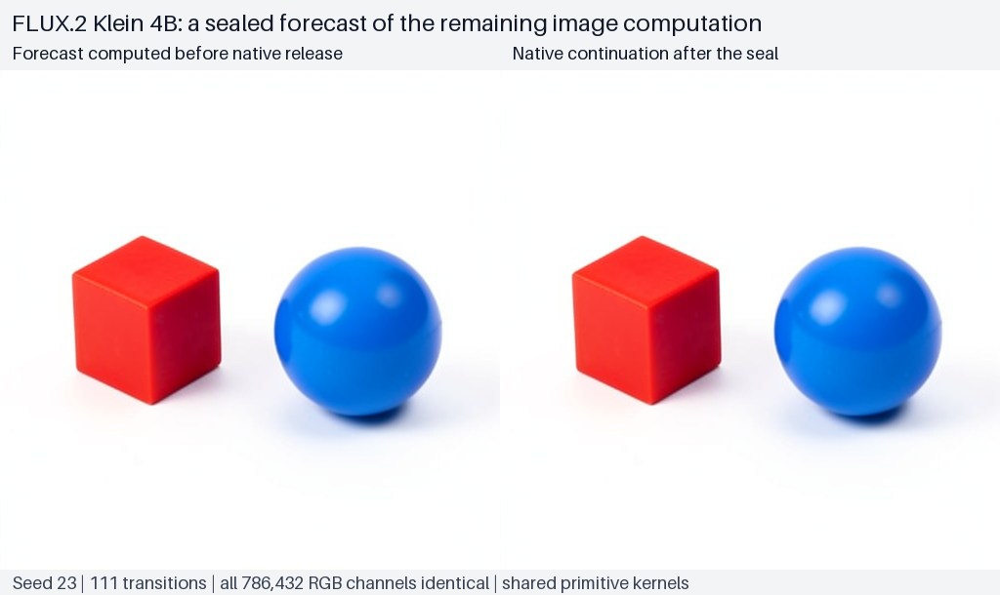
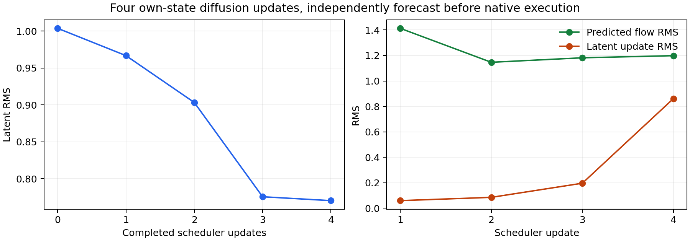

# Predicting a diffusion continuation through the rendered image

This experiment extends the [single-MLP forecast](FLUX-MLP-COMPUTATION-FORECASTS.md) to a complete numerical continuation from one observed state through RGB. One declared initial frontier supplies the prompt conditioning, initial latent, first input projections and timestep context. A separately wired functional implementation predicts all remaining transformer transitions, subsequent timestep projections, deterministic Euler updates and VAE decoding. Every later computation consumes the preceding predicted state. The predicted trajectory and image are sealed before native continuation begins.

The completed numerical comparison matches exactly for this finite case: 111 ordered transitions, 228 corresponding tensor-content hashes, every saved witness, eight full readout/scheduler arrays, raw decoded RGB and all 786,432 final uint8 channels. Forecast and native PNG bytes are identical. The scheduler job remains **failed** because summary serialization failed after the observations were durably stored; the independent offline audit recovered the numerical result without rerunning the model or rewriting that failure.

The model is the same frozen distilled FLUX.2 Klein 4B checkpoint, file-map SHA256 `dd976d67036c4a0a55642f702dcb3740ba7a4f367557596572baac168330904f`. The prompt again requests a red cube to the left of a blue sphere on a white background. Seed **23** is fresh relative to the earlier seed-17 image panel. The profile remains batch one, 512 × 512, four diffusion steps, guidance 1, CUDA BF16, deterministic execution and no reference images or adapters.

## Coverage and implementation independence

| Account | Supplied initial information | Independently calculated horizon |
|---|---|---|
| R3 ISA raw-input account | Instruction bytes, architectural state and full weights | Complete forwards and bounded instruction continuations |
| Qwen last-layer account | Observed residual and suffix/readout weights | Final MLP through first-token vocabulary logits |
| Original FLUX NumPy account | Observed MLP input, residual, gate and selected weights | One local MLP/write/residual update |
| This functional FLUX experiment | Observed typed frontier before joint block zero and full frozen weights | All remaining denoiser steps, scheduler updates and VAE pixels |

The functional implementation reads supplied parameter storage and uses explicit linear maps, normalization, rotary transforms, attention, nonlinearities, residual additions, convolutions, upsampling and pixel conversion. It calls no native module forward, adapter transition, scheduler step, pipeline unpack helper or VAE decode method while predicting. PyTorch CUDA primitive kernels are shared with the native reference. This tests independently wired control and data flow using the same arithmetic backend; the earlier NumPy FP64 comparison remains a separate arithmetic check. The implementation evaluates the model's full learned mathematics and makes no compression or speed claim.

The native text encoder and first projection/context are observations. Later attention states, time embeddings, modulation gates, input projections and latents are computed by the functional graph. The prediction does not start from raw prompt tokens. Its semantic interpretation remains separate from the numerical question of whether the computed states and pixels match.

The predicted image necessarily includes its visible objects, appearance and arrangement at the pixel level. Informal assistant visual inspection sees the red cube left of the blue sphere in both identical images. Explicit latent bindings for named objects or relations have not been established. Predicting the complete image is broader numerical coverage than forecasting one MLP, while discovering a reusable object program remains a different question.

## Execution contract

The public Saturn adapter captures an immutable typed parent before step-zero joint block zero. A global Torch module prehook allows the declared prefix, forbids all module calls during functional prediction, and counts the later native comparison. Full transformer/VAE parameter and buffer identities are checked before prediction, at release and after native continuation, including registration, storage, versions and byte hashes.

From this parent, four steps of five joint and twenty single blocks require **111 transitions**: four times project + 25 blocks + readout + scheduler, with the already observed first projection omitted. Each boundary records its step, phase and cursor. The functional graph recomputes later projections and contexts from its own latent state. The VAE then predicts decoder input, decoded floating-point RGB and the final uint8 image.

MDB `ForecastTransaction` publishes the ordered numerical records and image, then seals them globally. Separate native-module hooks guard the external CUDA model; this transaction is not bound to a copied full model. The callback is trusted Python. Hooks are instrumentation rather than an operating-system sandbox.

After sealing, the native adapter starts from its unchanged parent and consumes its own states for all 111 transitions. No predicted payload is installed. Each boundary is compared with the corresponding frozen prediction. Native VAE hooks capture decoder input/output, and final pixels are compared with the sealed forecast image. There are no donors or intervention arms in this assay.

## Evidence and numerical observations

Every predicted boundary's full immutable CPU values remain in memory through comparison. Sealed records retain descriptors, hashes and up to 4,096 deterministic witness values per tensor. Full denoiser readouts, scheduler latents, decoder output and final pixels are retained for offline comparison. Selected intermediate witnesses make the full-array storage cost explicit and keep artifact transport bounded.

Worker-side comparisons can calculate full-array intermediate errors against the frozen RAM cache. An offline auditor can independently recompute witness errors and complete errors at the retained endpoints. It cannot recompute every intermediate full-array aggregate after the RAM cache has been released. VAE evidence covers decoder input/output and final pixels, rather than every internal decoder operation.

Numerical differences, their first occurrence, signed effects, maxima, relative norms, timestep trajectories and pixel errors remain observations. Their magnitude does not independently stop collection. Identity, finite-value, shape, ordering, exclusion and custody checks protect the execution record.

## Completed comparison and publication recovery

The real execution is `run-03`, job `job-898a27a308ae`. It completed all 111 predicted transitions before the seal and all 111 native transitions afterward. Native comparison counted 100 transformer-block entries and one VAE decoder entry. During prediction, native module-entry counts were zero. The allowed prefix's 565 module entries are recorded separately; the initial frontier was observed, not independently predicted.

| Retained evidence | Offline comparison |
|---|---|
| 226 transition tensors and two VAE tensors | All 228 content-hash pairs agree; deterministic witnesses have zero error. |
| Four denoiser readouts and four scheduler latents | Full arrays retained and recomputed with zero error. |
| Raw VAE decoder output | Full array retained and recomputed with zero error. |
| Decoder input | Content hash and saved witnesses agree; full bytes were not retained offline. |
| Final 512 × 512 RGB | All 786,432 channels agree; maximum error zero; PNG files are byte-identical. |

Worker-side full-array comparisons against the immutable RAM cache also report zero error at every intermediate. The offline audit retains those metrics with their authority identified, rather than claiming to recompute unavailable full arrays. The final pixel SHA256 is `99b72c564fdc85ac1253294823265ba916ccd26797603d254b8ed70f20b27592`; both PNG files have SHA256 `c5e40266800935818c6f4cd07dd6ddbab77c35b1e58463a741e03e7e5b4635dc`.



The [figure manifest](../../../../artifacts/mdb-flux-trajectory-20261030/figures.json) binds the original forecast/native PNGs and the separately derived state-walk visualization. The two displayed images are one predicted/native pair, not two independent specimens.

After native decoding, the worker verified unchanged parameter/buffer hashes and the complete public transaction. It then failed while writing `summary.json`: a read-only `mappingproxy` returned by the transaction was not JSON serializable. The raw summary is truncated; no raw file manifest or transaction report was published. The failed archive nevertheless retains the source, initial typed parent, all forecast/native observations, PNGs, three weight-check files and closed transaction receipts.

The saved-array auditor first verifies that failed archive against the collector/request and staged source, then verifies the seal and phase chain. It reconstructs reporting metadata from the durable transaction and request-bound plan. The [independent audit](../../../../artifacts/mdb-flux-trajectory-20261030/run-03/analysis-v1.json), [derived summary](../../../../artifacts/mdb-flux-trajectory-20261030/run-03/derived/summary.json) and [recovery receipt](../../../../artifacts/mdb-flux-trajectory-20261030/run-03/derived/recovery-receipt.json) record `scheduler_status: failed`, `publication_status: failed-summary-serialization` and completed, independently audited observations. The raw partial summary and failure remain unchanged. No new model calls or functional-predictor evaluations were needed for recovery.

The [portable result](../qualification/flux-trajectory-forecast-20261030.json) binds the original executed worker SHA256 `71f62a71dc31122bb8b0071654ade64b6dbf1fd015a92b6c64d81a7ae36945f2`, the functional implementations and the failed archive. Current worker changes repair future reporting only; they did not execute this scientific case. Two preceding attempts stopped at admission without creating scheduler jobs or calling the model. Generalized history produced a VRAM ceiling above the host limit; the admitted measured exception declares 32,000 MB RAM, 13,000 MB VRAM and four CPUs. These attempts remain in the provenance.

The separate [offline evidence sweep](../../../../artifacts/mdb-flux-trajectory-20261030/evidence-v2/checksums.json) checks 114 derived numerical-stream rows: 111 transitions and three VAE/RGB endpoints. Run and verification return zero. This checks saved stream mechanics and bindings; it adds no model execution, independent-kernel replication or semantic certification. The preceding metadata-key-only sweep remains preserved separately.

## Walking the four predicted latent updates

The [state walk](../../../../artifacts/mdb-flux-trajectory-20261030/state-walk.json) summarizes the already sealed full readout and latent arrays. The flow update is produced by all transformer blocks at that timestep. The Euler scheduler combines it with the current latent using the supplied sigma interval and declared BF16 casts. The next timestep consumes the resulting predicted latent. Native comparison matches every retained latent exactly.

| Step | Sigma interval | Latent RMS before | Flow RMS | Stored latent-change RMS | Latent RMS after |
|---|---|---:|---:|---:|---:|
| 0 | 1.000000 → 0.958085 | 1.003666 | 1.413323 | 0.059344 | 0.966710 |
| 1 | 0.958085 → 0.883982 | 0.966710 | 1.146386 | 0.085109 | 0.903287 |
| 2 | 0.883982 → 0.717497 | 0.903287 | 1.181737 | 0.196173 | 0.775685 |
| 3 | 0.717497 → 0.000000 | 0.775685 | 1.198275 | 0.861293 | 0.770436 |

The last update changes the vector substantially while its RMS changes little. Scalar magnitude alone would hide that change; the full state and its producer/consumer path remain the object of the computation account. These summaries describe numerical movement and assign no object meaning to individual latent coordinates.



## Inspect the saved result

The finite launcher stages the worker, both functional implementations, configuration and preflight identities into one mrun lease with strict preflight and no retries. The completed case is already retained; inspection and recovery do not require a new submission. The exact recovery commands are:

```sh
python qualification/analyze_flux_trajectory_forecast.py /absolute/path/campaign/run-03 /absolute/path/campaign/run-03/analysis-v1.json --failed --derived-dir /absolute/path/campaign/run-03/derived
python qualification/publish_flux_trajectory_forecast.py /absolute/path/campaign /absolute/path/publication.json --run run-03 --failed
```

Outputs and recovery directories are exclusive; use fresh names when reproducing the offline audit. The implementation uses installed public MDB/Saturn packages and pinned Diffusers 0.39, Torch 2.13 and Transformers 5.14.1. Local checks use tiny random models; the trained-model experiment runs through mrun.

This is one prompt, one fresh seed and one pinned execution profile. It establishes an exact conditional continuation in the tested case, using shared low-level kernels and full supplied weights. Predicting the prompt-to-frontier computation, extending applicability across inputs/backends and connecting named object supports to prospective interventions remain open. There is no compression, inference-speed or general semantic-control claim.

## Code

- [Finite submission](../qualification/submit_flux_trajectory_forecast.py)
- [Capture, forecast, seal and native comparison worker](../qualification/flux_trajectory_forecast_campaign.py)
- [Functional denoiser and scheduler](../qualification/flux_functional_denoiser.py)
- [Functional VAE and pixel conversion](../qualification/flux_functional_vae.py)
- [Functional denoiser and transaction mechanics tests](../tests/test_flux_functional_denoiser.py)
- [Functional VAE mechanics tests](../tests/test_flux_functional_vae.py)
- [Finite admission checks](../tests/test_flux_trajectory_submission.py)
- [Saved-array auditor](../qualification/analyze_flux_trajectory_forecast.py)
- [Recovery and custody tests](../tests/test_flux_trajectory_forecast_audit.py)
- [Portable publisher](../qualification/publish_flux_trajectory_forecast.py)
