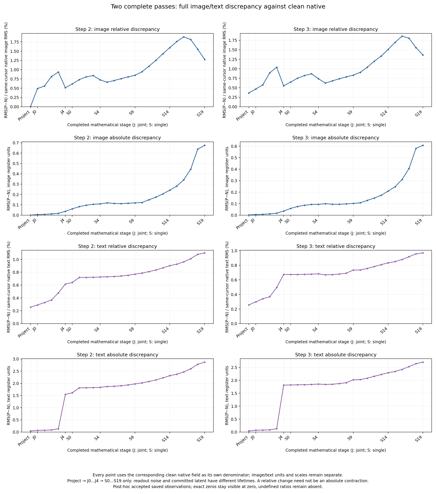
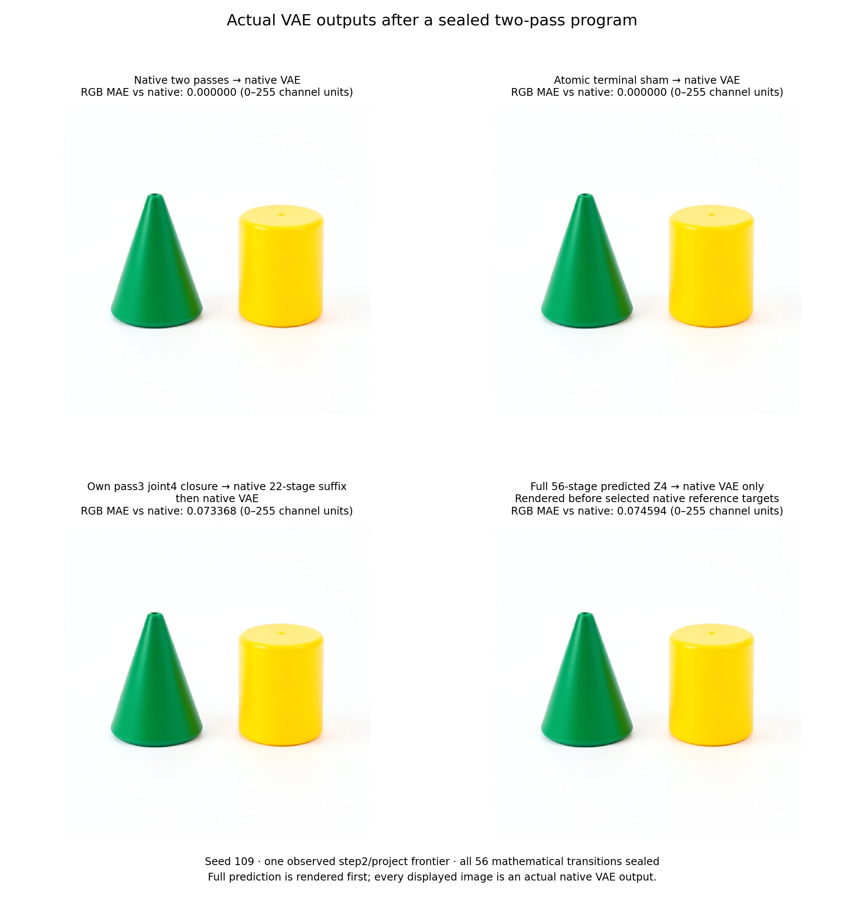
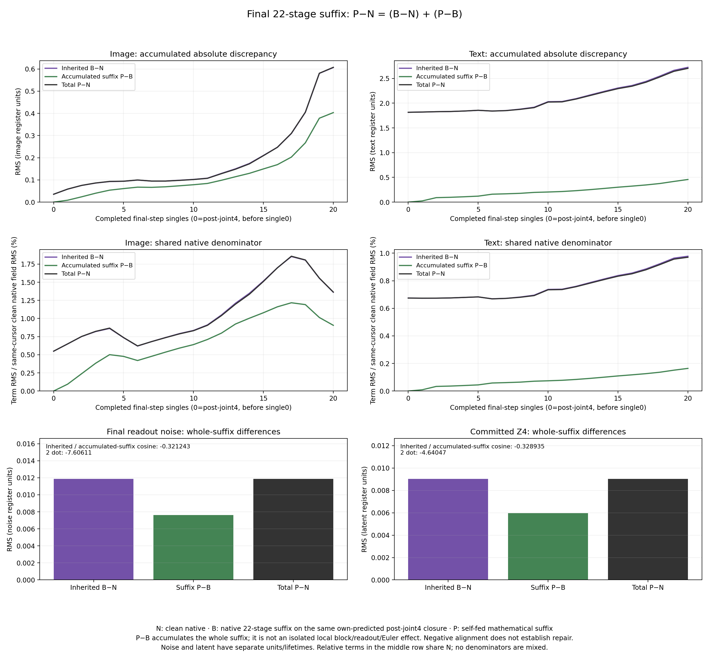

# Two complete FLUX passes from an observed project frontier

This campaign forecast two complete denoising passes from an observed step2/project frontier and rendered its predicted terminal latent before the native comparison. The accepted saved-only audit reconstructed all 246,775,808 compared output scalars exactly to the sealed mathematical forecast. The predicted final latent differed from native by 1.083820% relative RMS; its actual native VAE image had RGB channel MAE 0.074594 on the 0–255 scale. These observations apply to one seed109 history and the qualified numerical profile.

The specimen is one fresh seed109 history with the green-cone/yellow-cylinder prompt, distilled FLUX.2 Klein, 512×512 pixels, four scheduler steps, batch1 and CUDA BF16. The native prefix executes 56 transitions through steps0 and1. At the chosen frontier, step2 projection has not run and image, text, context and noise working slots are all `None`. The observed latent, conditioning, IDs, schedule and actual parameters are legitimate inputs.

## The sealed program

Each pass has 28 mathematical transitions:

1. Project the incoming latent and observed conditioning into image/text registers and a newly predicted context, including time modulation and FP32 RoPE.
2. Execute five self-fed joint blocks. Their image/text attention and receiving MLP are serial, with native BF16 boundaries.
3. Execute twenty self-fed single blocks. Each uses parallel attention and MLP features, followed by the actual output projection, gate and residual addition.
4. Apply readout normalization/modulation/projection to the predicted image register.
5. Apply the qualified Euler update to the incoming latent and predicted noise, then reset the working slots.

Pass3 consumes pass2's predicted Z3, regenerates its own context, and repeats the complete sequence to predict Z4. No native future image/text register, context, RoPE, noise or latent enters either pass. The immutable numerical helpers retain their qualified source hashes; parameter banks are archived once and streamed for reuse across both passes.

The arithmetic contract includes population LayerNorm, Q/K RMSNorm and FP32 RoPE arithmetic, BF16 linear/activation/residual boundaries and the qualified scalar Euler profile. In that profile the timestep difference is FP32, its multiplication with dense BF16 noise uses a BF16 coefficient/product, and addition commits a BF16 latent. The worker qualifies hostile CUDA scalar cases before model entry. These are source/profile-specific equations, not a universal claim about every backend.

The transaction seals all 56 predictions and declared hypotheses before selected native targets. It retains all predicted full registers, context, readout and commit arrays; the independent saved-only auditor reconstructs both passes using its own preceding outputs.

## Predicted image before the native reference

The opt-in public `mdb.flux_derived_terminal.derive_terminal` helper constructs a terminal scaffold from the observed prefix. It declares its operation as non-native state construction: source conditioning/IDs/schedule are carried, the clock is terminal project/cursor0, working fields are reset, and the observed latent is an explicitly identified placeholder. The helper performs zero native advances and applies zero Acts.

Its returned four-port Act installs sealed predicted Z4 and explicit `None` image/text/context. The inherited `FluxFinalLatentClosureAdapter` binds thirteen source/clock fields and admits the change atomically. The worker applies that Act and renders the actual native VAE **before** executing any selected native reference transition.

During prediction every transformer and VAE module is guarded. During the first render only VAE modules are permitted. Selected target counters must remain zero at seal and after the PNG is saved; the observed source payload and model/VAE parameter identity/version census must remain unchanged. This census is a runtime mutation check, distinct from the archived cryptographic parameter bindings.

The derived scaffold has a separate self-sealed metadata record. It is not a native continuation receipt, and it does not claim intervening native execution.

The state-construction API is deliberately explicit:

```python
from saturn_pub import Session
from mdb.flux_derived_terminal import derive_terminal

# prefix is the observed native project/cursor0 StateCut.
# predicted_z4 is the sealed, correctly shaped BF16 mathematical result.
derived = derive_terminal(adapter, prefix, predicted_latent=predicted_z4)
terminal = Session.from_cut(adapter, derived.scaffold)
receipt = terminal.apply(derived.action)
predicted_terminal = terminal.capture()
```

Constructing `derived` does not run the denoiser or apply the Act. The scaffold still carries an explicitly declared observed-latent placeholder; `apply` installs the predicted latent and the complete reset closure atomically. Save `derived.derivation` alongside the Act receipt. The campaign's native VAE consumer renders this admitted terminal state; this API does not implement an independent VAE.

## Native futures and comparisons

| Scientific row | Admission and actual consumer |
|---|---|
| `native` | Both complete native passes, then native VAE |
| `sham` | Exact terminal four-port closure, then native VAE |
| `bridge.predicted` | Own predicted Z3, pass3 context and post-joint4 image/text installed together; 22 native single/readout/Euler transitions, then native VAE |
| `full.predicted` | Prefix-derived terminal admission of predicted Z4; native VAE with zero denoiser continuation |

Physical execution order is full prediction, native, sham, bridge. The scientific table order does not imply execution order.

One lease/load/encoding/noise draw served 56 prefix +56 native reference +22 bridge =134 native transitions, three Acts, 137 receipts and four actual VAE calls. The derived scaffold adds metadata but no native/application receipt. Direct candidate calls were zero.

The complete native reference retains 56 boundaries. Pass0 noise/Z3 are boundaries26/27; final noise/Z4 are54/55. The matched bridge's final noise/Z4 are boundaries20/21. Common post-joint4, before pass3 single0, is native boundary33. Native and bridge each retain 23 aligned full-cut/array observations from this common boundary through commit.

The public publisher curates six dependent comparisons over four sealed fields from one history: pass0 noise/Z3 against native, and final noise/Z4 against both native and matched bridge. Every record's candidate future belongs to the **whole sealed 56-stage program** and its terminal VAE. Pass0 outputs precede a further complete 28-stage mathematical pass; the noise field also precedes its own Euler commit. These are not isolated noise or Z3 intervention experiments.

For aligned final-suffix registers, the auditor may report `P−N = (B−N) + (P−B)`, including norms and signed cross terms. The additional term is the whole accumulated remaining suffix discrepancy. RGB comparisons are actual VAE responses to latent differences; RGB is not independently predicted. Neither negative alignment nor a relative-error change establishes semantic repair.

## Reproduction and custody

Build and install a public MDB wheel containing `flux_derived_terminal` and `flux_final_latent_closure`, with public Saturn-pub and the qualified Torch2.13/Diffusers0.39 environment. Run from an isolated directory. The launcher stages byte-pinned helpers from the accepted final-latent payload, avoiding unrelated live source changes.

```bash
MDB_PY=/path/to/qualified/python
MDB_Q=/path/to/saturn-pub/packages/mdb/qualification
MDB_RUN=/path/to/new-run
rtk proxy "$MDB_PY" -I "$MDB_Q/submit_flux_two_pass.py" "$MDB_RUN" \
  --prior-run /path/to/accepted-final-latent-run
rtk proxy "$MDB_PY" -I "$MDB_Q/submit_flux_two_pass.py" "$MDB_RUN" --submit-staged
rtk proxy "$MDB_PY" -I "$MDB_Q/collect_flux_two_pass.py" "$MDB_RUN" JOB
rtk proxy "$MDB_PY" -I "$MDB_RUN/independent-math-freeze/analyze_flux_two_pass.py" \
  "$MDB_RUN" --out /path/to/new-audit.json
rtk proxy "$MDB_PY" -I "$MDB_Q/publish_flux_two_pass.py" \
  "$MDB_RUN" /path/to/new-audit.json /path/to/new-publication
```

Strict mrun admission requests CUDA, four CPU threads and finite measured reservations; it declares a 1200-second worker budget and 1350-second outer timeout. The transaction/member caps are 1536MiB each, total output14GiB and disk reservation16GB. The worker measures the deduplicated forecast-array storage profile before sealing. No speedup is claimed.

The authenticated SSH collector compares complete remote-before, remote-after and local file inventories against the producer manifest. The auditor binds the request, source snapshots, checkpoint, qualified ABI, transaction, derived scaffold, first predicted PNG, typed paths, actual native arrays and image files. Accuracy measurements remain observations, separate from custody and mechanics.

The [worker](../qualification/flux_two_pass_campaign.py), [worker tests](../tests/test_flux_two_pass_campaign.py), [auditor](../qualification/analyze_flux_two_pass.py) and [publisher](../qualification/publish_flux_two_pass.py) implement this cut. Public EquationCatalog/ComputationAtlas records bind model/source/execution, input/reference cuts, prompt, seed, logical step and field/program horizons. Exact applicability retrieval does not induce a family or establish an error bound outside this specimen.

## Measured seed109 execution

Job `job-691aa1b12089` succeeded under request `739f2b0282952b45f36a2bb2f85a9fe6f587ad25ef04962c54cdf6aba173b145`. The forecast sealed at 559.629 seconds; its actual predicted PNG was saved at 570.399 seconds, with all 34 selected transformer counters still zero. The source payload and parameter mutation checks passed. The declared prefix-derived scaffold performed no native advance or Act application; one subsequent terminal Act installed the predicted Z4 before rendering.

The primary frozen auditor passed on its first execution in 217.779 seconds. Its 80 independent output comparisons cover 246,775,808 scalar positions, including both passes' full image/text registers, context, RoPE, noise and latent. All sealed-versus-independent comparisons are bitwise exact. This is separate from disagreement with native CUDA execution.

| Clock-aligned milestone | Step2 image relative RMS | Step2 text relative RMS | Step3 image relative RMS | Step3 text relative RMS |
|---|---:|---:|---:|---:|
| After project |0.001875%|0.256406%|0.362260%|0.256406%|
| After joint4 |0.512154%|0.614522%|0.549288%|0.674345%|
| After single19 |1.276909%|1.100095%|1.363941%|0.970396%|

Each percentage uses its corresponding clean native field at the same cursor. The native trajectory is a clock-aligned reference, not the same incoming state as the predicted trajectory after divergence. Both passes use their own preceding mathematical state throughout.

Step2 readout noise differs by 0.845198% relative RMS and committed Z3 by 0.288154%. Step3 readout noise differs by 0.979252%, followed by the final Z4 discrepancy below. All these readout/commit measurements have their own field units and denominators.



Image relative error peaks after single16 in both passes: 1.886420% and 1.858142%. It then falls while absolute RMS rises: step3 image error grows from 0.309915 after single16 to 0.607502 after single19. The denominator changed; this is not absolute error contraction. Step2/step3 final text absolute RMS values are 2.870804/2.704447, and the largest text-coordinate difference is 1024 in both passes. A small average or percentage is not a uniform coordinate bound.

| Actual terminal future | Z4 relative RMS vs native | RGB channel MAE, 0–255 | RGB RMS | Largest channel difference |
|---|---:|---:|---:|---:|
| `native` |0|0|0|0|
| `sham` |0|0|0|0|
| `bridge.predicted` |1.083153%|0.073368|0.300140|6|
| `full.predicted` |1.083820%|0.074594|0.303523|7|

Native and sham latent/PNG controls are exact. Full prediction has 93,889 nonidentical latent coordinates out of 131,072; maximum absolute latent difference is 0.19140625. Its PNG differs in 52,515 of 786,432 channel values. Image averages include the white background and do not certify foreground identity or semantic quality.



For the final 22-stage suffix, `P` and `B` share the exact own-predicted post-joint4 starting closure: Z3, context, image and text. The clean native `N` is only clock-aligned. At final Z4 the inherited/additional/total absolute RMS values are 0.009032 /0.005959 /0.009037, with shared-native-normalized values 1.083153% /0.714596% /1.083820%. The inherited/additional cosine is −0.328935; twice their dot product is −4.640472. The vector and squared-norm identities close exactly in the saved-array diagnostic.

The negative cross term coexists with a slightly larger total discrepancy than the inherited term. Full prediction is slightly worse than the native bridge in final latent RMS, RGB MAE and RGB RMS. `P−B` is an accumulated whole-suffix discrepancy; it does not isolate one block, readout or Euler error. The native VAE's `P−B` RGB MAE is 0.059764 with maximum channel difference3. This is an observed image response to different terminal latents, not an independently predicted RGB field or VAE-kernel error.



The worker's measured scientific-branch subtotal was 668.944 seconds; runner elapsed time was 943.71 seconds including startup/export overhead. Peak RSS was 8444.6 MB and VRAM 9748 MB. Authenticated collection retains 971 files/10,199,845,508 bytes. The deduplicated forecast arrays occupy 1,039,196,432 NPY bytes, below the predeclared 1536MiB transaction cap. No serving speedup was measured.

## Published observations and audit trail

The unchanged frozen publisher produced six public EquationCatalog/ComputationAtlas records over four distinct sealed fields and one native history. Each complete occurrence query retrieves exactly one record; changed-seed queries retrieve none, and missing-input-cut applicability is unknown. The records retain all native discrepancies without a numerical or semantic discovery gate. All six selected full-array comparisons and actual terminal latent/PNG futures were checked separately after publication, including the report's observed-minus-predicted sign and the futures' predicted-minus-reference sign.

The cross-run atlas now contains 36 observations from five histories and 24 complete applicability contexts. These are source-bound observations, not independent replication of every comparison or automatic family induction. Comparing this seed109 two-pass run with the earlier seed107 44-stage run does not isolate a horizon effect: seed, frontier and rendering order also changed.

The workspace evidence root is `artifacts/mdb-flux-two-pass-20261105`. Principal immutable references are:

- `audit.json` — SHA256 `5bd9689e1bad81245da7e415778bd204a1064e04f42d6e887d7169f815e53e8f`; unchanged pre-outcome auditor source `499a25d18cbbdf6e7a6189159a44070e51057d2e24cb651fc37fe93e30631e81`.
- `postrun-review-v1.json` — SHA256 `b44fe7da418a7b686ef28b0f8c62d82d9fa8735a6ee789deb7681381929d550c`.
- `run-01/collection.json` and `run-01/extracted/flux-two-pass-result/{first-predicted-image,derived-terminal}.json` bind custody, render order and declared non-native construction.
- `equation-publication-v1/result.json` — SHA256 `bfecbddffc8390e0a61d56685213045463def3b9b4bf9c7db40a8ae57640121e`.
- `publication-verification.json` — SHA256 `9d43e1779079a1227bf2c85267151d6bcccdc8343d1f50af291ac98560cc3751`; `publication-attempt-01.json` preserves the actual command and before/after publisher hashes.
- `plot-data.json` and `plot-provenance.json` bind all plotted scalar observations and original PNG hashes. The three document assets are byte-exact copies of those generated figures.

Mechanics are valid and the numerical discrepancies are observations. Terminal status remains unassessed: this one history does not establish arbitrary-prompt coverage, a universal numerical bound or semantic equivalence. The accompanying notebook narrative is `obsidian/blog/2026-11-05-105513-predicting-two-complete-diffusion-passes.md`.
