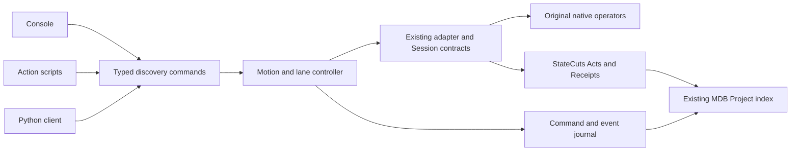

# MDB discovery debugger interface

Status: draft interface design, 2026-10-30. No commands or capabilities proposed
here have been implemented by this design change. The
[input and capability guide](ISA-DISCOVERY-DEBUGGER.md) describes the current R3
ISA model and the existing debugger foundations.

The interface lets a person or agent inspect mathematical execution, pause at
component boundaries, branch controlled state changes, compare outcomes and
repeat the process across independent input lanes. Components and routes have
generic names from the start. Semantic operation inference is optional.

## Decisions

1. The console, script runner and Python API invoke the same typed operations.
2. Stable component sites, input-dependent occurrences and physical executions
   have separate identities. User aliases are descriptive metadata.
3. A lane owns an execution and its branch tree. Physical batch slots do not
   own lane identity or determine its logical clock.
4. MLP output, residual application, forward completion and architectural
   instruction commit are distinct boundaries.
5. Motion preserves completed native transitions when interrupted. Instruction
   commit updates the architectural state atomically.
6. All stop causes and actual work remain visible. Failed branches remain
   evidence; scientific success is not a requirement for collecting them.
7. The initial R3 mode records a native reference and then executes its replay.
   Pausing the first eager execution requires a separately declared adapter.
8. New behavior uses an explicit `discovery-v1` dialect. Legacy command and
   serialized execution contracts retain their meanings.

## Architecture and ownership



The resident worker owns frozen model execution, live tensors and the adapter.
The client sends metadata and content-addressed references. It never receives
an implicit writable pointer into the worker. Residency begins inside one
finite admitted mrun lease; cross-job serving is a later lifecycle extension.

Reuse [DebuggerAdapter and AdapterCapabilities](../src/mdb/debugger_adapters.py),
the [existing control transport](../src/mdb/debugger_protocol.py),
public [Session](../../../src/saturn_pub/core.py),
[execution contracts](../../../src/saturn_pub/contracts.py),
[Project](../src/mdb/project.py), and prepared-parent/panel APIs. Add optional
operations and sidecar metadata rather than another executor, checkpoint format
or graph database. The dependency remains `mdb -> saturn_pub`.

## Objects and identities

| Object | Owns or identifies |
|---|---|
| Model binding | Frozen weights, source/runtime binding, backend, dtype, declared mutable closure and numerical contract |
| Program binding | A qualified executable operator program, structural catalog, adapter version and supported shapes; separate from user input bytes |
| Investigation | The existing Project, its session records, analyses, aliases, graph views and evidence references |
| Resident session | Worker/model ownership, capabilities, budgets and the lane scheduler |
| Lane | A stable logical experiment ID, input epochs, selected branch and scheduling status |
| Input epoch | Immutable input/program-byte binding and initial architectural state; changes when roots are replaced |
| Branch | A parent cut and ordered native transitions/Acts within an input epoch |
| Site | A structural component, value port, mathematical stage or state-update boundary in a program binding |
| Occurrence | A site at a particular lane/epoch/branch/forward and execution point |
| Physical attempt | One actual execution attempt, including capture, replay, audit or batch execution |
| Route | A qualified set of dataflow edges; causal measurements attach separately |

An occurrence can be reproduced by replay. Every physical attempt still gets a
new attempt ID and contributes to resource/work accounting. Display ordinals
such as `mlp_001` and `route_0007` resolve to qualified IDs; they are not global
addresses. Tensor content digests identify observed values, not structural sites.

Program identity must not be copied from an input-bound trace fingerprint and
then described as input-independent. Derive a structural program binding and
retain its explicit relationship to each native trace. New graph shapes or
dynamic control flow require a new binding or a declared alignment.

An alias record contains its namespace, target ID/type, revision and authoring
provenance. Renaming an alias does not change an execution ID. Installed
breakpoints pin resolved IDs and alias revisions; they do not silently move
when a name is rebound. Ordinary aliases do not require evidence-qualified
`SymbolBinding` status and confer no write authority.

Structural graph paths, input-dependent routing observations and experimentally
measured causal effects have distinct record kinds. All can use generic names.
Logging an edge does not automatically label it as causally necessary.

## Capability negotiation

`discovery.capabilities` returns an explicitly versioned extension document,
without changing existing capability/schema fingerprints. It declares:

- execution modes: `record-replay`, `native-pause`, `offline-inspect`;
- available motion units and actual clock domains;
- boundary catalog reference, source/program binding and supported selectors;
- readable/writable surfaces, Act operations and invalidation rules;
- checkpoint support: `live`, `replay-recipe`, `native-durable`;
- input drivers and their commit/fetch/effect policies;
- observation profiles and their verification coverage;
- resident scalar lane limits and separately qualified physical batch profiles;
- script language version, supported actions and budgets.

Use the existing `boundary_catalog`, address specifications and surface
contracts where possible. New execution-unit descriptions live in this
extension. A UI offers only supported operations. A fused or unavailable
LayerNorm boundary is reported unavailable; the runtime must not change
execution merely to pretend it paused there.

## State and command targeting

A lane's execution status is one of `ready`, `running`, `paused`, `completed`,
`errored`, or `closed`. A pending Act is a separate state, since a paused lane
may have an edit awaiting commit or abort.

Execution phase is separate from that status: `input_ready`, `forward_active`,
`forward_complete`, `commit_pending`, `effect_blocked`, or `driver_terminated`.
Finishing a forward leaves a ready/paused lane with uncommitted heads, so
`step instruction` can commit them. Lane `completed` is reserved for driver
termination. A motion command can complete while its lane remains runnable.

| Operation | Preconditions | Result |
|---|---|---|
| Create lane | Bound model/driver/input and available budget | New input epoch and initial `ready` branch |
| Select lane/branch | Target exists | Client focus changes; execution does not advance |
| Run or motion | Ready/paused, no pending Act, revision matches | Advances to a stop, completion, or error |
| Pause | Lane running | Requests a pause at the next advertised safe point |
| Fork | A compatible retained cut | New branch with the same epoch and parent lineage |
| Replace input | Target stopped, no pending Act | Retain old epoch; select a new epoch with fresh roots |
| Restore | Compatible restorable cut, stopped target | Selected branch head moves; physical work is not erased |
| Prepare/commit edit | Adapter admits target and payload at current cut | Preview or atomic Act on the selected branch |
| Close lane | Stopped, or pause completed | Release live resources; preserve indexed evidence |

Every mutating operation names lane ID, epoch ID, branch ID and expected lane
revision. The server resolves a console's implicit focus before dispatch and
logs the explicit target. Changing focus while a command runs cannot retarget
that command. `run --all` freezes a target set at acceptance.

An input replacement preserves the old history. It invalidates derived values,
prepared frontiers and input-bound route/occurrence resolutions. Structural
aliases may remain valid under the same program binding; occurrence-specific
breaks and payload applicability must be rechecked. Changing roots inside a
completed prefix is never treated as ordinary lane selection.

Default cut restore stays within the selected lane/input epoch. Returning to
an archived input uses explicit `lane checkout-epoch`, while stopped, and
selects a compatible branch/cut from that epoch. It increments the lane revision
and re-primes watches without erasing either epoch's history. Client focus
selection and this execution-context mutation are different operations.
Cross-lane payload transfer is an explicit provenance-bound Act; a cut from a
different input cannot silently become the current lane's continuation root.

## Typed operation surface

All names below are proposed optional operations over the existing transport.
Related subcommands use structured payloads, not string evaluation.

| Operation family | Examples of actions |
|---|---|
| `discovery.capabilities` | Describe supported units, catalogs, drivers and batch profiles |
| `discovery.lane` | List, create, select, replace input, close |
| `discovery.catalog` | List/resolve sites, scopes, ports and generic names |
| `discovery.alias` | Add, list, rebind, remove a descriptive alias |
| `discovery.break` | Add, list, enable, disable, remove structured breakpoints |
| `discovery.watch` | Register bounded predicates over available values/summaries |
| `discovery.motion` | Step, next, finish, until, continue, pause, reverse |
| `discovery.inspect` | Read live state, summaries, dependencies, or explicitly recorded history |
| `discovery.checkpoint` | Capture, restore, list, export or describe restore support |
| `discovery.branch` | Fork, select, compare, abandon; explicit promotion only when supported |
| `discovery.act` | Preview, commit, abort using existing adapter-owned Act semantics |
| `discovery.script` | Validate, execute, cancel, inspect an action program |
| `discovery.events` | Read command, stop, execution and evidence records |

The Python client wraps these operations. The console parses to the same
payloads. A saved script compiles to these operations plus bounded control flow.
Do not build a second set of console-only mutation rules.

## Console and Python interface

The proposed front door is the existing debugger with an explicit negotiated
interface, for example `mdb debug JOB_ID --interface discovery-v1`. A script
declares that same interface in its header. The current CLI does not accept
these new options or commands.

| Discovery console form | Meaning |
|---|---|
| `plan load FILE` | Validate a bounded plan, resolve bindings and create its declared lanes |
| `plan validate FILE --metadata-only` | Check file contracts without loading a model; unresolved runtime bindings stay explicit |
| `lanes` / `lane select ID` | Inspect lanes or change focus without execution |
| `lane replace-input ID --case CASE` | Start a new input epoch on a stopped lane |
| `lane checkout-epoch ID --epoch EPOCH --branch BRANCH` | Select a compatible archived execution context explicitly, while stopped |
| `catalog list --kind mlp` / `resolve TARGET` | Browse structural sites and inspect the exact binding |
| `alias NAME = TARGET` | Add a descriptive alias; rebinding creates a new alias revision |
| `break TARGET enter\|exit --id NAME` | Install a resolved component boundary break |
| `watch PORT --change --at BOUNDARY` | Observe change at advertised available points |
| `step --unit UNIT --count N` | Complete bounded smallest-unit motion |
| `next --scope SCOPE` / `into --scope SCOPE` / `finish --scope INSTANCE` | Move through declared executable scopes |
| `until TARGET enter\|exit` / `continue` | Execute while honoring all active stops and budgets |
| `pause --lane ID` / `cancel OPERATION_ID` | Request safe stopping; do not kill execution in an arbitrary kernel |
| `capture NAME --restore MODE` / `restore NAME` | Save or select a compatible stopped cut |
| `branch fork NAME --from CUT` / `branch select NAME` | Create or select a branch explicitly |
| `act preview replace PORT --value-ref REF --parent CUT` | Preview an adapter-admitted replacement from a qualified payload reference |
| `act commit ID` / `act abort ID` | Resolve the pending edit transaction |
| `compare A B --fields LIST` | Compare retained state or outcomes without advancing either branch |
| `inspect TARGET --source live\|recorded --summary` | Read current computed state or explicitly selected historical observations |
| `events --after CURSOR` / `export DIRECTORY` | Inspect the journal or export its declared evidence closure |

Default focus is only a convenience in console input. A Python client can
invoke the existing `DebugSession.call` shape with a discovery operation,
explicit target and revision. Typed convenience methods should generate that
same payload. Payload references resolve through existing worker-side tensor
algebra/custody, then become native Act values; they are not raw memory handles
or executable import paths.

For example, after loading the example plan without an automatic handler,
this proposed manual sequence separates law exit, update, forward and commit:

```text
alias mlp_focus = module:post.1
break mlp_focus exit --id inspect_mlp --lanes lane_00
run --lanes lane_00 --stop-policy lane
capture parent --restore live
inspect mlp_focus:output --source live --summary
step --unit update --count 1
restore parent
branch fork trial --from parent
branch select trial
act preview replace mlp_focus:output --value-ref PAYLOAD_REF --parent parent
act commit ACT_ID
step --unit forward --count 1
inspect outputs --source live --summary
step --unit instruction --count 1
compare main trial --fields registers,flags,outputs
```

`PAYLOAD_REF` and `ACT_ID` are explicit placeholders. This sequence illustrates
interface semantics and does not claim a numerical experiment was executed.

The compact console frame should make the selected context and execution level
visible. This illustrative layout uses the post1 exit from the retained R3
program; it is not a new debugger transcript:

```text
(discovery-v1 | lane_00/input_00/main | unit=law)
paused: breakpoint mlp_exit at post.1:exit
clock: instruction=0 forward=0 aten.next=369
phase: forward_active; architectural state uncommitted; pending_act=none
next: post.1.residual
restore: live
```

Inspection views share that target binding: a mathematical scope view shows
the declared stages and native operation provenance; a ports view shows live
input/output shape, dtype, producer, uses and writable status; a diff view
separates tensor changes from decoded architectural changes; and a timeline
shows branches, stops, Acts and physical attempts. A graph view uses the
existing Project graph and route records. Recorded reference values remain
visibly distinct from live computed values in every view.

## Requests responses and retries

Preserve `saturn-debugger-request-v1` / `saturn-debugger-response-v1` envelopes.
Use negotiated discovery payload schemas for the new optional operations.
For example, this is a proposed motion request payload:

```json
{
  "schema": "mdb-discovery-motion-proposal-v1",
  "target": {
    "lane_id": "lane_00",
    "epoch_id": "input_00",
    "branch_id": "main",
    "expected_revision": 12
  },
  "action": "step",
  "unit": "law",
  "count": 1,
  "budget": {"max_native_operations": 512, "max_wall_ms": 10000}
}
```

The outer request retains its request ID and ordering sequence. Within a
worker, resending the same ID and identical command returns the same response;
reusing an ID for different command bytes is refused. Lane revision conflicts
return the current revision and head cut, without advancing execution.

The discovery dispatcher must check request-ID/content bindings before a
cached response can bypass dispatch. This stronger rule belongs to the
negotiated discovery interface; legacy request handling is not silently
redefined. Two clients racing on one lane cannot both mutate the same expected
revision successfully.

Long motion may return an operation ID with `accepted` or `running`. Querying
that operation is read-only; it does not reissue the motion. Its eventual
outcome is `stopped`, `completed`, `cancelled` or `errored`. Results contain
actual revision/head, completed units, `completed_unit`, all stop causes,
execution points, receipts, observation references and work counters. An early
breakpoint is a successful stopped command even if its requested law is unfinished.

Durable retry after worker restart is a separate advertised capability. Until
implemented, an uncertain disconnected mutation is reconciled against the
journal/head before any new request ID is issued. Never promise exactly-once
physical execution from an in-memory request cache.

## Boundaries scopes and clocks

A boundary descriptor contains qualified site ID, kind, scope/parent scope,
entry/exit/update edge, live inputs/outputs, mapped native execution point and
availability. A mathematical scope is a declared executable region. It must
not be inferred from an arbitrary noncontiguous route through the graph.

For the R3 post MLP, expose:

```text
entry → LayerNorm → affine → GELU → affine → exit → residual update
```

The MLP exit makes `F(x)` available before residual addition consumes it.
The update boundary makes `x + F(x)` available. Entry is before the first
consumer of the MLP input. Nested invocations get distinct scope instances.

Keep instruction index, forward-call index, ATen event index, FX-node index,
component invocation and physical attempt separate. A cursor contains the
existing `ExecutionPoint` plus qualified sidecar coordinates. Missing axes
remain absent; no numeric equality between FX and ATen indices is implied.
Logical scan position is observational unless the adapter supports it as a
native safe point. R3's parallel doubling scan does not expose every recurrence
position as a separate physical pause.

## Motion semantics

| Unit | Completed work |
|---|---|
| `op` | One original ATen primitive |
| `math` | One declared mathematical stage, including necessary implementation views |
| `law` | One declared component evaluation, such as an MLP, excluding its caller's residual application |
| `update` | One declared state-update transaction, such as a residual application |
| `forward` | Finish a model invocation; raw output heads exist, architectural state remains uncommitted |
| `instruction` | Finish the call and atomically commit decoded architectural state plus driver cursor |

An FX-only adapter may additionally expose `graph-node`; it must not call an
FX node one ATen `op`. The initial R3 interactive default is `law`, displayed
in the prompt and recorded as an explicit unit in every command. Adapters with
no law scopes choose a declared supported default rather than guessing one.

`step` completes the current or next smallest scope of the selected unit.
For `law` at a post-MLP entry, that means reaching its output before residual
application. Transparent operations needed to reach a next scope are executed
and counted. Starting at a completed scope selects the next occurrence.

`next` completes the selected enclosing scope, including nested components.
At a leaf MLP, `step law` and `next law` coincide. `into` stops at the next
nested scope entry; `finish` reaches the selected active scope's exit.
`until` executes to a resolved boundary. If nested scopes make the target
ambiguous, show candidates and require a scope selection.

Motion checks stops after every available native transition, even when the
requested unit is coarse. It commits each successful transition separately.
On interruption inside a law/update, return `completed_unit: false` with the
actual retained point. Already completed transitions remain executed. This
deliberately differs from the atomic macro semantics of some existing Session
methods; it must not accidentally delegate to an all-or-nothing multi-step call.

An instruction architectural commit is a separate atomic transaction. A pause
before it sees old architectural state plus computed heads. A pause after it
sees all new registers/flags/cursor together. No observer sees half a commit.

Model `op`, `math`, `law`, `update` and `forward` motion never implicitly commits
architectural state to enter the next call. At `forward_complete`, they return
`commit_required` if further requested work needs the next instruction. A
`step instruction` there commits the already computed heads without running
another model forward. Counts greater than one return the completed count
and the blocking point if they cannot finish without an explicit commit.
The `update` default covers model updates; architectural commit belongs to
`instruction` or an explicitly selected driver-commit operation.

Reverse stepping restores a retained compatible point or replays forward from
one. It does not invert MLP mathematics. A jump/seek command must either inspect
history without changing execution, restore a valid cut, or execute required
producers. Arbitrarily writing a cursor is not a valid jump.

Legacy `step`, `next`, `continue N`, and `Session.step(token/denoise)` retain
their current behavior outside the new dialect. In particular, legacy `next`
aliases step, and legacy `continue N` ignores installed breakpoints while still
observing watches. New discovery motion always honors its active stops; a
disabled breakpoint must be explicitly disabled and that change logged.

## Breakpoints watches and stop ordering

A selector may name a structural ID, pinned alias, source module, component
kind, edge, instruction/forward occurrence or branch/epoch. Single-target
resolution refuses unknown or ambiguous names. A wildcard requires explicit
multiple-match selection and returns the resolved set. An unbound selector may
be stored as pending, but an enabled script must resolve it before execution
or explicitly permit unresolved optional matches.

Breakpoints match boundaries. Watches match declared values or bounded
summaries at available boundaries. Predicates are allowlisted operations;
serialized scripts do not execute arbitrary Python. A change watch primes its
baseline when armed. Restore and input replacement re-prime it and log that
event; comparing different inputs is an explicit comparison operation.

At a safe point:

1. Finish and validate the current native transition, retaining its receipt.
2. Resolve boundary occurrence and observe available values.
3. Evaluate all watches and matching breakpoints, the motion target and budgets.
4. Record every coincident cause and capture the returned stopped state.
5. Run applicable action blocks once, then return or enqueue continuation.

The stop record binds an immutable `hit_cut` and hit target/revision before
handlers run. It separately returns each final branch head/revision and the
selected target after any handler edits. Subsequent handler commands acquire
the revision returned by the preceding successful command; they do not reuse
the original hit revision blindly. The handler context remains bound to its
original hit even if client focus changes.

Also check an initial entry boundary before executing its first operation.
Resuming suppresses only the just-handled breakpoint/occurrence pair until
execution advances; it does not disable that breakpoint for later invocations.
Native memory/correctness errors preserve the last safe state and error record.

Primary display priority is execution/integrity error, observation/action error,
explicit cancellation or pause, watchpoint, breakpoint, completion, requested
motion target, budget limit. All causes are returned regardless of priority.
A watch or action failure leaves the lane paused; it cannot silently resume.

Budget exhaustion, cancellation, unresolved effects, group pause and integrity
errors are blocking causes regardless of display priority. Read-only capture
and logging can still run at a valid hit. Deferred continuation cannot override
them. A new explicit command must extend a budget, acknowledge a cancelled
operation, resolve a group pause, restore valid state or select a compatible
effect policy as appropriate. No breakpoint suppression rule clears a blocking
cause.

## R3 instruction driver

The default driver accepts program bytes, initial registers/flags, starting
byte offset and a finite instruction budget. The existing exact input ABI is
documented in the [input guide](ISA-DISCOVERY-DEBUGGER.md).

JSON register words use canonical sixteen-digit hexadecimal strings so every
64-bit value round-trips through JavaScript clients. Native tensor bits remain
unchanged. Flags are four integer bits in explicit CF/ZF/SF/OF order. Canonical
program hex contains whole bytes. Driver identity pins byte padding and
architectural commit policies.

At an instruction boundary, take up to fifteen bytes from the program and
zero-pad the tail. The absolute host RIP is not an extra model tensor. On a
completed forward, decode register/flag logits using `> 0`, and length using
`argmax + 1`. Require finite outputs and valid typed shapes, not agreement with
an expected answer. Atomically commit predicted registers/flags and advance
offset by that predicted length.

If the offset reaches or exceeds the program length, return `program_end`
without inventing another instruction from padding. Record actual consumed
length and any overshoot as observations. Stop after `max_instructions` commits
or another budget. Decode syscall/store enable logits with `> 0`; a zero tie
is false. Preserve raw logits and all decoded effect decisions in the record.
The initial syscall policy is `stop-before-commit`: retain the computed heads,
set phase `effect_blocked` and return `predicted_syscall`. This is a driver
stop, not proof that a valid OS action occurred.

The initial driver has no general RAM input or complete store executor. Its
default store policy is `stop-before-commit`: a predicted store retains all
outputs and returns `unhandled_effect` rather than pretending RAM was updated.
An explicit `observe-only` policy may reproduce a bounded causal assay that
does not consume stores; that scope is part of driver identity. Forward-only
exploration remains available. No decoder, arithmetic oracle or evaluator
repairs the predicted architectural state.

If syscall and store are both positive, return both effect causes. Ordinary
resume remains blocked, with no architectural commit. Changing an effect
policy creates a new driver binding/input epoch; a compatible model cut can
be reused only through an explicit applicability check. Keep the original
blocked outcome. An adapter with a real effect consumer can later advertise
its own policy and closure rather than inheriting this limited driver.

A separate `fixed-successor` driver supplies declared next windows while
consuming actual predicted registers/flags. It records that fetch is supplied,
not model-length-driven. The scan's hidden state resets each call in both
drivers. Supporting persistent hidden state requires a different model/adapter
contract, not an option that silently changes this model.

## Branches and intervention actions

Fork from a retained compatible cut. Default selection stays on the original
branch until an explicit branch-select command. A candidate edit uses the
existing adapter-owned preview/commit/abort path. Reads and writes use qualified
ports; generic names do not broaden the writable surface.

An edit can target only state admitted at that boundary, with matching
shape/dtype/device and declared invalidation. Consumed intermediates require
an earlier restore and replay. Weight changes create a new model binding and
invalidate incompatible resident lanes; they are outside initial discovery
session edits.

Panels retain their existing sealed-candidate behavior. Log each candidate's
sources and installed bytes before execution. Completed outcomes survive a
later candidate failure. Expected states and semantic labels are measurement
inputs, never implicit output replacements.

## Resident lanes and batching

Lane IDs survive batch-slot compaction and replacement. Input epoch and branch
IDs distinguish refilled experiments. No mutable execution state is shared
between lanes except adapter-declared immutable model/program resources.

Start with multiple scalar lanes in one resident worker. A round-robin scheduler
advances ready lanes to the next safe boundary within a declared quantum;
paused/completed/errored lanes are skipped. Selecting a lane has no execution
effect. `run --all` uses `--stop-policy group` by default. First finish the
hit lane's bounded handlers. If its stop remains blocking or the handlers do
not authorize continuation, request a safe group pause of the other target
lanes. `--stop-policy lane` permits unaffected lanes to continue.
Their exact resulting points remain visible rather than implying simultaneous
logical time. Automatic stop actions can choose continuation without a client
round trip.

A group-pause token has controller ownership and suppresses other lanes'
deferred continuation requests. Their read-only stop actions may finish but
cannot undo that group pause. If concurrent native groups reach stop points,
record every hit and the final quiescent points; group policy never claims
that all lanes stopped at one identical clock.

A physical batch profile groups lanes by admitted adapter, model, program,
stage/frontier ABI, shape, dtype, device and numerical contract. A batch-one
recorded graph cannot simply be used at a different batch size. The adapter
owns logical-to-physical port alignment and explicit batch program binding.

Paused lanes park their frontiers. They are not logically advanced as dummy
rows. If a backend executes masked/padded work, record that physical work and
the rule that prevents state publication to the parked lane. Refill resets
all per-input state and creates a new epoch before the slot runs again.

The scheduler never assigns results by a mutable display ordinal. Each physical
batch includes an immutable row-to-lane/epoch/branch/expected-revision mapping.
Publish lane results independently only after adapter validation. A native
kernel error records the attempted group and leaves affected lanes at their
last valid heads; completed groups and unrelated lanes remain retained.

## Observation retention and accounting

Use named observation profiles with explicit coverage:

| Profile | Retention |
|---|---|
| `summary` | Declared live port summaries, endpoints, native outputs and provenance needed by the experiment |
| `selected` | Requested tensors/rows plus summaries and native outputs |
| `audit` | Full supported primitive descriptors/observations and the independent comparisons requested by the audit plan |

The live frontier needed for correct continuation is retained regardless of
display profile. Inspection never recomputes hidden future values silently.
Default reads show live computed state. Historical captured reference values
require an explicit recorded-history read and are labelled accordingly.

Receipts describe checks actually performed. Summary mode must not claim full
per-operator equality or an independent native comparison it did not execute.
Changing profiles records a new observation contract; missing earlier values
require a declared replay or return `not-retained`.

Count native reference captures, model forwards, replay primitives, independent
audit forwards, logical branches, architectural commits, physical batches,
active/padded rows, preparation, hashing, serialization and scheduler overhead
separately. The same completed output inspected twice is one execution.
Restore never subtracts work already performed.

## Scripts and breakpoint actions

Scripts explicitly declare `mdb-discovery-v1`. Legacy command files keep their
existing parser and behavior. Discovery scripts can declare cases, budgets,
aliases, breaks, actions, finite loops, conditions, panels and exports. Each
compiled action resolves to the typed operations above. The
[example action file](design/isa-discovery.example.mdb) illustrates the proposed
syntax; it is not runnable in the current CLI.

Freeze aliases, case digests, boundary bindings and the script digest at script
start. A changed script creates a new run record. Allow bounded loops over an
explicit finite lane/case/branch list; no unbounded polling loop or dynamic code
import is required. Trusted Python callers may orchestrate richer programs
through the same API, with their source identity recorded.

Handlers run once per stop/action-block identity. Capture and logging actions
operate on the stopped occurrence. Branch/edit actions use explicit targets.
Continuation is deferred until all applicable blocks finish, avoiding recursive
`continue` inside a breakpoint callback. If any block requests a pause or fails,
automatic continuation is suppressed and completed actions remain recorded.

Order matching handlers by explicit integer priority, then declaration order,
then stable block ID. Freeze that order at script start. Multiple deferred
continuation requests for the same target collapse to one request. If a
handler explicitly selects another branch for continuation, record that
target separately; a focus change alone does not retarget a deferred command.
The global blocking-cause and group-pause rules take precedence over handlers.

Budgets cover executed commands, native operations, model forwards, branches,
architectural instructions, observation bytes and wall time. Count hidden
reference capture and audits too. Hitting a budget is a retained stop, not a
scientific null. A future worker that resumes scripts after restart must also
make completed action IDs durable before promising exactly-once action behavior.

Command budgets cannot exceed the session's remaining plan budget or the
admitted lease/resource ceiling. An explicit plan revision may extend a logical
budget within those ceilings; it never resets spent work or silently extends
an mrun lease. Record physical model invocations and logical forward rows
separately, and bound both. Likewise distinguish actual batched operator calls
from logical per-lane transitions, so batching cannot bypass the work limit.

Resolve plan references relative to the plan file and script references
relative to the script file. Interactive paths use the declared working
directory. Resolve and hash the referenced files at plan/script validation;
later source changes require a new revision. A metadata-only validation may
report an unbound model reference, but `plan load` cannot run it until a
qualified resident binding resolves. The example's placeholder is deliberate.

## Journaling durability and recovery

Use the existing Project/LocalStore/CAS as the source of saved objects. Index
metadata points to those objects; it is not an alternative checkpoint payload.
Publish immutable artifacts before atomically updating the selected index head,
using the existing revision discipline. An orphaned unselected blob does not
grant continuation authority.

Record command ID/digest, target/revision, script and alias revisions, resolved
sites, before/after cuts, Act/transition receipts, stops, observations,
physical-attempt links, errors and actual numerical/observation contracts.
Returned stops and explicit checkpoints declare whether their restore support
is live-only, reproducible by root replay, or native-durable.

Publishing a stop record does not upgrade a live-only cut to crash-restorable
state. The example plan requires live restore and publishes its stop metadata;
full process-independent continuation remains a capability to qualify.

Root replay can rebuild a compatible point from admitted roots and ordered
Acts, then verify it against the declared cut. A frontier manifest alone is not
proof of process-independent restoration. Offline metadata browsing works
without Torch; execution/resume requires the qualified adapter and weights.

On a lost connection, the client inspects the operation result and selected
head before issuing new mutations. Cancellation requests stop at the next safe
point. A process crash recovers the last durably published selection, with
unconfirmed attempts marked unknown until reconciled. Missing tensor payloads
produce unavailable state rather than fabricated snapshots.

## Adapter qualification and implementation sequence

Initial scope is the existing frozen deterministic CPU FP32 R3 ATen path.
Its recorder captures a native reference before replay. Reuse actual operators,
root-only provenance, live-frontier ownership and typed receipts; don't replay
intermediate reference tensors as unexplained roots. Known RNG/mutation
limitations remain in force. Other adapters advertise their own support.

Implementation slices are independently reviewable:

1. **Catalog and aliases:** stable sites/occurrences, named component ports and
   source-qualified math/update regions. Metadata navigation works without a
   model framework. Existing identities and semantic annotations remain valid.
2. **Motion and stops:** ATen Session adapter, versioned dialect, scope-aware
   units, breakpoint/watch ordering, partial-progress semantics and safe edits.
3. **Instruction driver and scripts:** exact input ABI, atomic commit/fetch,
   finite action programs, journals and declared recovery modes.
4. **Resident scalar lanes:** independent state/history, input epochs, focus,
   refill and prepared-parent reuse with invalidation.
5. **Physical batches:** adapter-specific grouping, row ownership, isolation,
   numerical comparison and throughput/storage measurements.

Engineering checks should establish command targeting/retry behavior, stop
ordering, alias pinning, primitive and macro motion, interrupted progress,
checkpoint compatibility, input invalidation, action failure isolation and
lane ownership. These are instrument requirements, not scientific outcome gates.

Then use admitted finite real-model panels to compare the same inputs, edits,
selected tensors, all native output heads and actual successor inputs against
the existing scalar reference. Keep capture-first and direct-pause modes,
scalar and batched numerical profiles, and independent audits distinct.

Batch qualification varies batch size, row order, parked lanes, refill and
same-parent branches. Record all numerical differences. An exact profile must
earn its stated equality; a distinct bounded-numeric exploratory profile can
retain informative results without claiming scalar identity.

Three user-facing acceptance walkthroughs should be reviewable before broadening:

- Load the four example inputs, stop at every chosen MLP exit, inspect generic
  IDs, finish a law/update/forward/instruction, and compare lane state.
- Fork a captured parent, install a declared row edit, retain native-copy and
  candidate outcomes, restore, and reproduce the chosen continuation.
- Park one lane, advance another, replace its input, then reopen history and
  demonstrate no state/alias/payload inheritance from its previous epoch.

The acceptance cases must also make the edge conditions observable:

| Case | Required interface behavior |
|---|---|
| Rename/rebind an alias after installing a break | Installed break retains its original site and alias revision |
| Stop at MLP exit, then step update | MLP output exists before residual application; update completes the addition |
| Interrupt halfway through a law | Earlier primitives remain retained; `completed_unit` is false |
| Finish forward, then step instruction | Commit the existing heads; no extra model forward is hidden |
| Request model motion beyond uncommitted heads | Return `commit_required`; do not commit implicitly |
| Timeout and resend the same mutation | Same result/head; no second advance |
| Race two clients on one revision | One mutation succeeds; the other receives the new revision conflict |
| Watch plus breakpoint plus exhausted budget | Return all causes; handler continuation cannot bypass the budget |
| Cancel or block on a predicted effect | Ordinary deferred resume cannot clear the block |
| Handler edits state and then fails | Preserve hit cut and completed actions; return final head and error, paused |
| Stop one lane under group policy | Other lanes stop at safe points; their handlers cannot undo the group token |
| Restore or replace input with an armed change watch | Re-prime watch baseline and log it; no fabricated cross-input change |
| Request an unavailable fused boundary | Report unsupported resolution; do not substitute a different execution |
| Reopen a live-only frontier in a fresh process | Report unavailable unless a declared replay recipe can rebuild it |
| Switch/refill a physical batch slot | Keep logical lane/epoch ownership and account for all physical work |

Measure complete experiment time, executed work, peak memory and retained bytes
alongside replay parity and source/evidence coverage. A lower primitive count
or a larger batch is not by itself a throughput result.

## Deferred scope

Automatic semantic naming, minimum causal circuits, universal prompt-to-program
compilation, cross-model alignment, training edits, arbitrary Python process
snapshots and cross-job resident serving are not prerequisites for this design.
They can use the resulting records and execution interface when separately
supported. The first tool should already be useful with `mlp_001` and
`route_0007`.
