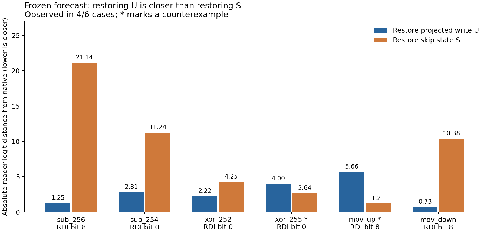

# Frozen route predictions on SUB, XOR and MOV

The first prospective transfer test found useful recurring effects and explicit
counterexamples. Three generic patterns extracted from the previous ADD campaign
were frozen before six new-operation fixtures ran. The site predictor scored
14/18 complete-register outcomes, tied with the frozen no-effect baseline.
It has not demonstrated aggregate predictive superiority. Its mistakes reveal
where the proposed applicability was too broad.

The unchanged [forecast](../qualification/predictive-route-forecast-20261030.json)
and its outcome-free [generator](../qualification/predictive_route_plan.py)
were committed as `b09dfec` before execution. Job `job-589f9f433ab4` then
executed all six cases and eight arms per case. The
[source-bound results](../qualification/predictive-route-results-20261030.json)
retain all outcomes; the [generic index](../qualification/predictive-route-records-20261030.json)
contains 48 intervention observations, not 48 discovered programs.

## What was predicted

The old evidence used ADD immediate1, RSI3 and RDI252–255. Two same-context
restoration panels at RDI252/bit0 and RDI255/bit8 supplied the route contrast.
Their exact artifact hashes are in the forecast.

| Generic ID | Frozen proposed expansion | New observation |
|---|---|---|
| `pattern_0001` | Removing post.0 retains the incoming register bank | 2/6; SUB only |
| `pattern_0003` | Removing post.1 or post.2 preserves native register decisions | 12/12 |
| `route_0002` | After post.0 removal, native projected write U restores native registers | Target RDI 6/6; complete bank 5/6 |
| `route_0002`, reader comparison | U restoration gets closer to the native reader logit than S restoration | 4/6 |

The predicted post.0-removal reader sign matched 6/6; the U-restoration sign
matched 5/6. Directions and reader coordinates were supplied from fixture
semantics. These sign results do not establish learned instruction semantics.
Static reachability was evaluated separately: all three posts can influence
the same five heads. That graph alone cannot predict the observed hard decisions,
effect signs, restoration ranking or collateral.

Observed applicability remains the exact checkpoint and old/new input envelopes.
The six new envelopes were an explicitly labelled scope-expansion hypothesis.
There is no claim that these operations were absent from model training.

## Exact inputs and measured outcomes

The model is frozen R3 Mamba, checkpoint
`9399e921776d7a5437c5bbd51bfc1928f09d2ddea444fe2aa1c9cf282baf7f1e`,
CPU FP32 with one thread. All other registers and initial flags are zero.
Each program contains two repetitions of the listed raw instruction.
Serving receives only the current zero-padded 15-byte window, register bits
and flag bits. No operation name, expected result or forecast enters the model.

| Case | Instruction bytes | Before RDI / RSI | Native first RDI | post.0-zero first RDI | U-restored first RDI | U closer than S? |
|---|---|---:|---:|---:|---:|---|
| `sub_256` | `4881ef01000000` | 256 / 3 | 255 | 256 | 255 | Yes |
| `sub_254` | `4881ef01000000` | 254 / 3 | 253 | 254 | 253, but RSI becomes 1 | Yes |
| `xor_252` | `4831f7` | 252 / 3 | 255 | 4299685887 | 255 | Yes |
| `xor_255` | `4831f7` | 255 / 3 | 252 | 12540 | 252 | No |
| `mov_up` | `4889f7` | 255 / 256 | 256 | 256 | 256 | No |
| `mov_down` | `4889f7` | 256 / 255 | 255 | 255 | 255 | Yes |



The graph has the same final-mixer interface in every case:
`M = S + U`, followed by `M + post.2(M)`. After source removal, the factorial
compares edited S/edited U, edited S/native U, native S/edited U, and native
S/native U. Donors come from independent, unchanged execution of the same input,
after forecasts were sealed. This tests a conditional restoration route; it
does not produce a donor-free replacement program.

## Counterexamples change the interpretation

**Early-write suppression has limited scope.** Both SUB cases retain their
incoming words when post.0 is removed. The XOR cases instead produce extra
bits, while MOV retains its native register decisions. The same module therefore
cannot simply be named an operation or a universal update switch.

**Target repair and state preservation differ.** At `sub_254`, U restoration
repairs RDI to 253 but flips RSI from 3 to 1. The next call correctly decrements
RDI to 252 while preserving the erroneous RSI 1. At `xor_255`, skip restoration
preserves the register bank but incorrectly sets ZF. Flags were an explicit
forecast abstention, and the observation is retained as collateral.

**A reader can disagree with whole-word repair.** In `xor_255`, post.0 removal
already leaves bit0 on the native side of zero while corrupting other bits.
Restoring U repairs the RDI word but moves that bit0 logit from −19.5773
to −17.0649, farther from native −21.0695. The preselected reader sign and
distance forecasts fail even though the complete RDI word is repaired.
Within XOR and MOV, the U-versus-S ranking changes across the two receiving
states. Module identity and operation family alone do not resolve this ranking.

The no-effect baseline and table both score 14/18 site outcomes: the table wins
the two SUB removals, the baseline wins the two MOV removals, and both miss
the two XOR corruptions. This tie is a limitation of the predictive rule,
not a reason to discard the causal differences.

## Continuation and trustworthy execution

All 48 branches commit their own decoded registers, flags and predicted length,
then execute the next instruction on that literal state. All 48 successor
register banks match the supplied operation grammar on their actual incoming
state. This is local competence, not recovery of the intended trajectory:
the XOR corruption continues as 4299685887→4299685884 and 12540→12543.
Repeated MOV overwrites RDI again, so a correct second forecast can mask a
wrong first forecast. Internal hidden state resets between calls.

The job used 108 physical B1 forwards, 18,084 replay primitives and 72 typed Acts.
All 48 replay branches matched independent native forwards exactly across
all 11 heads. Identity, same-value projected writes and complete-carrier
restoration closed exactly; these controls are excluded from the substantive
forecast counts above. Six distinct fixtures provide the denominator, rather
than repeated controls, heads or horizons. The retained 17 counterexample rows
include repeated no-op and horizon outcomes and are not 17 independent discoveries.

The independent standard-library analyzer verifies 87 artifact files, 18,156
public receipt records, source/parent/SSA/payload joins, initial roots and all 144
successor tensor-root descriptors. Worker time was 16.27s; scheduler start to
finish 36.80s; measured peak RSS 1152.6MB. All 169 installed, source and payload
MDB Python modules agree. One finite mrun lease ran with strict preflight,
no parameter updates and no automatic retries.

Saturn evidence run and verify both return zero with `target-streams-only`
coverage: 18,084 watch records, no fires, zero automatic native-receipt ingestion
or physical-address xref. Direct public receipt verification supplies the
instrument evidence. The complete archive was collected from logs and verified
against SHA-256 `c4b55e581862e09ab97628742807460f8476cacb9d08d57ca5a41f70f4412afd`.
Raw evidence lives under `artifacts/mdb-predictive-routes-20261030/run-01` in
the domains workspace. Final analysis is `analysis-v4.json`; prior analysis
snapshots remain unchanged, including a first offline rounding-check failure.

The executed worker source is retained in the payload with SHA `bbccdf75…`.
A later, unexecuted durability fix in the current harness retains completed
primary evidence when a successor raises; its failure-injection mechanics
check passed. This run had no continuation errors and was not repeated.
Sol implemented the harness and independent analyzer; Astra reviewed the
design, leakage boundary and interpretation.

## What this adds to the table

Keep the three generic IDs and attach the evidence to their qualified domains.
Narrow `pattern_0001` to its observed ADD/SUB envelopes, preserving the failed
XOR/MOV expansion. Extend `pattern_0003` only to these measured fixtures.
Split `route_0002` into target recovery, complete-state preservation and reader
response obligations. They have different observed applicability.

We now have a prospective test of a small association table and measured reasons
to revise it. A competitive general route predictor is still unestablished.
The next informative cut is the `sub_254` collateral contrast and the
`xor_252`/`xor_255` ranking reversal: inspect which receiving-state and reader
features separate those outcomes, then freeze a new prediction before testing
another state. A rule fitted to these six outcomes would be post-hoc discovery
until that next test.

Reproduce with the frozen forecast and a new output directory:

```sh
python qualification/predictive_route_campaign.py --isa-root /path/to/isa --forecast qualification/predictive-route-forecast-20261030.json --run-dir /tmp/new-route-run
python qualification/predictive_route_campaign.py --run-dir /tmp/new-route-run --collect JOB_ID
python qualification/analyze_predictive_route_campaign.py /tmp/new-route-run --helper-source qualification/analyze_post_mlp_campaign.py --output /tmp/new-route-run/analysis.json
```

Use the configured `common exec` environment for launch/collection in domains.
The analyzer is framework-free. The compact publisher and figure source are
[summarize_predictive_routes.py](../qualification/summarize_predictive_routes.py).
