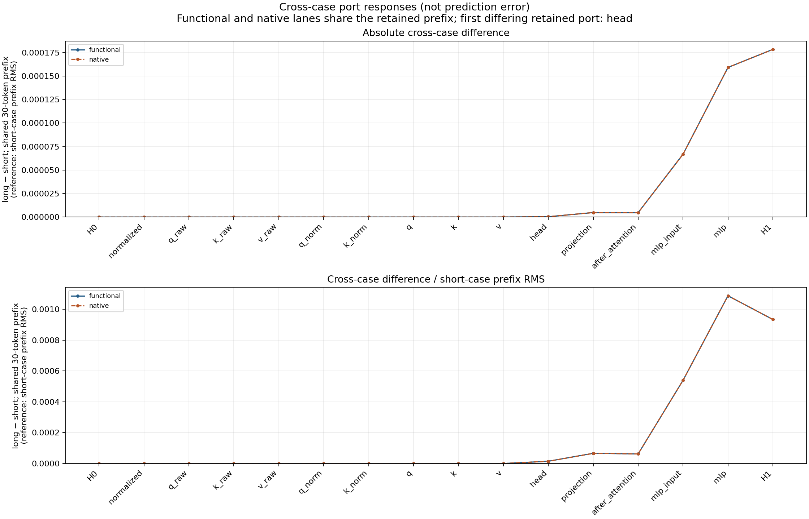
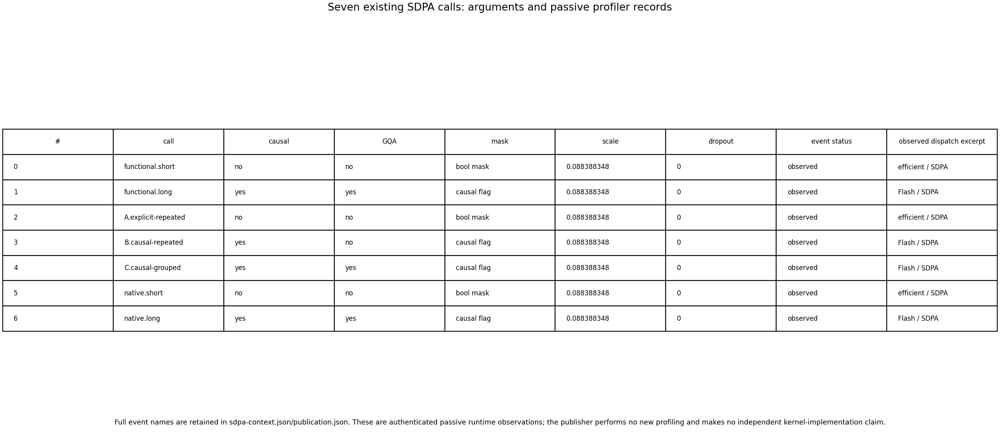

# Qwen block0 attention microscope

This bounded experiment localizes shared-prefix numerical drift in the Qwen3
encoder bundled with FLUX.2 Klein4B. The [preceding paired campaign](FLUX-RAW-MASK-PAIR.md)
predicted both complete image paths exactly, but found first-block differences
over their identical first30 token IDs. This experiment ends at H1.

## Result and scope

Shared-prefix Q/K/V are bit-identical. The first differing retained port is
the SDPA head return: five changed values over122,880 coordinates. Projection,
normalization and MLP propagate those changes to3,376 differing H1 values.
Actual profiling observes memory-efficient attention for the explicit-mask
route and Flash Attention for the causal-flag route.

A complete fixed long-case operand bank supplies three actual primitive arms:

| Arm | K/V | Mask | Causal | GQA |
|---|---|---|---:|---:|
| A | Explicitly repeated | Full bool causal mask | False | False |
| B | Same repeated tensors | None | True | False |
| C | Original grouped tensors | None | True | True |

These express equivalent ideal attention over512 rows. B−A changes107,158
head values over the full bank, and five on the common prefix. C−B is
bit-exact zero for the complete head and functional H1. These are
order-conditioned representation contrasts, not full factorial attribution.
The short padding mask is equivalent to full causal attention only over its
valid prefix. A separate saved-only bridge verifies complete signed vectors:
FP64(B−A) equals FP64(native.long−native.short) at all six downstream ports
over506,880 repeated positions. A/short and B/C/long prefix endpoints agree
bit-for-bit; full C−B has zero changed values over8,650,752 positions.

The native after_attention port is reconstructed from H0+captured projection.
Native block H0 is the supplied regenerated embedding, a shared input rather
than an independently executed native embedding. The42 matched fields include
shared-input and reconstructed fields, rather than42 independent computations.
The norm/MLP/H1 ports are observed module outputs; the triangle's tail is
functional, while its head is an actual SDPA return. Historical H0/H1 are
known replay controls, not new held-out predictions. No semantic reading of
future tokens, universal GQA invariance, intrinsic gain or new image prediction
is claimed.

The signed-vector join localizes the first differing fused primitive, rather
than separately explaining dot-product, softmax and value accumulation inside
the two CUDA implementations. The ideal attention equation is shared; exact
primitive arithmetic remains part of the declared runtime profile.

## Fixed numerical program

Original geometry is hidden2560,query32×128,KV8×128,MLP9728. Original learned
tensors are BF16; rotary inverse frequencies originate FP32 on CPU and move
device without casting. Tensor primitives preserve the source RMSNorm, Q/K
normalization, RoPE, SDPA, projection, residual and SwiGLU cast order.

```text
H0 = embedding(ids)
Q,K,V = source_QKV(RMSNorm(H0), positions)
head = SDPA_f(Q,K,V,mask,causal,gqa,scale)
R = add_bf16(H0, Linear_f(head, Wo))
X = RMSNorm_f(R)
M = Linear_f(SiLU_f(Linear_f(X,Wgate)) * Linear_f(X,Wup), Wdown)
H1 = add_bf16(R,M)
```

Both functional source blocks and the three fixed-bank arms are committed
before the two native block calls. Actual census is7SDPA,2native blocks,
2parameter-free rotary calls,1native block hydration,12selected recipe payload
reads and0full encoder/FLUX/VAE/tokenizer calls. Passive profiling wraps the
existing calls without forcing a backend or repeating a forward.

All42matched source/native full ports /70,516,736 repeated scalar positions
are bit-exact. Historical H0/H1 replays are exact. Small NumPy-versus-Torch
FP64 summary-reduction discrepancies remain recorded independently of raw
tensor comparison outcomes:40scalar reductions differ by at most1.7764e−15.
Five conditional H1 records are observed evidence, not automatic rule
induction. Fifteen actual installed CLI queries return5exact matches and10
changed-clock/changed-bank abstentions. Of five changed head-token rows, only
four retain a projection/H1 difference; row20's head change disappears at
the finite projection. No uniform amplification law follows.

## Workflow

Use the qualified installed public environment, original source closure and
same runtime wheels. These are maintainer qualification scripts, not a new
top-level MDB command. Staging makes no local model call.

```sh
python -I -B qualification/stage_qwen_block0_attention.py NEW_RUN \
  --parent-run WORKSPACE/artifacts/mdb-flux-raw-mask-pair-20261106/run-02 \
  --compact AUTHENTICATED_PAIRED_COMPACT
# Inspect exact source, finite request, geometry, resources and advisor review.
python -I -B qualification/stage_qwen_block0_attention.py NEW_RUN --submit

# Saved-only full audit, through a separate CPU lease:
python -I -B qualification/stage_qwen_attention_audit.py NEW_AUDIT --study NEW_RUN
python -I -B qualification/stage_qwen_attention_audit.py NEW_AUDIT --submit

# Optional exact signed-vector supplement; no new neural calls:
python -I -B qualification/stage_qwen_attention_audit.py NEW_BRIDGE --study NEW_RUN --bridge
python -I -B qualification/stage_qwen_attention_audit.py NEW_BRIDGE --bridge --submit
```

New model work and multi-step saved scientific analysis use mrun. The actual
production run used one finite CUDA lease, B1/512rows, CPU4/RAM8GiB/VRAM4GiB,
240s estimate/600s cooperative/900s outer, no retries. All arrays stayed near
data; a separate CPU2/3GiB lease audited saved evidence without recurrence.

Native request`5579dc04e6fbcb20d675386833b4e3cc545f0f071383c2443cb72b108c260c36`:
job`job-0a3c41fce1d0`,77.1s/RSS4,591.6MB/VRAM1,850MB.
Saved audit request`1d558db457410353773c2a55cbfda177ccab0f843d092cdb8251a1696e00a355`:
job`job-2d91d9d5163a`,14.53s/RSS487.6MB/0VRAM.
Signed-vector supplement`job-c12bda14d64e`:7.41s/RSS299.8MB/0VRAM,
request`0c0c00b928f206faffe6fa68acd82f4b2f1aca78d0626469c3d3ca2da55e3cfe`.
Its compact is7files /59,335B expanded,9,308B archived; no recurrence or
parameter reconstruction was performed.
Raw wrapper`e593670a65263168b08fb70fb684dca676ceb078fc78234dd11fb8e3cb3876a8`
binds185members /579,212,168B; its own bytes are additional.
The compact is29files /52,396,064B expanded,5,183,913B archived. The12loaded
parameter payloads total979,773,952B; full398recipes/source archives are
authenticated and standalone retrieval code is retained. No weight bank is
exported. Array positions and records are dependent evidence.

The producer has8isolated CPU checks using the actual installed block,
serializers, recorder and finalizer. The independent reader has11checks and
an actual writer-generated tiny schema proof. Astra reviewed the exact
14-source/3-wheel request and hostile-ambient command before admission.

The next planned causal image cut is a genuine conditioning Act zeroing only
direct E18columns[2560:5120], with an own-value sham, fixed E9/E27/noise and
complete predicted/native continuations. This is not an upstream Qwen MLP
ablation. Dense states and generic operation IDs are sufficient.

## Portable evidence

The [publication](assets/qwen-block0-attention-20261106/publication.json),
[original complete saved audit](assets/qwen-block0-attention-20261106/compact-evidence/audit.json),
[exact signed-vector bridge](assets/qwen-block0-attention-20261106/signed-bridge/bridge.json)
and [actual job/CLI verification](assets/qwen-block0-attention-20261106/actual-saved-report-verification-v1.json)
retain all numeric effects, source identities and applicability limits.
The original [parameter recipes](assets/qwen-block0-attention-20261106/compact-evidence/qwen-parameter-artifacts.json)
and [standalone weight retriever](assets/qwen-block0-attention-20261106/compact-evidence/retrieve_qwen_weights.py)
support rehydration without a stored pretrained bank. Source closures,
qualification receipts and original full worker logs accompany the delivery.





The [complete/prefix triangle contrasts](assets/qwen-block0-attention-20261106/triangle-contrasts.png),
[signed energy accounts](assets/qwen-block0-attention-20261106/triangle-energy.png)
and [separate matched/replay errors](assets/qwen-block0-attention-20261106/matched-replay-errors.png)
keep nonzero state differences distinct from prediction error.

The subsequent [direct E18 experiment](FLUX-E18-CONDITIONING.md) is now
complete: genuine conditioning Acts, two fully predicted image futures and
complete signed-response checks extend this local mechanism work.
