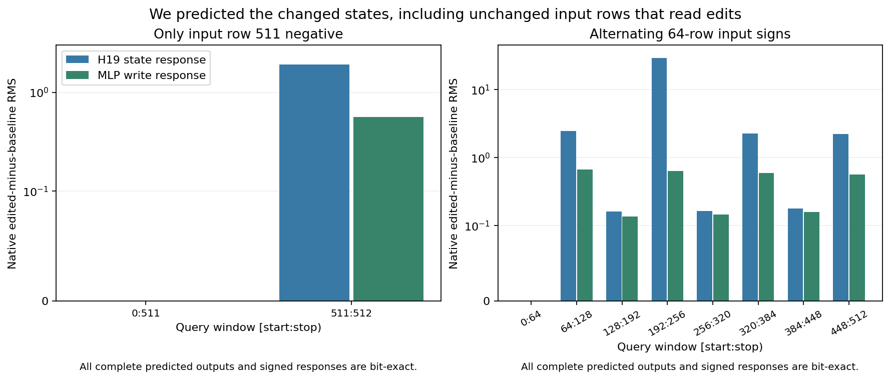
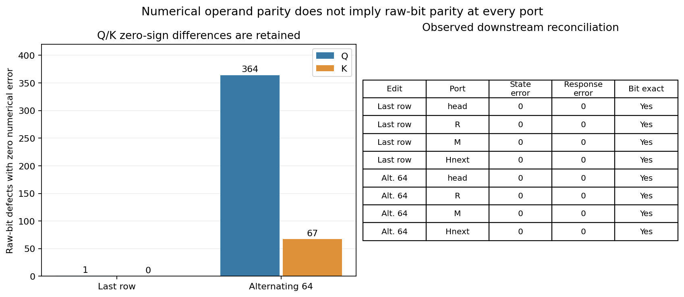

# Predict changed attention from positioned QKV

Two fixed new edits at original Qwen block 18 produced bit-exact predictions
for the complete attention head, receiving residual R, MLP write M and H19.
The predictor transforms its inherited own-functional positive Q/K/V and
recomputes original-profile attention and the complete downstream tail.

Read the [mathematical account](../../../../obsidian/blog/2026-11-06-090851-predicting-attention-from-transformed-operands.md),
including per-head Q/K RMSNorm and grouped attention. The preceding
[row-sign experiment](QWEN-ROW-SIGN.md) supplies the cheap relation's
mixed-support counterexample. The [H18 history experiment](FLUX-H18-STATE-HISTORY.md)
supplies the earlier image-consumer context.

```text
h_prime = row_signs * h_positive
Q_prime = row_signs * Q_positive_positioned
K_prime = row_signs * K_positive_positioned
V_prime = row_signs * V_positive
head_prime = original_profile_SDPA(Q_prime, K_prime, V_prime)
R_prime = h_prime + linear(flatten(head_prime), Wo, None)
x_prime = original_post_attention_RMSNorm(R_prime)
G_prime = linear(x_prime, Wg, None)
U_prime = linear(x_prime, Wu, None)
M_prime = linear(SiLU_BF16(G_prime) * U_prime, Wd, None)
H19_prime = R_prime + M_prime
```

This is a conditional inherited-state component assay with fixed positions,
512 all-attended rows and no cache. The standalone source-qualified native
DecoderLayer calls are not public Qwen Acts. It is not another fresh raw-prompt
forecast, an independent CUDA implementation or an image suffix.



## Evidence, including finite counterexamples

Cached−full, full−native and cached−native are separate comparisons. Each
channel has eight primary head/R/M/H19 fields / 12,058,624 positions with
bit-exact endpoints and complete signed responses. Its 40 protocol-window
fields also agree. These are dependent accounts, not independent trials.

| Fixed edit | Closed rows | Cross-sign permitted edges | Native whole H19 response RMS | Cached Q/K zero-sign defects |
|---|---:|---:|---:|---|
| Only input row 511 negative | 511 | 511 | 0.0848342880 | Q: 1, K: 0 |
| Alternating 64-row blocks, first positive | 64 | 65,536 | 10.5038829370 | Q: 364, K: 67 |

All QKV numerical errors are zero. V is bit-exact. Full-functional/native QKV
is bit-exact on six fields / 6,291,456 positions. Cached/direct and cached/native
repeat the same 432 signed-zero differences. Final observed head/R/M/H19
reconcile exactly; this is not a universal claim that zero signs never matter.
Seven inherited-positive/native-baseline fields are also bit-exact.



The last-row edit leaves the first 511 rows unchanged. Alternating edits leave
the first 64 rows unchanged but alter later positive-input regions through
their permitted reads. The complete new state and signed response are both
predicted. Counts of permitted edges are structural diagnostics, not causal
importance or min-cut capacities. Different edit doses and state amplitudes
prevent reading the two response magnitudes as an amplification ratio.

## Inspect the actual records

The portable [audit](assets/qwen-cached-qkv-20261106/compact/audit.json),
[independent verification](assets/qwen-cached-qkv-20261106/verification/verification.json)
and [publication receipt](assets/qwen-cached-qkv-20261106/publication/publication-receipt.json)
bind source, full arrays, transaction chronology, actual SDPA operands and jobs.

```bash
cd packages/mdb
python -m mdb equations find \
  --catalog docs/assets/qwen-cached-qkv-20261106/compact/catalog/equations \
  --alias cmp.qwen.cached-qkv.alternating64 \
  --applicable-to docs/assets/qwen-cached-qkv-20261106/verification/cmp.qwen.cached-qkv.alternating64.exact.context.json
python -m mdb.computation_atlas \
  --atlas docs/assets/qwen-cached-qkv-20261106/compact/atlas find \
  --law-id law.qwen.positioned-QKV-row-sign.bf16.v1
```

The verifier actually executes 12 installed lookups: four exact matches and
eight changed-source/profile abstentions. Actual native effects and endpoint/
response prediction errors have distinct contrast IDs. Generic IDs are supplied;
exact occurrence retrieval does not infer new applicability or semantic names.

## Reuse the experiment machinery

`qualification/qwen_component_experiment.py` accepts named arms, forecast
callbacks and declared query windows. It authenticates inherited sources,
restores original dense strides, guards original module entry, seals all
predictions and responses, and captures actual native ports/operands.
`qwen_cached_qkv.py` is the small candidate. Its campaign adapter binds the
original parameter instance and source profile.

Q stride is `[2097152,128,4096,1]`; K/V stride is `[524288,128,1024,1]`.
Canonical archive storage must be restored into those original BHTD layouts
before SDPA. Sign multiplication preserves the same layouts. All 21 actual
QKV operand occurrences join saved descriptors and values. The aggregate
seven-call SDPA sidecar is written after targets; pretarget tensor/response
custody and actual-call joins remain separate claims.

The candidate uses one SDPA and four linears per edit, skipping input norm,
QKV formation, per-head norms and rotary. Full references use one SDPA and
seven linears. The prior positive formation cost remains part of the lineage;
this is not a measured speedup. Total work is two candidates, two references
and three native targets: seven SDPA and 43 linears.

To reproduce the fixed source cohort from the workspace root:

```bash
python -I -B saturn-pub/packages/mdb/qualification/stage_qwen_cached_qkv.py NEW_RUN \
  --parent-run artifacts/mdb-qwen-sign-shortcut-20261106/run-02 \
  --compact artifacts/mdb-qwen-sign-shortcut-20261106/compact-collection-01/extracted/binding-minimal-result \
  --selection artifacts/mdb-qwen-cached-qkv-20261106/selection-v1 \
  --frontier artifacts/mdb-qwen-sign-shortcut-20261106/frontier-metadata-v1 \
  --parameter-subset artifacts/mdb-qwen-row-sign-20261106/selection-v1/qwen-block18-parameter-artifacts.json \
  --resource-job artifacts/mdb-qwen-row-sign-20261106/run-02/job.json
python -I -B saturn-pub/packages/mdb/qualification/stage_qwen_cached_qkv.py NEW_RUN --inspect
# Bind the new exact finite mechanics/resource review, then submit one lease.
python -I -B saturn-pub/packages/mdb/qualification/stage_qwen_cached_qkv.py NEW_RUN --submit
python -I -B saturn-pub/packages/mdb/qualification/stage_qwen_cached_qkv_saved_audit.py NEW_AUDIT --study NEW_RUN
python -I -B saturn-pub/packages/mdb/qualification/stage_qwen_cached_qkv_saved_audit.py NEW_AUDIT --submit
```

Use the qualified installed runtime, original store and parent metadata; this
is an exact-cohort recipe. Original execution is mrun-only, strict CUDA/B1,
one finite lease, no nested jobs or retries. No full model, tokenizer, embedding,
LM head, FLUX, VAE, initial noise or image consumer executes in this panel.

Native `job-585e40c9614b`: 45.4 s / RSS 1697.3 MB / VRAM 676 MB.
CPU audit `job-aa0dc56ace52`: 18.83 s / RSS 1045.3 MB / VRAM 0.
Seal: `f55ba3ef6ef0c5a16cefc4efff42fdc9fe58062dfc6432a46942cf8392c096c4`.
One original 11-weight hydration / 201,861,632 payload bytes. Whole-shard
verification streams 4,967,215,360 bytes once, separately accounted.

Raw manifest indexes 148 members / 423,853,232 bytes, excluding itself.
Compact: 43 files / 2,651,374 bytes, archive 339,962 bytes.
[Original weight recipes](assets/qwen-cached-qkv-20261106/compact/source-metadata/qwen_parameter_manifest.json),
[weight retriever](assets/qwen-cached-qkv-20261106/compact/source-metadata/retrieval_script.py)
and [raw-evidence retriever](assets/qwen-cached-qkv-20261106/compact/retrieve_evidence.py)
avoid exporting new parameter or activation banks. Its legacy `reader` alias
explicitly refers to inherited parent evidence.

Astra review 11 endorses the cut and recommends an input-driven applicability
evaluator, followed by one block19 consumer of the previous cheap/corrected
H19 difference. Those are upcoming work. Full raw-prompt coverage, source-native
primitive closure, independent arithmetic and semantic explanation remain
separate claims in the cumulative account.
