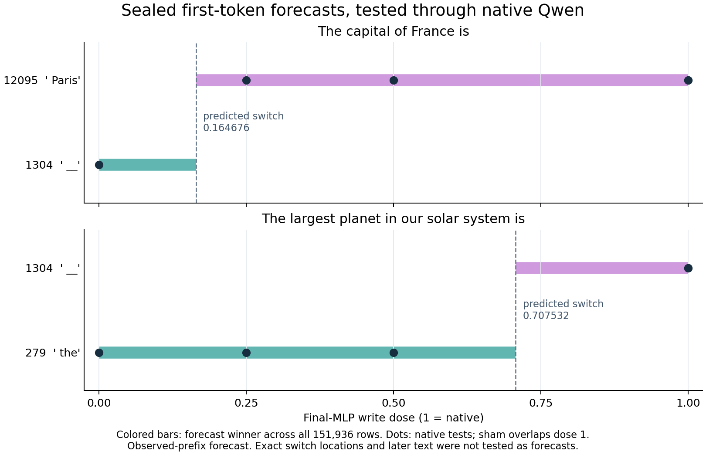

# Forecasting a trained language model's final MLP

The ISA workflow transfers to a trained Qwen2.5-0.5B-Instruct checkpoint: MDB
captures an actual residual state, independent NumPy equations predict the final
MLP and its readout, one global seal freezes those predictions, and native model
execution tests them. Branches retain their own generated tokens and native KV
caches. This is a conditional computation forecast from an observed prefix.

The initial panel predicted thirteen selected token logits. A second panel extends
the same equations to the complete vocabulary and forecasts its first greedy
token at each declared dose. Later tokens are native observations in both panels.

## What is being predicted

Let `r` be the last prompt token's residual immediately before layer 23's
post-attention RMSNorm. With the checkpoint's actual weights, the independent
FP64 predictor computes:

```text
x       = RMSNorm_post(r)
g       = W_gate x
u       = W_up x
m       = W_down (SiLU(g) * u)
s(dose) = r + dose * m
logits  = W_head RMSNorm_final(s(dose))
```

The NumPy implementation does not call Torch, Transformers, an MLP module, or a
model forward. It receives the observed cut and explicitly supplied frozen
weights. Native full-model execution is withheld until the seal has been saved.
FP64 arithmetic predicts the computation; it does not emulate native FP32
reduction order bit for bit. The archive retains numerical errors at each stage.

For a bias-free head and final RMSNorm weight `gamma`, each vocabulary row has a
particularly useful form:

```text
a[v] = W_head[v] dot (gamma * r)
b[v] = W_head[v] dot (gamma * m)
logit[v, dose] = (a[v] + dose * b[v]) / RMS(r + dose*m)
```

The denominator is positive and shared by all tokens. Therefore the first-token
winner follows the upper envelope of affine lines `a[v] + dose*b[v]`. The
predictor can compute every change of winner on `[0,1]` before testing native
doses. This describes the final reader for this fixed state and MLP write; it
does not identify a universal semantic circuit for a word or fact.

## Run and inspect

These are finite qualification scripts, not a new automatic semantic-atlas CLI.
Use an installed MDB environment with its public dependencies and configured
mrun credentials. Launch from this package directory:

```sh
python qualification/submit_qwen_mlp_forecast.py /absolute/path/selected-run
python qualification/submit_qwen_mlp_forecast.py /absolute/path/selected-run --collect JOB_ID
python qualification/analyze_qwen_mlp_forecast.py /absolute/path/selected-run /absolute/path/selected-run/analysis-v1.json
```

The full-vocabulary panel uses a separate directory and one separate finite lease:

```sh
python qualification/submit_qwen_mlp_forecast.py /absolute/path/full-run --full-readout
python qualification/submit_qwen_mlp_forecast.py /absolute/path/full-run --collect JOB_ID
python qualification/analyze_qwen_full_readout.py /absolute/path/full-run /absolute/path/full-run/analysis-v1.json
```

The worker is packaged with source hashes, an exact request/config pair, and
strict preflight. It requests the CPU FP32 recorder lane through intent-first
mrun planning, keeps one resident checkpoint, disables retries, and exits after
the declared panel. It does not launch one scheduler job per branch.

The local worker checkpoint path and weight-content digest are explicit in the
plan. Adjusting the specimen requires a new declared plan and compatibility
check; it is not an interchangeable model alias. Public dependency pins remain
in the payload metadata.

## Exact input and branch authority

Both panels use raw prompt text with `add_special_tokens=False`, no chat template,
batch size one, eager attention, CPU FP32, four threads, and greedy decoding.
These choices matter: an instruct checkpoint given an unfinished plain-text
sentence may produce a fill-in-the-blank worksheet rather than an assistant
answer. We preserve that behavior.

The first panel supplies these exact strings:

```json
["Complete the equation: 2 + 3 = ",
 "The capital of France is",
 "The opposite of hot is"]
```

The arithmetic prompt includes the trailing space. Native, sham, zero, and
half-dose arms are declared before capture. The sham clones the actual MLP
return; the dose arms scale its actual native return during the first prefill.
Typed replay independently applies the corresponding edit to the recorded
module-return port.

The follow-up repeats the capital prompt as an explicit anchor and fixes one new
prompt, `The largest planet in our solar system is`. It adds a quarter-dose arm.
Full vocabulary forecasts are sealed for all doses and both prompts before any
tested suffix executes.

Each branch then runs its own native prefill and three cached successors. Every
successor consumes that branch's previously chosen token. No answer key,
teacher-forced token, or predicted continuation is substituted into the model.

## What the first panel actually showed

The trained checkpoint has 24 decoder layers, hidden width 896, and 151,936
output rows. The pinned safetensors-file-map digest is
`2b226fe4944dc744596b1142a15d6676160e9d06f245d31c1a36633f6c86baa3`.

All twelve branches matched the independently predicted winner **within the
thirteen declared candidates**. Maximum selected-logit error against the full
native model was `4.60444e-6`. Native cuts matched their captured boundaries;
typed replay matched the five retained suffix outputs exactly in every branch.

| Raw prompt | Native / sham / half continuation | Zero-dose continuation |
|---|---|---|
| `Complete the equation: 2 + 3 = ` | `5\n\nTo complete` | same |
| `The capital of France is` | ` Paris. It is` | ` ____\nA.` |
| `The opposite of hot is` | ` ____\nA.` | same |

The capital example exposes a material limit of candidate-only prediction:
` Paris` remained the best of the thirteen selected candidates at zero dose,
while an unselected blank-prefix token won globally. Five of the twelve native
global winners were outside the fixed candidate set. That counterexample
motivated full-vocabulary prediction; it was not relabeled as a successful
global forecast.

The successful job made three genuine prefix calls, twelve suffix recordings,
and forty-eight full native calls: 63 physical attempts. Worker time was 31.18
seconds and peak RSS was 6176.2 MB. A preceding launch failed on a missing
configuration field before model loading; its failure and logs remain in the
portable provenance. The launcher regression test covers that mismatch.

## Full-vocabulary results

The follow-up forecast all **151,936 logits** for each of ten native branches,
including the repeated capital anchor and the new planet prompt. All ten first
greedy tokens matched. Maximum logit error across the 1,519,360 tested values was
`8.75655e-6`. Prefix boundaries and typed replay again matched exactly. The
smallest native top-two margin was `0.171531`, far larger than the observed
rounding residuals in this panel.

| Prompt | Dose | Sealed first-token forecast = actual | Observed native continuation |
|---|---:|---|---|
| Capital | 1, sham, 0.5, 0.25 | ` Paris` (12095) | ` Paris. It is` |
| Capital | 0 | ` __` (1304) | ` ____\nA.` |
| Planet | 1, sham | ` __` (1304) | ` ____\nA.` |
| Planet | 0.5, 0.25, 0 | ` the` (279) | ` the ____\nA` |

The sealed affine envelope predicts the capital winner changing at dose
approximately `0.164676`, and the planet winner at `0.707532`. Those are
equation-derived boundaries; the native experiment tested doses 0, 0.25, 0.5
and 1, which agree with both predicted regions. It did not measure the exact
floating-point switch locations. Near-tie doses deserve a separate test.



The [plotter](../qualification/plot_qwen_readout_envelopes.py) reads the portable
saved result only; it makes no model calls or equation-module evaluations.

The two states use the same MLP/readout law but have different coefficients and
decision boundaries. This gives a concrete generic computation record: an
observed state, an MLP writer, a dose-dependent reader, a predicted token choice,
and native continuations. Semantic names such as a "Paris circuit" would require
further evidence across contexts, sites and interventions.

This job made two prefix calls, ten suffix recordings and forty full native
calls: 52 physical attempts, eight typed Acts and 310 replay primitives. Worker
time was 33.94 seconds; scheduler time was 79.09 seconds; peak RSS was 6738.5 MB
under a 7825.7 MB recorder reservation. One preceding follow-up launch failed
before model loading because sorted JSON reordered branch names; the worker now
uses explicit execution order, covered by a configuration round-trip test. The
failure remains in the portable provenance.

Fifty-six focused tests pass against installed public dependencies outside the
workspace. These cover independent scalar equation references, affine envelopes
and ties, exact launcher/config identity, branch ordering after sorted JSON,
head/RMS custody, and retention of numerical/top-one counterexamples as evidence.
The test lane uses no trained model; the two admitted trained-model panels are
the separate model-backed qualification.

The full-vocabulary audit is mechanically valid; numerical errors and winning
IDs remain observations, with terminal certification unassessed. Both panels'
offline Saturn evidence sweeps and verification returned zero, with no findings
in their derived target streams. This checks that declared evidence lane; it
does not supply an independent semantic evaluator.

## Why an alternate future can appear without a changed prompt cache

This edit happens at the final MLP, after every layer has written its prefill K/V
tensors. Those prompt-cache fingerprints were identical across arms. An altered
first token nevertheless becomes a different next input and can produce a
different future. Where both prompt cache and first token stayed the same,
unedited greedy continuations stayed identical in the eleven applicable rows.

The measured route is therefore:

```text
observed residual -> final MLP write -> final readout -> token choice
                                                    -> next token input + KV -> future
```

It is a token-choice-mediated continuation in this panel. Testing a persistent
memory change requires an earlier edit that precedes a later layer's K/V write,
followed by cache/pathway restoration controls. That is a separate experiment.

## Custody and claim boundaries

The archive retains prefix traces and numeric boundaries; the selected suffix's
actual weights; source/checkpoint/tokenizer identities; forecast arrays and seal;
native outputs; typed Acts and replay receipts; cache fingerprints; generated
tokens; physical call counts; and independent saved-array audits. Complete model
roots are not saved per branch, and durable restoration of the whole checkpoint
is not claimed by this experiment.

Full-vocabulary mode supplies a separately declared immutable FP32 head copy
from the pinned checkpoint. Its descriptor, extraction recipe and exact byte
hash are bound before prefixes, checked before release, and checked after
execution. The 544,538,624-byte matrix remains in the externally retained
checkpoint; it is not duplicated into the portable archive. Sealed coefficients
and all first-token logits are retained. The offline auditor verifies those
arrays and source-bound worker provenance; it does not independently reload the
external head matrix.

These records support generic names such as
`qwen2.final-MLP.SwiGLU.residual.RMSNorm.readout`, with explicit checkpoint,
boundary, prompt, dose and consumer conditions. They are useful entries for a
computation atlas. They do not yet provide every prompt's complete symbol table,
names for distributed semantic operations, or predictions of an entire future
token sequence.

The smallest next extension is to walk the observed boundary backward, test
earlier MLPs under matched conditions, and distinguish token-choice effects from
persistent KV writes. A first-class selected-parameter contract in
`ForecastTransaction` would make this easier: retain full-model guards while
publishing only the required ports and head rows, without a hand-built suffix
wrapper. That feature request is recorded in the Saturn workspace.

Portable results: [selected-logit panel](../qualification/qwen-mlp-forecast-20261030.json)
and [full-vocabulary panel](../qualification/qwen-full-readout-20261030.json).
The [six fresh prompt contexts](QWEN-PROMPT-GENERALIZATION.md) extend the same
experiment across arithmetic, translation, code, recall, sequence and antonym inputs.
