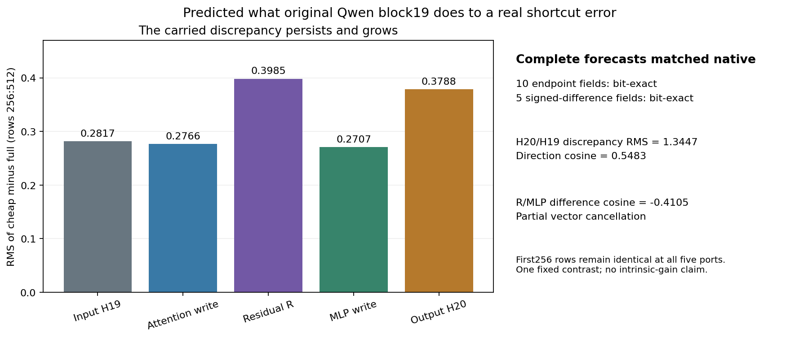
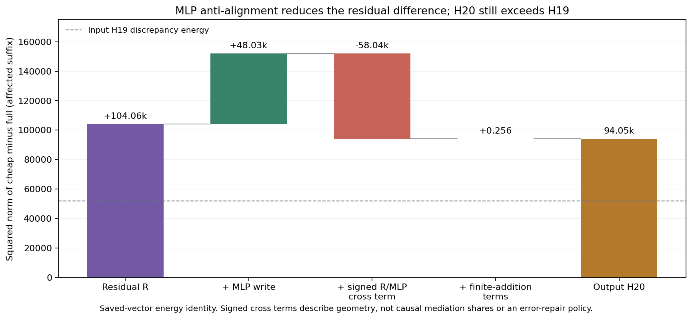

# Predict a retained discrepancy through its next consumer

Two different presealed H19 forecasts were consumed by original Qwen block 19.
Both complete H20 states and their signed difference were predicted bit for bit.
The carried approximation discrepancy grew across the block, while the MLP
addition partly cancelled the receiving residual difference. Read the
[mathematical account](../../../../obsidian/blog/2026-11-06-093800-predicting-how-an-error-moves-through-the-next-block.md).

The inputs come from the [row-sign counterexample](QWEN-ROW-SIGN.md).
[Cached QKV](QWEN-CACHED-QKV.md) explains its stale-read failure; the
[applicability planner](COMPUTATION-APPLICABILITY.md) selects a local method
from actual sources and profile before looking up outcomes.

## Actual execution and evidence

`full-input` is the prior complete functional prefix-negative H19 forecast;
`cheap-input` is its retained cheap approximation. Both are BF16 `[1,512,2560]`
arrays. The same original IDs, all-attended mask, positions, FP32 RoPE buffers
and eleven block19 parameter tensors serve both. No donor or H20 observation
is a prediction input. The shared explicit-world evaluator forms each complete
forecast from that world's own input and globally seals both forecasts and
complete FP64 difference hashes before authorizing either native call.

```text
full_H19  -> complete functional block19 -> full five-port forecast
cheap_H19 -> complete functional block19 -> cheap five-port forecast
             seal both + complete cheap-minus-full differences
full_H19  -> original native block19 -> observed full ports
cheap_H19 -> original native block19 -> observed cheap ports
             saved-only endpoint / response / continuation accounts
```

Passive hooks capture actual O projection, R at the post-attention norm input,
and M at the down output. Actual SDPA QKV/head receipts and returned H20 are
retained. The native raw head is aligned only by its declared BHTD→BTHD
transpose. These are source-qualified component calls, not public Qwen Acts,
genuine `record_prefix`, or a new raw-prompt/image forecast.

| Account | Result |
|---|---|
| Complete endpoints | 10 fields / 14,680,064 positions; bit-exact |
| Complete signed differences | 5 fields / 7,340,032 positions; bit-exact |
| Dependent regional views | 20 endpoint / 10 response fields; bit-exact |
| Physical work | 2 functional + 2 native blocks; 4 SDPA, 28 linears, 30 native entries |
| Native job | `job-f74bf3f78621`: 38.21 s, RSS 1801.8 MB, VRAM 652 MB |
| Saved-only CPU audit | `job-2259d3e99ff9`: 14.79 s, RSS 1006.6 MB, VRAM 0 |
| Global forecast seal | `1542aa8c8901e79378a7c133aacf4082516ef121860300af3f1336a2c4616984` |

Fields and windows are dependent accounts of one fixed contrast. The native
study hydrates original parameters once. The CPU reader separately streams the
original recipes for authentication, with no learned projection or model call.
CUDA primitive selection remains unprofiled; no independent-kernel claim follows.



On rows 256:512, discrepancy RMS changes from H19 `0.28173098` to H20
`0.37882960`, ratio `1.34465`; direction cosine is `0.54831`. Projection,
R and M differences have RMS `0.27662846`, `0.39847960` and `0.27071305`.
R/M difference cosine is `−0.41048`. The equal first 256 input rows remain
equal at all five output ports. Whole-state reference-relative discrepancy
rises from `1.2630%` to `1.6944%`; suffix-relative discrepancy rises from
`27.3022%` to `31.6276%`. Regional RMS alone makes no spread claim.

```text
delta_R   = delta_H19 + delta_projection + epsilon_R
delta_H20 = delta_R   + delta_M          + epsilon_H
```

Finite-addition defect suffix RMS is `0.00333459` / `0.00287106`. The saved
vector identities close exactly; energy expansion retains a small FP64
summation residual. Signed cross terms describe geometry, not causal mediation,
intrinsic gain or an autonomous repair mechanism.



## Browse the supplied records

```bash
cd packages/mdb
python -m mdb equations find \
  --catalog docs/assets/qwen-error-consumer-20261106/compact/catalog/equations \
  --alias cmp.qwen.error-consumer.full-input
python -m mdb.computation_atlas \
  --atlas docs/assets/qwen-error-consumer-20261106/compact/atlas find \
  --law-id law.qwen.complete-component-primitive-graph.bf16.v1
```

Root executes these portable examples. The separate verifier also executes
12 installed lookups: four matches and eight source, clock or profile
abstentions, while authenticating jobs, commands, custody and complete logs.
Browse the [audit](assets/qwen-error-consumer-20261106/compact/audit.json),
[coverage](assets/qwen-error-consumer-20261106/compact/coverage.json),
[frontier](assets/qwen-error-consumer-20261106/compact/source-source-frontier.json)
and [verification](assets/qwen-error-consumer-20261106/verification/verification.json).
Retrieval finds recorded occurrences; it does not infer semantic names or
generalize a law from two records. A further consumer needs its own binding.

## Reporting repair and exact retrieval

An unpacking bug overwrote cross-term names with scalar summaries in the frozen
audit. The additive [label sidecar](assets/qwen-error-consumer-20261106/labels/cross-term-labels.json)
restores `left_term` / `right_term` for all 36 records. Every summary is checked
against pinned source order, including equal zero-prefix summaries. The
[repair receipt](assets/qwen-error-consumer-20261106/labels/repair-receipt.json)
binds the original audit and source. Original scientific numbers and audit bytes
remain unchanged; no original model or scientific audit was rerun. The qualified
[repair script](assets/qwen-error-consumer-20261106/label-repair-sources/label_consumer_cross_terms.py)
reproduces this from JSON and exact reader source only.

Full arrays remain on Beast: 105 indexed raw members / 240,234,784 bytes.
The compact is 46 files / 1,249,760 bytes; archive 212,440 bytes. No new weight
bank is exported. Retrieve an exact field with Beast access:

```bash
python docs/assets/qwen-error-consumer-20261106/compact/retrieve_evidence.py \
  --manifest docs/assets/qwen-error-consumer-20261106/compact/external-evidence.json \
  native functional/cheap-input/Hnext.npy /tmp/mdb-error-consumer-evidence
```

Alias `reader` selects the inherited H19 world root. Use
`external-evidence-context.json` with alias `reader` for the separate context
root. Retrieval verifies the recorded checksum. Source metadata includes the
original weight recipes/retriever; parameters are inherent in the checkpoint.

The [exact run handoff](assets/qwen-error-consumer-20261106/frontend-commands-v1.md)
preserves stage/submission commands. Native intent-first admission used scheduler
history/defaults for the unknown component alias (actual CPU4, RAM4GiB, VRAM4GiB),
strict preflight, one finite lease, and no retries/nesting or explicit override.
The [Astra review](assets/qwen-error-consumer-20261106/advisor/holistic-review-12.json)
covers completed QKV/applicability posts and this design prospectively; it does
not claim to review the later H20 outcomes. Independent arithmetic, arbitrary
context applicability, semantics and causal repair retain separate evidence.
