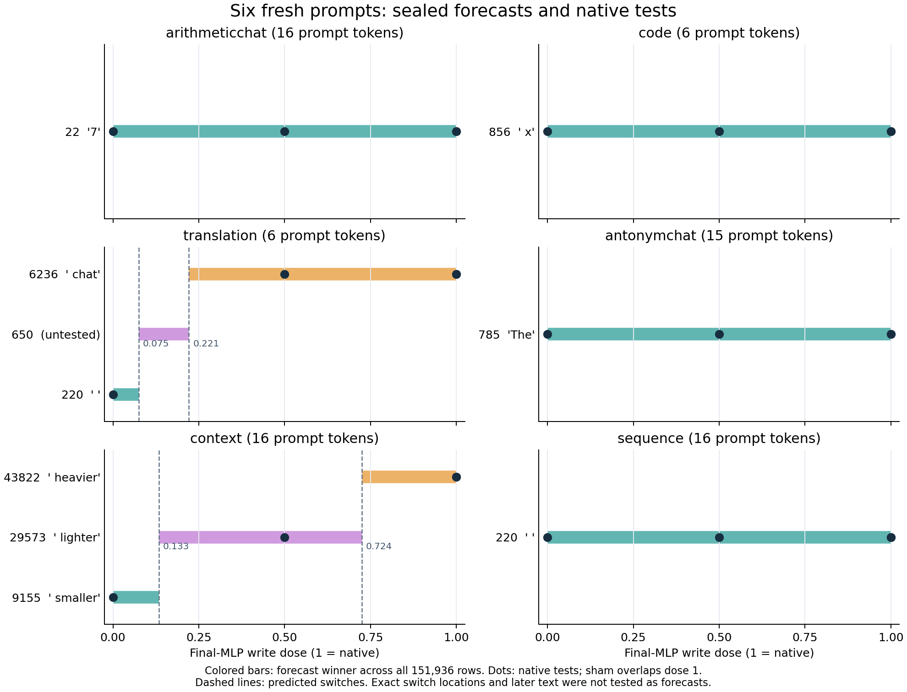

# Six fresh prompt contexts for the Qwen computation forecast

This campaign repeats the [trained-Qwen final-MLP experiment](QWEN-COMPUTATION-FORECASTS.md)
on six new prompts. It uses the same checkpoint, numerical equations, worker,
captured boundary and full-vocabulary reader. The change is the supplied context.
The question is whether the conditional forecasts continue to match native token
choices across different kinds of inputs and counterfactual MLP doses.

## Inputs fixed before execution

Both panel lists and their source hashes are saved together in
`campaign-plan.json` before the first submission. Each panel has three prompts,
native/sham/zero/half arms, and its own global seal before any tested suffix runs.
That yields six contexts, eighteen distinct prompt/dose pairs, and six additional
sham controls: twenty-four branches in total. These counts do not describe
twenty-four independent discoveries or checkpoint specimens.

The raw literals are:

```json
{
  "language-a": {
    "arithmeticchat": "<|im_start|>user\nWhat is 7 times 8?<|im_end|>\n<|im_start|>assistant\n",
    "translation": "English: cat\nFrench:",
    "code": "def square(x):\n    return"
  },
  "language-b": {
    "context": "Alice has a red ball. Bob has a blue ball.\nBob's ball is",
    "sequence": "Continue the sequence: 2, 4, 6, 8,",
    "antonymchat": "<|im_start|>user\nWhat is the opposite of ancient?<|im_end|>\n<|im_start|>assistant\n"
  }
}
```

The tokenizer receives each literal with `add_special_tokens=False`. ChatML is
explicitly supplied in two strings; there is no implicit template or system
message. The archive retains the actual token IDs. The worker rejects inputs
longer than 32 tokens rather than truncating or replacing them. Chat and plain
completion provide varied coverage here; this is not an isolated format study.

## What a forecast knows

The trained model supplies a genuine prefix ending immediately before its last
post-attention RMSNorm. The independent predictor receives that observed
last-token residual and the checkpoint's frozen suffix weights. It computes the
SwiGLU MLP update, residual addition, final RMSNorm and all 151,936 output logits
in FP64. The same sealed bundle contains an affine dose envelope for the winning
token. No tested native suffix executes before that panel's seal.

Native execution then tests the declared doses. Each branch owns its native
prefill cache and consumes its own selected token on subsequent steps. The edit
is removed after the prefill. We record three cached successors after the first
token even if an end token appears. This is a fixed-budget continuation probe;
post-EOS steps are not ordinary EOS-terminated generation.

Full-vocabulary first-token decisions are predictions. The later text is an
observation. There are no semantic answer labels, correctness-based case
selection, fitted equations or post-result prompt replacements.

The full head remains externally checkpoint-bound. The portable archive retains
its extraction/checksum proofs, sealed coefficients and forecast/native logits;
the offline audit checks that provenance rather than reloading the head matrix.

## Results

All **24 of 24 first-token forecasts matched** native execution. That includes
six sham controls and eighteen distinct prompt/dose pairs. Maximum absolute
logit error over 3,646,464 tested values was `1.35573e-5`; the smallest native
top-two gap was `0.150530`. Both panels independently audit as mechanically
valid. Numerical residuals remain observations rather than a scientific gate.

| Prompt | Input tokens | Native first token | Half dose | Zero dose |
|---|---:|---|---|---|
| Arithmetic chat | 16 | `7` | `7` | `7` |
| Translation | 6 | ` chat` | ` chat` | single space (220) |
| Code | 6 | ` x` | ` x` | ` x` |
| Ball context | 16 | ` heavier` | ` lighter` | ` smaller` |
| Sequence | 16 | single space (220) | same | same |
| Antonym chat | 15 | `The` | `The` | `The` |

Shams match native in all six contexts. Zero dose changes two first-token choices;
half dose changes one. Four contexts preserve their first token and their
subsequent fixed-budget token sequence across all tested doses. These unchanged
choices do not imply an absent MLP contribution: the saved logit and margin
changes remain available.

The ball prompt is especially useful because three predeclared doses reach three
different winning tokens. Its observed native continuations are:

| Dose | Sealed first-token prediction = actual | Observed four-token text |
|---:|---|---|
| 0 | ` smaller` (9155) | ` smaller than Alice's` |
| 0.5 | ` lighter` (29573) | ` lighter than Alice's` |
| 1 | ` heavier` (43822) | ` heavier than Alice's` |

The prompt supplied ball colors, not comparative sizes or weights. We predict
what this checkpoint actually does; these outputs are not scored as correct
answers to a color-recall task. The arithmetic probe begins `7 times 8`, and the
antonym probe begins `The opposite of ancient`; four generated tokens do not
establish their eventual answers. The code probe yields ` x * x\n\n` in all arms.



The sealed ball-context envelope predicts switches at approximately `0.133484`
and `0.724487`; our measured doses lie in all three predicted regions. Translation
has predicted switches at `0.075184` and `0.221224`, with token 650 winning between
them. No tested dose falls in that middle translation region. That token choice
and the exact switch locations remain untested analytical forecasts. They give
a specific next experiment without selecting a successful native outcome first.

Every native prefill reproduced its captured last-token boundary. Typed replay
matched all five retained suffix outputs in every row, and prompt-cache hashes
stayed identical across each prompt's arms. The two jobs made 126 physical
attempts, eighteen typed Acts and 744 replay primitives. Worker scopes were
41.73 and 41.11 seconds; scheduler scopes were 104.17 and 105.08 seconds. Peak RSS
was 6810.2 and 6796.0 MB under the intent-first 7825.7 MB recorder reservations.
These are instrumented experiment timings, with no inference-speed claim.

The combined offline Saturn evidence sweep preserves two separately bound
12-row target streams. Sweep and verification returned zero, with no findings
or broken inputs; all 31 checksum entries independently verify. This checks the
declared evidence lane, not semantic correctness. Fifty-nine focused tests pass
with installed public dependencies outside the workspace; the trained-model
panels are separately admitted through mrun.

The [portable combined record](../qualification/qwen-prompt-generalization-20261030.json)
retains every branch, prompt/token identity, full-vocabulary error, dose envelope,
native continuation, source binding and panel denominator.

## Reproduce

Use an installed MDB environment with public dependencies and configured mrun
credentials. From the MDB package directory:

```sh
python qualification/submit_qwen_mlp_forecast.py /absolute/root/language-a/run-01 --full-readout --prompt-panel language-a
python qualification/submit_qwen_mlp_forecast.py /absolute/root/language-a/run-01 --collect JOB_ID_A
python qualification/analyze_qwen_full_readout.py /absolute/root/language-a/run-01 /absolute/root/language-a/run-01/analysis-v1.json
```

Run `language-b` in a separate directory after the first lease finishes. Each
panel admits one CPU FP32 recorder job, four threads, eager attention, batch one,
strict preflight and no retries. It has three prefix calls, twelve suffix
recordings and forty-eight full native calls: 63 physical attempts. Branching and
replay remain in-process; there is no scheduler job per branch.

For the combined publication, retain the original pre-execution
`campaign-plan.json`, both collected runs and their independent audits. The
publisher verifies both request configurations and equation/worker identities
against that fixed campaign declaration. All branches and panel boundaries stay
visible.

```sh
python qualification/publish_qwen_full_readout.py /absolute/root/language-a /absolute/root/language-a/publication-v1.json --run run-01
python qualification/publish_qwen_full_readout.py /absolute/root/language-b /absolute/root/language-b/publication-v1.json --run run-01
python qualification/publish_qwen_prompt_generalization.py /absolute/root /absolute/root/publication-v1.json
```

## Why this is useful

A source-based forecast gives us an experimentally testable computation record:
state, writer, readout, dose response, token choice and native future. Across
inputs we can compare when the same mathematical component changes a decision,
when its effect stays below a decision boundary, and which intermediate dose
regions deserve another experiment. The affine envelope describes a fixed
observed state and write; its untested switch locations remain predictions.

Replication strengthens the instrument for building a computation atlas. It
still uses observed prefixes, full weights and supplied architecture equations.
Discovering semantic programs, explaining how earlier layers constructed the
state, and predicting persistent KV updates require further causal work. No
inference speedup or complete model understanding is claimed by this campaign.
