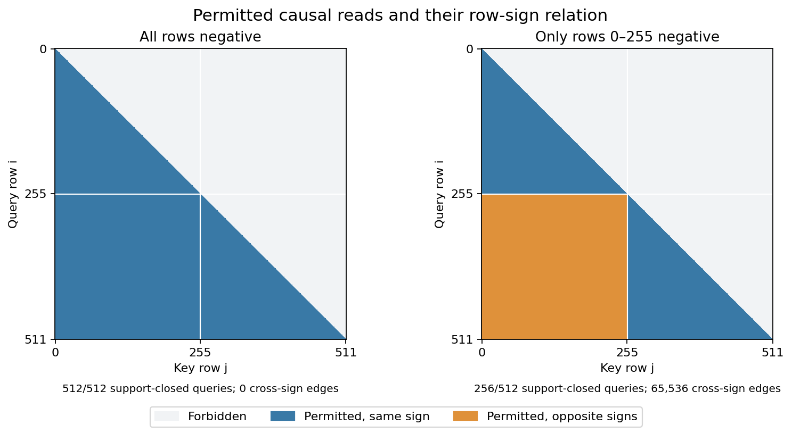
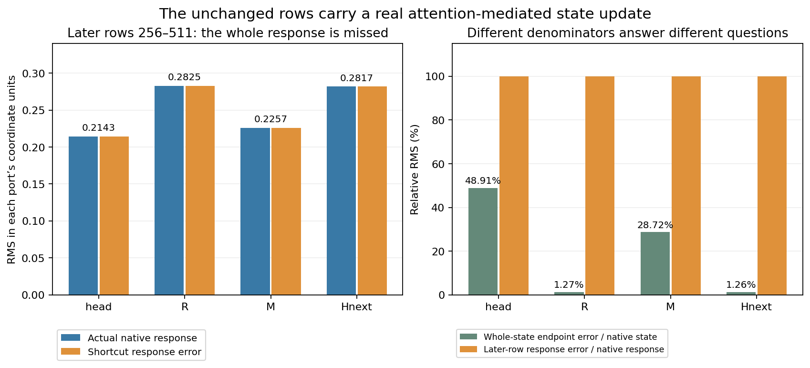

# Qwen row signs: a computation record with a counterexample

The positive-port sign shortcut is numerically exact on the tested
support-closed queries. It misses the complete response of the later,
unchanged input rows when they can read the edited prefix. Full functional
execution still matches the native block bit for bit.

The [mathematical blog post](../../../../obsidian/blog/2026-11-06-084211-where-a-computation-shortcut-stops-working.md)
connects the support condition, attention read, receiving residual and MLP write.
This follows the [three-context shortcut](QWEN-SIGN-SHORTCUT.md) and the
[H18 history/image experiment](FLUX-H18-STATE-HISTORY.md).



## Result and coverage

Keep original Qwen block 18, 512 all-attended rows, causal SDPA, fixed positions
and no cache. The frontier is inherited own-functional positive H18 and ports
from the prior globally sealed forecast. It is a conditional component assay,
not a fresh raw-prompt prediction or a public Qwen Act.

Two edited predictions precede a fresh native baseline, global-negative target
and prefix-negative target. For signs `s`, the shortcut uses positive R/G/U:

```text
head_hat = s * head_positive
R_hat = s * R_positive
G_hat = s * G_positive
U_hat = s * U_positive
P_hat = SiLU_BF16(G_hat) * U_hat
M_hat = linear(P_hat, Wdown, None)
H19_hat = R_hat + M_hat
```

The full functional reference recomputes the complete block. Its eight
head/R/M/H19 whole fields, 12,058,624 positions, and complete signed responses
are bit-exact against native. Four positive baseline fields are also exact.
Whole fields, windows and three comparison channels share operands.

For global negation, shortcut head/M/H19 are bit-exact; R has zero numerical
error and 903 zero-sign defects. For the prefix edit, rows 0–255 have zero
numerical error, with 415 R zero-sign defects. Rows 256–511 give:

| Port | Actual response RMS | Shortcut response | Response relative error |
|---|---:|---:|---:|
| head | 0.2143150034 | 0 | 1 |
| R | 0.2825052105 | 0 | 1 |
| M | 0.2256543606 | 0 | 1 |
| H19 | 0.2817309802 | 0 | 1 |

All 3,002,798 changed endpoint values are in that later region; max absolute
error is 7.5 in R. Whole-state R/H19 relative endpoint errors are only
1.2673%/1.2630%. They coexist with missing the entire later-row response.
Head/M whole endpoint errors are 48.91%/28.72%; no aggregate accuracy gate
replaces these separate accounts.



## Browse the actual computation records

The portable [compact audit](assets/qwen-row-sign-20261106/compact/audit.json),
[independent verification](assets/qwen-row-sign-20261106/verification/verification.json)
and [publication receipt](assets/qwen-row-sign-20261106/publication/publication-receipt.json)
retain the counterexample and exact source/profile conditions.

```bash
cd packages/mdb
python -m mdb equations find \
  --catalog docs/assets/qwen-row-sign-20261106/compact/catalog/equations \
  --alias cmp.qwen.row-sign.prefix-negative \
  --applicable-to docs/assets/qwen-row-sign-20261106/verification/cmp.qwen.row-sign.prefix-negative.exact.context.json
python -m mdb.computation_atlas \
  --atlas docs/assets/qwen-row-sign-20261106/compact/atlas find \
  --law-id law.qwen.row-sign-conditional-bf16.v1
```

The verifier actually ran 12 installed catalog/atlas queries: four exact
matches and eight changed-source/profile abstentions. The generic ID was
supplied. A match retrieves an observation, including a failed shortcut;
it does not certify a reusable law. Actual native signed effects and endpoint/
response prediction errors have distinct contrast IDs in the atlas.

## Reproduce the source cohort

Use the installed runtime and original model store from the
[raw-input workflow](FLUX-INITIAL-NOISE.md). Staging reads metadata only.

```bash
python -I -B saturn-pub/packages/mdb/qualification/stage_qwen_row_sign.py NEW_RUN \
  --parent-run artifacts/mdb-qwen-sign-shortcut-20261106/run-02 \
  --compact artifacts/mdb-qwen-sign-shortcut-20261106/compact-collection-01/extracted/binding-minimal-result \
  --selection artifacts/mdb-qwen-row-sign-20261106/selection-v1 \
  --frontier artifacts/mdb-qwen-sign-shortcut-20261106/frontier-metadata-v1
python -I -B saturn-pub/packages/mdb/qualification/stage_qwen_row_sign.py NEW_RUN --inspect
# Bind the new request-specific finite mechanics/resource review before submit.
python -I -B saturn-pub/packages/mdb/qualification/stage_qwen_row_sign.py NEW_RUN --submit
python -I -B saturn-pub/packages/mdb/qualification/stage_qwen_row_sign_saved_audit.py NEW_AUDIT --study NEW_RUN
python -I -B saturn-pub/packages/mdb/qualification/stage_qwen_row_sign_saved_audit.py NEW_AUDIT --submit
```

This exact-cohort recipe needs the stated parent evidence, source recipes and
original parameter store. It is not a standalone arbitrary-checkpoint launcher.
Original science executes through mrun, CUDA/B1/sequential, one finite lease,
no nested submissions or automatic retries. No full encoder, tokenizer, LM,
FLUX, VAE, initial noise or image suffix runs in this panel.

Native `job-74efe5506ecf`: 47.22 s / RSS 1795.4 MB / VRAM 826 MB.
Corrected CPU audit `job-ded9cc529d99`: 18.63 s / RSS 998.2 MB / VRAM 0.
Work was two full functional blocks (2 SDPA/14 linears), two shortcut down
projections, and three native blocks (3 SDPA/21 linears, 45 module entries).
There was one hydration of 11 original tensors / 201,861,632 payload bytes.
Whole-shard checksum streaming was 4,967,215,360 bytes, accounted separately.

All forecasts seal before every native target under seal
`12077f1ee8ca0f2b23c1c440e11a9dea7b5f07058270041594320289055f0121`.
The first CPU audit failed only at atlas publication for missing backend
metadata; the corrected reader derives it from saved actual operands. Failed
source/logs remain under execution/audit-01. Numerical functions are unchanged.
A collector scheduler-field bug was fixed before transport, without rerunning
the scientific computation or saved audit.

Raw manifest: 125 members / 376,594,023 bytes, excluding the wrapper itself.
Compact: 41 files / 1,676,498 expanded bytes, archive 252,014 bytes.
Original [recipes](assets/qwen-row-sign-20261106/compact/source-metadata/qwen_parameter_manifest.json)
and [weight retriever](assets/qwen-row-sign-20261106/compact/source-metadata/retrieval_script.py)
avoid a new weight bank. The [raw-evidence retriever](assets/qwen-row-sign-20261106/compact/retrieve_evidence.py)
uses [external evidence roots](assets/qwen-row-sign-20261106/compact/external-evidence.json).
Its `reader` alias explicitly denotes inherited parent evidence, not the CPU
audit's own output. All raw arrays and original weights stay near compute.

## Next mechanistic cut

For a query whose permitted keys share its sign, ideal attention symmetry
justifies the cheap relation. Mixed signs can change QK scores and value reads.
The first retained mismatch here is the attention head; the next panel directly
tests the positioned-QKV finite prerequisite and recomputes downstream writes.

Last-row-negative and alternating 64-row blocks are fixed before new targets.
Their complete source-profile-bound forecasts will use transformed positive
Q/K/V, restored original BHTD strides and the same SDPA dispatch. The new shared
component evaluator removes repeated assay plumbing. These are future tests,
not outcomes of this saved report. Independent kernel arithmetic, automatic
applicability induction and semantic object names remain separate questions.
