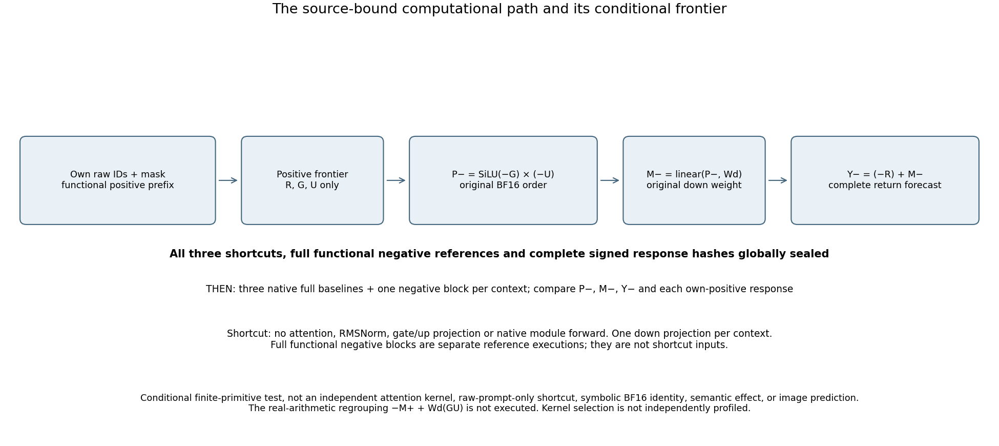

# Qwen sign-shortcut computation records

Three fixed fresh contexts at original Qwen block18 produced bit-exact
positive-only conditional predictions for the negative branch's gated product,
MLP return and H19. Full signed edit responses also matched exactly.

The predictor receives its own functional positive R/G/U and original down
weight. It executes `P=SiLU(-G)*(-U); M=linear(P,Wdown,None); Y=(-R)+M` in the
qualified BF16 primitive order. It does not receive negative functional/native
ports or execute attention, normalization, gate/up projections or native modules.
The complete cohort seals before every native learned target.

Read the mathematical account and limits in the
[blog post](../../../../obsidian/blog/2026-11-06-075814-a-computation-family-survived-three-fresh-contexts.md).
The prior [H18 history experiment](FLUX-H18-STATE-HISTORY.md) supplies the
downstream image-consumer context; this campaign performs no image inference.

| Case | Attended / padded | Native M response RMS | Native H19 response RMS | Endpoint / response error |
|---|---|---:|---:|---|
| short-objects | 36 / 476 | 1.0576407761 | 29.8675571189 | Bit-exact / zero |
| short-procedure | 39 / 473 | 0.8775121383 | 29.8445521962 | Bit-exact / zero |
| long-description | 512 / 0 | 0.5295434940 | 31.5301792784 | Bit-exact / zero |

Three endpoint channels—shortcut−functional, functional−native,
shortcut−native—and their own-positive signed-response errors remain separate.
Each channel covers nine fields /22,806,528 scalar positions. Counts overlap;
they are not independent trials. Native residual oddness has514/471/903
signed-zero defects despite zero numerical error. Gate/up oddness and all
tested shortcut P/M/H endpoints are bit-exact.



## Inspect the saved records

The portable result is in [the asset directory](assets/qwen-sign-shortcut-20261106/).
The actual [independent audit](assets/qwen-sign-shortcut-20261106/publication/compact-evidence/audit.json),
[root verification](assets/qwen-sign-shortcut-20261106/verification/verification.json)
and [publication receipt](assets/qwen-sign-shortcut-20261106/publication/publication-receipt.json)
bind the native result, saved-only reader, source inventories and actual CLI
outputs. Original weights and activation arrays remain outside Git.

```bash
cd packages/mdb
python -m mdb equations find \
  --catalog docs/assets/qwen-sign-shortcut-20261106/publication/compact-evidence/catalog/equations \
  --law-id law.qwen.sign-shortcut.bf16-primitive-order.v1
python -m mdb.computation_atlas \
  --atlas docs/assets/qwen-sign-shortcut-20261106/publication/compact-evidence/atlas find
```

The saved verification directory contains18 actual installed CLI lookups:
three contexts × exact/changed-source/changed-primitive-profile × catalog/atlas.
Each changed-context lookup abstained. Catalog conditions bind exact tested
occurrences; automatic family induction and unseen-prompt applicability remain
unfinished. The law ID is supplied, not discovered by the catalog.

## Reproduce the finite assay

Use the qualified installed runtime and source cohort documented in the
[raw-input account](FLUX-INITIAL-NOISE.md). The committed source/test closures
and qualification receipts are retained under the asset directory.

```bash
# From the workspace root; choose fresh output directories.
python -I -B saturn-pub/packages/mdb/qualification/stage_qwen_sign_shortcut.py NEW_RUN \
  --parent-run artifacts/mdb-flux-h18-history-20261106/run-01 \
  --resource-job artifacts/mdb-qwen-sign-shortcut-20261106/source-baseline-collection-v1/job.json \
  --selection artifacts/mdb-qwen-sign-shortcut-20261106/selection-v1
python -I -B saturn-pub/packages/mdb/qualification/stage_qwen_sign_shortcut.py NEW_RUN --inspect
# Bind the exact finite source/resource review, then submit the one lease.
python -I -B saturn-pub/packages/mdb/qualification/stage_qwen_sign_shortcut.py NEW_RUN --submit
# After successful completion, stage and submit the near-data saved-only reader.
python -I -B saturn-pub/packages/mdb/qualification/stage_qwen_sign_shortcut_saved_audit.py NEW_AUDIT --study NEW_RUN
python -I -B saturn-pub/packages/mdb/qualification/stage_qwen_sign_shortcut_saved_audit.py NEW_AUDIT --submit
```

This is a source-cohort reproduction recipe, not a self-contained generic
launcher. It requires the stated parent metadata, authenticated baseline and
original model store. The native execution is mrun-only, CUDA/B1/sequential,
one Qwen hydration, no retries or nested jobs. Parameters are398 original
recipes /8,044,936,192 bytes; none are exported. The component-specific planner
uses its authenticated measured baseline because its Qwen-in-FLUX model alias
is not a registered full-model planner entry.

Actual native job `job-8c949b1c0278`:92.29s, RSS8326.7MB, VRAM8790MB.
Actual CPU reader `job-56b19223977c`:32.94s, RSS1338.2MB, VRAM0.
Physical work:60 functional blocks,3 shortcut down projections,111 native
blocks,6 native root authorizations and3 unused native LM calls. The native
reference tails are overhead, not extra forecast coverage or a speedup claim.

The raw manifest indexes 426 members / 1,366,181,022 bytes near Beast, excluding
the manifest wrapper itself. The compact
collection has30 members /1,770,172 expanded bytes; its archive is256,879 bytes.
Use its [evidence retriever](assets/qwen-sign-shortcut-20261106/publication/compact-evidence/retrieve_evidence.py)
and [external evidence description](assets/qwen-sign-shortcut-20261106/publication/compact-evidence/external-evidence.json)
for raw records. Original [weight recipes](assets/qwen-sign-shortcut-20261106/publication/compact-evidence/source-metadata/qwen_parameter_manifest-qwen-parameter-artifacts.json)
and [weight retriever](assets/qwen-sign-shortcut-20261106/publication/compact-evidence/source-metadata/retrieval_script-retrieve_qwen_weights.py)
remain available without storing a new parameter bank.

## Scope and next cut

The failed first launch `job-30027b477a9e` stopped at argument parsing before
model loading. A fresh request corrected only the missing `--config` argument;
the failed metadata, original launcher and correction checks are retained.

The source-qualified native Qwen wrapper is not a public Qwen Act. Named ports
are not a complete CUDA ATen trace. Exact native primitives at this boundary
do not establish independent kernel arithmetic. The real-arithmetic identity
`M(-x)+M(x)=Wd(G*U)` is explanatory; its extra learned RHS projection and a
BF16 regrouping identity were not executed or certified.

Astra recommends a fixed row-wise sign cut next: keep the all-attended prompt,
block18, mask and positions; negate rows0:256. Compare support-closed early
queries and mixed-support later queries using the same three error channels.
This tests applicability and attention routing. It does not assume that every
mixed-support row must numerically disagree or require another full image.
