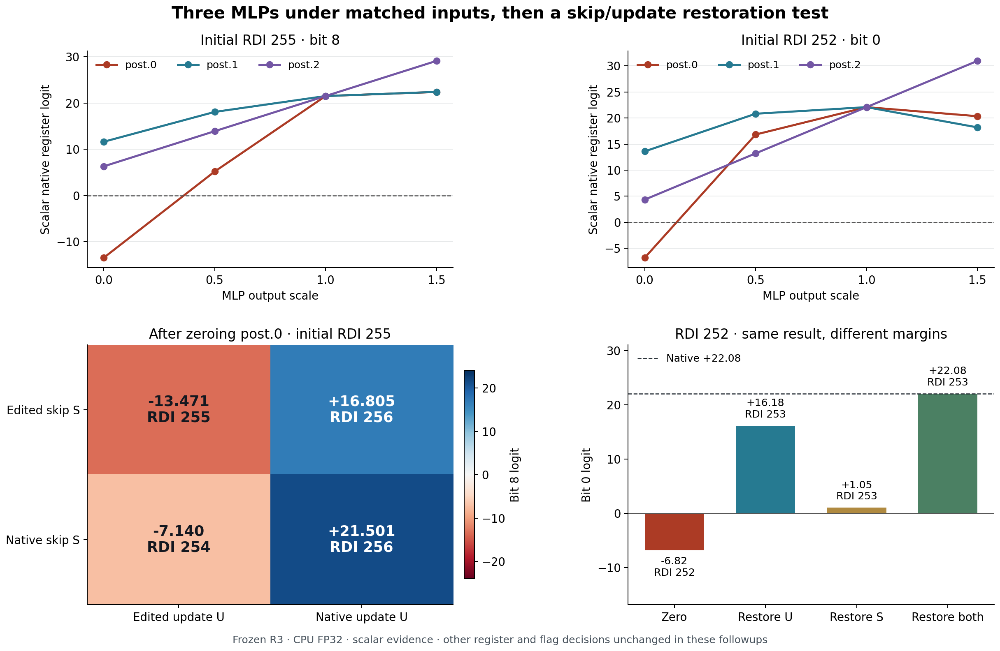

# Three post MLPs and their downstream state updates

The matched campaign found different decision-level consequences at the three
post MLPs. Zeroing `post.0` removed the observed increment in all four inputs;
zeroing `post.1` or `post.2` preserved decoded state while changing continuous
responses. A final-mixer restoration factorial then separated contributions
through its skip state and projected update. Those contributions depended on
both the receiving context and the consumer.

The campaign completed as `job-c5bfaffc8b0a`: 48 screened conditions, all 48
scalar controls, and 28 scalar follow-up branches. Every follow-up matched an
independent native execution exactly across all 11 heads. The
[source-bound summary](../qualification/post-mlp-campaign-20261030.json) and
[76-record generic index](../qualification/post-mlp-variants-20261030.json)
retain the results and artifact references. The index counts observations and
controls, not 76 independent contexts.



## Matched inputs and interventions

The specimen is frozen R3 Mamba, checkpoint
`9399e921776d7a5437c5bbd51bfc1928f09d2ddea444fe2aa1c9cf282baf7f1e`,
CPU FP32, one thread. The supplied program is
`4881c7010000004881c701000000`. RSI is 3; RDI is 252, 253, 254 or 255;
all other registers and initial flags are zero. Only raw bytes and before-state
tensors enter the model. No expected after-state or operation label is supplied.

Each site receives output scales 0, 0.5, 1 and 1.5. The native B4 screen uses
12 physical forwards. Forty-eight separate B1 calls check all heads and the
complete decoded consumer projection. All 48 decoded results agree; the
maximum B4/B1 absolute head difference is 3.0517578125e-5. These are numerical
comparisons under the declared profile, rather than bit-exact batching claims.

| Intervention | RDI after inputs 252, 253, 254, 255 | Other registers and flags |
|---|---|---|
| Native or identity output scale | 253, 254, 255, 256 | Native decisions |
| Zero `post.0` output | 252, 253, 254, 255 | Native decisions |
| Zero `post.1` output | 253, 254, 255, 256 | Native decisions |
| Zero `post.2` output | 253, 254, 255, 256 | Native decisions |
| Scale any post output by 0.5 or 1.5 | 253, 254, 255, 256 | Native decisions |

All three sites affect the same five continuous heads: `regs`, `flags`, `imm`,
`store_addr` and `store_value`. The other six heads remain unchanged. Fresh
scalar graphs at RDI 252 and 255 reach precisely these five heads; their
reachability predictions also agree with observations at 253 and 254, for which
this campaign did not capture a separate trace.

Fractional doses are not equal-energy interventions across sites. The removed
output norms at RDI 255 are 61.44, 70.12 and 103.16 for `post.0`, `post.1`
and `post.2`. These observations support a bounded contrast, not a general
ranking of MLP importance or a semantic instruction name.

## Restore the final mixer operands separately

The scalar trace and source identify this boundary:

```text
S = final mixer input / skip state
U = final mixer out_proj output
M = S + U
next state = M + post.2(M)
```

After zeroing either earlier MLP, both S and U may change. The four restoration
corners use edited or same-context native S and U. Restoring U changes the
projected update before its addition. Restoring S supplies native S plus the
edited branch's U at the complete-carrier boundary. The independent native
audit constructs that mixed state using U from its own fresh execution.
The complete native carrier is a broad closure control. A same-value projected
write is the no-op control. Every branch retains the original source edit.

Follow-ups use RDI 255 and 252. The sealed selection policy always includes 255,
then adds the largest scalar register-response disagreement between `post.0`
and `post.1`; when that maximum is 255 itself, it adds the fixed 252 control.
Selection remains within discovery data.

For initial RDI 255 after zeroing `post.0`:

| Final-mixer skip S | Projected update U | RDI result | RDI bit 8 logit | Next predicted RDI |
|---|---|---:|---:|---:|
| Edited | Edited | 255 | −13.4713 | 256 |
| Edited | Native | 256 | +16.8054 | 257 |
| Native | Edited | 254 | −7.1398 | 255 |
| Native | Native | 256 | +21.5007 | 257 |

Restoring U recovers all register/flag decisions, while register logits still
differ from native by as much as 12.37. Restoring S alone changes the erroneous
word to 254: its bit 8 margin moves toward native, but the complete word remains
different. The no-op control exactly retains the zeroed branch's heads.
Restoring the complete carrier recovers every native head exactly.

At RDI 252, either single restore yields 253. Their continuous states remain
different: the bit 0 logit is +16.18 with U restored, +1.0516 with S restored,
and +22.0825 natively. Equal decoded outcomes here do not establish
interchangeable or redundant pathways.

For each reader, the factorial interaction is:

```text
I = Y(native S, native U) - Y(edited S, native U)
    - Y(native S, edited U) + Y(edited S, edited U)
```

At RDI 255 / bit 8, zeroing `post.0` gives a U-restoration effect of +30.2767,
an S-restoration effect of +6.3315, and interaction −1.6362. Zeroing `post.1`
gives +10.0829, −1.8635 and +1.6652 respectively. Effects through the same
operand interface can therefore have different signs and interactions under
different source edits. They are conditional responses, not additive percentages
of causal importance.

The last MLP has no later mixer in this model. Its identity and zero-output
branches are retained separately; no upstream carrier is represented as a
mediator of that later edit.

## The future consumes the altered state

All 28 branches commit their literal decoded registers, flags and predicted
length, then execute one fresh model call on that state. The analyzer rebuilds
all 84 input-root descriptors from those commits, verifying the bytes supplied
to the successors.

For example, the native RDI-255 trajectory is 255→256→257; the zero-`post.0`
branch is 255→255→256, and its skip-restored branch is 255→254→255. A successor
that advances an altered input does not recover the original trajectory.
Other register and flag decisions remain native throughout these follow-ups.
This is one-step architectural continuation; the driver resets internal hidden
state between calls.

## A consumer specific response pattern

The analyzer fits a post-hoc affine relation using scalar doses 0 and 1:

```text
Y_hat(d) = Y(0) + d * (Y(1) - Y(0))
residual = observed Y(d) - Y_hat(d), at d = 0.5 and 1.5
```

Across four contexts, `post.2` register residuals have maximum absolute values
between 3.10e-6 and 7.63e-6. Earlier-site register residuals reach 21.68 for
`post.0` and 8.13 for `post.1`. The `post.2` flag head also has appreciable
nonlinearity, with maximum absolute residuals 0.198–0.712.

The nearly affine interface belongs to the path from the already-computed
`post.2` output to the register readout. The MLP computes its nonlinear map
before that output is scaled. Different downstream consumers of the same write
can have different response laws. These fits describe observed discovery rows;
they are not held-out forecasts or universal laws.

Useful generic associations are **post output to final-mixer skip/write
response**, qualified by context and reader, and **final post output to register
affine dose response**, qualified by the tested domain. Immutable observation
IDs remain separate from these interpretations. The new index binds 76 records
to their raw rows and source hashes; a global atlas, automatic family matching
and prospective rule discovery remain further integration work.

## Execution and custody

The job used one finite mrun lease and 120 of its 128 allowed physical forwards:
60 screen/control calls, four capture/control calls, 28 independent native
audits and 28 successors. The worker executed 8,220 replay primitives and 44
typed Acts. All native audits match across 11 heads, and the analyzer verifies
their retained raw values rather than relying on success flags alone.

The job elapsed time was 42.22 seconds; peak process-tree RSS was 1061.6 MB.
Source, isolated installation and executed payload agree on all 169 MDB Python
modules. Frozen model hashes are unchanged. Fifty-eight output artifacts,
8,264 public receipt seals and their source/PC/SSA/payload joins verify. Two
selected native frontiers and their complete stores are retained.

Sol agents reviewed the instrument and implemented the framework-free analyzer;
Astra advised on the causal panel and checked its interpretation. The standard
evidence sweep and verify pass with `target-streams-only` coverage: watch scans
8,220 records, but automatic native receipt ingestion and physical-address xref
remain zero. Direct public receipt verification is the authority for this assay.
No broader evidence-plane certification is implied.

MinIO publication is `failed-queued`; the complete worker archive was recovered
from logs and hash-verified before extraction. Raw requests, payloads, cuts,
heads, branch rows, receipts and immutable analysis revisions are under
`artifacts/mdb-post-mlp-campaign-20261030/` in the domains workspace. There were
no automatic retries or failed model-job predecessors in this campaign.

## Reproduce and choose the next cut

With the installed qualified packages and configured mrun control environment:

```sh
python qualification/post_mlp_campaign.py --isa-root /path/to/isa --run-dir /tmp/new-post-campaign
python qualification/post_mlp_campaign.py --run-dir /tmp/new-post-campaign --collect JOB_ID
python qualification/analyze_post_mlp_campaign.py /tmp/new-post-campaign --output /tmp/new-analysis.json
python qualification/plot_post_mlp_campaign.py /tmp/new-post-campaign --output /tmp/new-figures
```

Launch and collect through `common exec` when using the domains workspace's
shared credentials. The explicit ISA source root is a maintainer staging input;
workers import installed wheels. Analysis is framework-free; plotting requires
Matplotlib. New result paths preserve prior raw evidence and source snapshots.

The next smallest mechanism cut splits U formation into recurrent carrier H
versus the reader/local bundle `(C, SiLU(gate), d*u)` at RDI 255, separately for
zeroed `post.0` and `post.1`, while preserving their edited S. The separate
factorial corners can distinguish changed recurrent transport from changed
reading/local response. The current U restoration does not isolate those
components. New doses and contexts can separately test the affine response
candidate prospectively.
